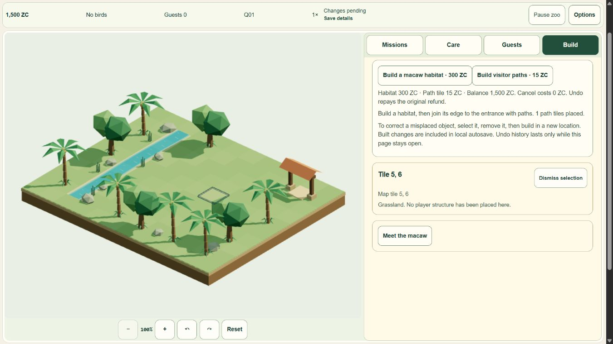

# Camera release — live result and stop checkpoint

**Live:** https://myzootwin.com/play/ · deployed commit **`d8c03c6c8d3cc1aeef848470b69d287937a1ab7f`** · Pages **`a7dbf297-e15a-4096-ae9b-82b95f684018`**. Terminal success **2026-11-03 00:44:56 UTC**,43s, Node22.23.4/npm10.9.9. One authorized non-force main push; no Actions/manual duplicate build/settings/grants or documentation-only follow-up push.

Final local evidence is494tests/check213zero/build9routes. Published apex and deployment match the candidate:9HTML routes except configured analytics property value,16other assets exact, direct`/play` routing/canonical correct. Runtime remains lazy; Three notice/original asset distribution unchanged. Known chunk warning and hardware/performance limits retained.

Focused live native smoke passed left/right45°, Q/E, reset, rotated preview/Cancel and picking, desktop1366×768 plus actual360×780/780×360 browser viewports. Cold Continue restores1500ZC/tick1947/generation/world fields exactly, paused, while ephemeral camera angle resets45→0. Gameplay tests used a new deployment origin, preserving apex-owner saves. Both captured console contexts are empty at limit200 and no provider scripts were observed. These are internal Chromium/viewport checks, not physical A56/touch, presented FPS, process restart, native background or speaker proof.

[Live portrait](qa/camera-live/portrait-135.png) · [landscape](qa/camera-live/landscape-45.png) · [Continue](qa/camera-live/cold-Continue.png) · [full acceptance and denial](qa/camera-live/acceptance.json) · [Cloudflare build](qa/camera-live/cloudflare-build.txt) · [production route/asset identity](qa/camera-live/routes-assets.json).

Automatic approval review **denied** confirming a300ZC habitat build in this new live smoke, because that persistent action exceeded camera/build-cancel scope. State was checked: no habitat,1500ZC,angle0; the rejected sequence had not executed. It was not retried or bypassed. Only preview/Cancel was exercised afterward. Live300ZC confirmation is **UNRUN** for this release. Final local construction/refund/Undo evidence and the prior real productionQ01–Q04/economy/save journey remain separately valid; the current commit changes no core/economy/animal/visitor/mission/persistence modules. This is explicit reuse, not a fabricated fresh golden run or permission waiver.

Rollback reference: previous verified production **f5c480a57761ed5a97de2c9e05f8e2aefc06ac78 /ff9d9fd5-f36b-4008-89cf-f2e13e07666f**. Older5a755ea7/ad20f2b and five local rollback/evidence archives remain preserved. No actual production rollback was executed; eligibility is not claimed tested.

M6-08 is complete for authorized publication, focused live desktop/mobile-viewport smoke and this rollback-ready report under the owner's requested live-test sequence. **46/51 (90.20%)**; M6 **5/8**. Five items remain partial: recordingM4-07, genuine human studyM5-07, device/presentationFPSM6-01, cross-device/nativeM6-03, privacy/service sign-offM6-06. Current camera15-minute soak, physical A56 and native tests remain unrun; historical exact-source core duration/GPU/import evidence retains its original limits. Operator/contact remain explicitly deferred. This is a live playtest release, not full100% acceptance/legal clearance.

All QA tabs/services closed, viewport reset confirmed1280×720/DPR1.5. Owner browser tabs/data/build/archives preserved. Stop before **01:00UTC /08:00WIB**, await owner resume; no additional feature/test loop, OS shutdown or automatic restart. Only local documentation checkpoint remains ahead of remote so it does not trigger another deployment.

## Owner-reported live result — 2026-11-03 00:54 UTC

Owner: “sudah saya coba live bud, hasilnya ok”. Recorded as **owner-reported live OK for what they tried**, not inferred physical A56/device/browser/FPS, exhaustive coverage, unaided first-run study, recording or sign-off. [Feedback record](qa/camera-live/owner-live-feedback.json). Production remains`d8c03c6`/Pages`a7dbf297-e15a-4096-ae9b-82b95f684018`. **46/51 unchanged**; QA already closed, documentation local only, no new test/feature/push and no automatic resume after stop.
