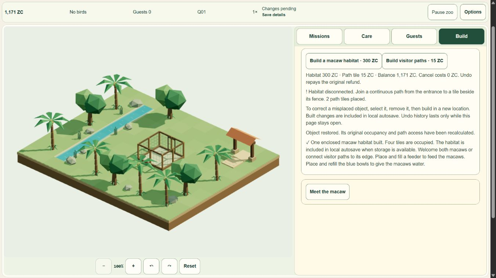

> Publication update: current camera d8c03c6/a7dbf297 is live. See [current live/stop report](CAMERA_LIVE_RELEASE.md). The evidence below retains its original stage/source limits.

# Camera rotation — pre-deploy candidate

**Local implementation and bounded verification complete. Camera is not pushed.** Published baseline remains `f5c480a57761ed5a97de2c9e05f8e2aefc06ac78`, Pages `ff9d9fd5-f36b-4008-89cf-f2e13e07666f`, https://myzootwin.com/play/; its native Q01–Q04 and cold Continue were verified in [release report](M6-08_LIVE_RELEASE.md). Parent review/dispatch precedes the already-authorized next publication. Hard stop: **3 November01:00UTC /08:00WIB**; no automatic resume.

## Delivered behavior

- Left/right buttons orbit in45° steps through eight directions; Q/E work while the world has focus. Reset/Home restore the original orientation, overview zoom and pan. Camera pitch stays fixed, with existing1×–3×zoom, mouse drag/touch pan and pinch retained. Steps are instant, including reduced motion; no second RAF or automatic camera animation.
- Refit uses actual rotated bounds and screen axes. Zoomed focus is retained where bounds permit; the map remains in view and pan directions stay coherent. Raycast/ghost placement uses the same updated camera. Camera actions cancel pending pointers and never build/delete/pick underneath toolbar input. Sun shadows remain world-space cached.
- ID/EN labels, titles, keyboard help and angle announcement are present. Actual portrait targets are at least44×44px. View state is intentionally ephemeral: reopening resets angle/pan/zoom while preserving game and preferences. Save schema, simulation and economy are unchanged.
- Fixed a related focus defect found in native QA: camera controls/world focus could scroll the document and clip the stage. They now use the existing HUD post-click/focus alignment, avoiding pointer movement during a gesture and preserving ordinary page scrolling. Final native stage top65px is below chrome bottom56px.

[ID portrait225°](qa/camera-v1/final-ID-portrait-225.png) · [ID landscape45°](qa/camera-v1/final-ID-landscape-45.png) · [zoom3/pan/keyboard](qa/camera-v1/final-desktop-zoom-rotated.png) · [cold Continue](qa/camera-v1/cold-Continue.png).

## Verification and exact identity

Final run `s20261103T002438Z`, source `6baf6b0363334e58c417445fa909e2d31d251c61768106cd3852e0284788dd67`, build `4465603e865b1c761cb8cdae61abbe708f172072edf9d5ca607fb522956bcfed`. **494/494 tests**, check **213 files / zero diagnostics**, nine-page isolated build. This final full test run follows the HUD fix; earlier QA-only reuse is explicitly historical. Five new meaningful camera tests cover all eight angles/corner fitting, zoom/pan/focus bounds, cancellation/keyboard ownership, actual raycast/ghost location across rotations and sizes, and invalid inputs. Existing gameplay/economy/save invariants remain covered.

Final native compiled checks cover both orbit directions, Q/E/arrows, reset after zoom3/pan, real mouse drag without picking, coordinate-picking the visible path at45°, preview/cancel/build, remove cancellation, actual refund15ZC and Undo15ZC, and occupancy. ID/reduced motion and actual360×780/780×360 were inspected. Cold Continue restores **1169ZC /tick4990 /one habitat /two paths**, checkpoint generation and15critical fields exactly, paused;45° resets to0° as intended. Pre-fix native habitat300ZC delete/Undo proof remains historical; final path editing was independently retested. No fabricated final-source Q01–Q04 rerun: published baseline provides that earlier core journey; no core/save changes here.

Nine routes/direct`/play`/sitemap pass. Eight journal pages are byte-identical to the baseline local build. Output25 files; emitted third-party modules remain only Three, matching full MIT text; no tooling, QA/source archives/maps or new art assets distributed. First-play **1,025,626raw bytes**, gzip9 estimate **270,588**, Brotli11 estimate **227,024**; renderer remains lazy. These are estimates, not mobile transfer/startup measurements.

## Measured cost and limits

Populated source-fixture windows: stationary2s versus eight explicit rotations over2s. GPU elapsed p50/p95 **1.757/2.426ms** stationary, **2.801/4.053ms** while changing views; CPU callback p95 **12.6ms** versus **11.5ms**. Short local samples cover different angles and shared hardware conditions; they do not establish presented FPS or A56 headroom. No per-frame camera refit, new GPU geometry/texture, extra RAF or static shadow refresh is introduced by rotation. High/Low lifecycle contexts finish with all program/geometry/texture/material/pending/subscriber counters zero. Auto/Low fallback remains available; historical GPU attribution uncertainty remains separate.

Source fixture commands/touch are injected and labeled. Native mouse/keyboard and viewport checks are distinct from physical A56/touch. Recording, unaided human study, physical/presentation performance, native background/speaker/process restart, formal privacy/service facts and camera live deployment remain unrun/partial. Operator/contact stay deferred. No overall V1 clearance or test waiver is asserted; **45/51 unchanged**.

[Acceptance/metrics](qa/camera-v1/acceptance.json) · [final tests/check/build](qa/camera-v1/final-gate.zip) · [profiles and preserved attempts](qa/camera-v1/profiles-and-attempts.zip) · [native steps](qa/camera-v1/native-final-steps.json) · [route/distribution](qa/camera-v1/routes-distribution.json). Initial unused-fixture hint, debugger timeout recovery, disabled-control/label/resize attempts and the QA redirect-assumption failure are retained. They are not hidden passes.

Only QA tabs/services were closed, viewport reset confirmed1280×720/DPR1.5, owner build and five rollback/evidence archives match. Current productionf5c480a/ff9d9fd5 is the next rollback reference; no rollback was executed. No camera push, Actions, new login/grant/settings, personal-profile action or prohibited route/download retry. Stop for parent pre-deploy review; only release dispatch within the time limit can publish this candidate.

Local gate command: `$env:MYZOO_QA_SCOPE='camera-v1'; node scripts/qa/settings-isolated.mjs local` (final run s20261103T002438Z). Fixture preparation: `node scripts/qa/camera-rotation.mjs .qa/builds/s20261103T002438Z`, followed by its visible Run control in the supported internal browser. Native checks used the exact compiled allowlisted loopback4371 build; all routes and payload were independently checked. These are source-fixture/native/manual browser checks with recorded evidence, not an unsupported autonomous browser driver.
