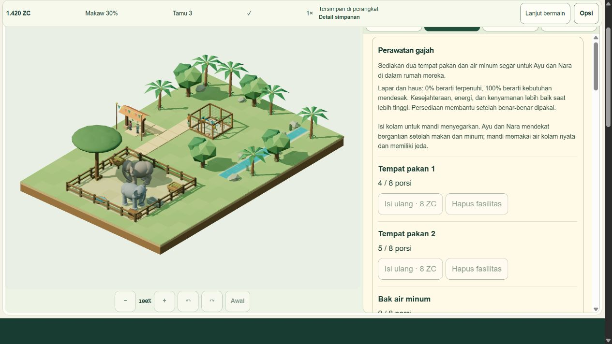

# EH6-06: Elephant Grove deployed and tested live

**39/39 (100%) scoped Elephant engineering items complete.** Owner approved push/deploy and live testing with “ok bud deploy”,6November2026. Original V1 remains46/51; its five physical/device/human/signoff gates are not silently closed. This is a release and scoped live smoke record, not blanket certification.

## Exact publication

One fast-forward `git push origin HEAD:main` succeeded fromd6aacb8555142a19a9844d84c4b1680ea5013e49 to **2aa836300304477f6e381413b4a39047c28bacf3**. No force/branch test push, manual deploy, workflow dispatch or hosting/settings/access change. Main was re-read after push. Cloudflare production **2c7e695d-620f-49e7-acee-68f73ad281c8** reports **success**, completed **2026-11-06T05:58:51.722438Z /12:58:51WIB**, duration27s, exact intended commit. Actual builderNode22.23.4/npm10.9.9. Its preserved build log includes the existing>500kBlazy-chunk warning. GitHub combined-status API returned an empty status list; Cloudflare's actual details/log and live responses establish deployment success.

[Play the deployed game](https://myzootwin.com/play/). [Immutable deployment URL](https://2c7e695d.myzootwin-com.pages.dev/play/). [Structured release/hash evidence](qa/elephant-release/release.json), [actual Cloudflare build log](qa/elephant-release/cloudflare-build.log), [push](qa/elephant-release/push.log).

Preflight runtime327inputs remained`0bee95281804ffe6372bc3a3ebdfb0c8daceb40a982dd25c5c117ff777d54761`;719tests,Astro308zero and local24file/9page build`f38b2e916d88e57c8d1501e0e35a28982fdb05e236ade379628da57799345b96` remained exact. The interrupted earlier preflight had changed only a receipt timestamp; compared and restored to reviewed bytes before pushing. No product change or unnecessary test rerun. Later release receipts are local-only and do not trigger another deployment.

## Public HTTPS gates

**57/57** responses pass across apex24files, deployment24files andwww9routes.26byte-exact,4text line-ending-only,27HTML differ only by the existing productionPUBLIC_GA4_ID filling one expected data attribute. Linux emitsLF in robots/MITnotice versus WindowsCRLF. First raw-only comparison failed and is retained; investigation confirmed these bounded differences. No content or asset mismatch was hidden. All compiledJS/CSS/images are byte-exact. Actual decoded production24file fingerprint **a7a03c0989f9405ddbc93232082538f7afcc4ff484538bf112801966d061d910**. [Initial comparison](qa/elephant-release/live-assets.json), [classified final checks](qa/elephant-release/live-assets-final.json), [difference diagnosis](qa/elephant-release/first-http-differences.json).

## Native live progression and save preservation

A separate IAB profile was visibly empty before play; no owner save was read/reset/seeded/overwritten. Before publication, the realV1game built its300ZCaviary, five15ZCpaths, welcomed two macaws, bought real care and claimedQ01. At pre-releasePause:975ZC/Q02, each bird4meals/4drinks, food/water8/8. After deployed reload->Continue, the same975ZC/Q02/claimed20ZC persisted, both birds resumed actual consumption rather than restarting. This is visible state/counter continuity; raw full IndexedDB payload was not inspected live. Complete strict full-payload migration/CAS/fault proof remains the earlier40native local cases.

The same migrated world continued throughQ02,Q03,Q04 using real welfare time/admissions, with total legacy cash rewards60ZC. A low-welfare, depleted phase occurred while inspecting at10x; stocked paid care restored needs and a real30second streak plus two new paid admissions qualifiedQ04. No state injection, time advance, free cash/food, scripted objective completion or owner progress manipulation.

The one1400ZCgrant changed1245->2645,650Grove construction changed2645->1995. Welcome produced exactly Ayu/Nara. Six real care facilities were built; all consumables initially empty until paid refill. The actual route needed **3tiles/45ZC**, not the6tile budget example. EH01's native claim click succeeded. Actual later counters: **each elephant7meals,8drinks,2baths,1greeting**. Visitors observed both homes; actual feedback includes satisfiedGrove66/100 and later concernedGrove51/100, consistent with changing welfare.72paid admissions show720ZC, one10ZCentry ticket. Original macaw gameplay continued in the same world. EH02-EH04 were not all manually claimed live; complete golden/mission/fault/soak proof remains local.

## Cold Continue, language and responsive checks

Paused EN->ID changes UI without clock progress. First cold reload->Continue->Resume->Pause preserves1420ZC and **all displayed numeric care stats** exactly for all4residents. Subsequent intentional viewport Resume/Pause cycles introduce tiny real ticks: needs/energy rounding changes by at most1, lifetime meals/drinks/baths/greetings remain exact. The first overstrict analysis expected equality across those intentional resumes and failed; retained raw snapshots show normal progression, not save reset. Grant remains received/disabled after reload; allQ01-Q04 remain claimed. EH01's badge was not separately re-inspected after cold reload, so no additional persisted-badge claim is made.

Native360x780:document345wide;780x360:document765wide;one real mounted canvas each; all4tabs44pxhigh. ID care/save/pause UI works. These are IAB viewport/DOM checks, not physical touch or a physical-phone certificate. Mobile screenshots were scrolled below the canvas and are excluded from visual acceptance. Desktop live3D screenshot is reviewed below. Warn/error observation0,limit200uncapped. Tests did not opt into analytics or change existing hosting/provider configuration.

## Closure and restart handoff

Live test save is paused at1x; own IABtab1/newCloudflaretab567533162 closed, viewport reset, no local test server started. Prior detachedCloudflaretab567533159 was left untouched after attach failure; unrelated owner tabs remain. Some native attempts hit expected busy-bird placement/paused-control guards or a not-yet-rendered path helper. Current state was checked before retargeting, not blindly repeated. Receipt formatting preserves verbatim logs/CRLF; application diagnostics remain intact.

Actual production rollback **UNRUN** because no rollback was needed. Save-compatible local7bcca5cfallback was already built and roundtrips currentV2saves; it is slower and a qualified fallback for later UI/performance faults. Do not restoreV1overV2 or present oldd6aacb8 as resumableV2gameplay. [Rollback constraints](ELEPHANT_RELEASE_PLAN.md).

Codex may restart after the local evidence commit. Remote production remains2aa8363; the newer local evidence commit is deliberately not pushed, avoiding an unnecessary second auto-deploy. No active job, pending push or owner question remains.
