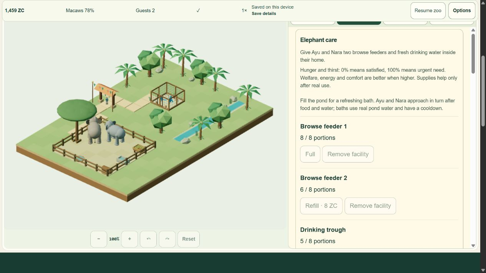

# EH6-04: final active soak and measured performance

Verified6November2026UTC after local checkpoint7bcca5c. **37/39** scoped engineering items complete. No push/deploy; physical-device/GPU-timer certification remains separate.

## Exact source and checks

327-input source `0bee95281804ffe6372bc3a3ebdfb0c8daceb40a982dd25c5c117ff777d54761` matched before canonical checks and after native measurement. Public build `f38b2e916d88e57c8d1501e0e35a28982fdb05e236ade379628da57799345b96`. **719/719 tests pass**,0fail/cancel/skip/todo,115389.1599ms. Astro308files,0errors/warnings/hints;9pages/24files. Nine HTTP route bodies byte-match this build, sitemap9URLs; no private QA/source maps in product. [Receipt/raw-log hashes](qa/elephant-soak/verification.json), [routes](qa/elephant-soak/routes.json).

Save-phase changes now refresh current status/visibility once instead of reapplying every locale/menu. Ready/audio gesture checks read existing lightweight controller state; full scene diagnostics compute repeated core views/snapshot once per call. Explicit locale/Continue/recovery rendering remains. No simulation, clock, needs, money, RNG, save-schema or dependency rule changes. Private profiler observes the existing native RAF/visibility/pause gate, without a second clock or injected advances during measurement.

## Actual measurements

Fresh named synthetic QA DB, actual UI/renderer/IndexedDB/nativeRAF,1280x720/DPR1.5. High starts04:07:10.492Z. Labelled preparation uses1800tick mixed-regression fixture and accepted earned-core setup; it is not another manual golden journey (separately verified EH6-02). Care stays selected; low stocks trigger existing affordable paid UI buttons, no gifts or free stock/rewards.

| Phase | Active / wall ms | Actual ticks | Game time / active wall | RAF delivery / s | Callback CPU mean ms |
|---|---:|---:|---:|---:|---:|
| High1x |900437.6 /900440.3|9004|0.999958|59.45998|7.08864|
| Low/reduced10x |12014.2 /12016.7|1200|9.988181|50.52355|13.50610|

Both automatically finish paused,0failures/0dropped wall or simulation ms. High35paid refills/208ZC; Low6/36ZC. Commands48->89 exactly41paid actions. Start1421ZC->High1463->Low1459, with ordinary tickets/upkeep. There are60unmeasured configuration ticks before Start10x. Both elephants actually eat/drink/bathe/rest/rub/greet, both macaws consume/rest, real guests visit both homes; strictV2 validation, one1400grant and one10ZC admission retained. [Raw closed profile](qa/elephant-soak/optimized-profile-closed.json), [invariant summary](qa/elephant-soak/optimized-summary.json), [full save](qa/elephant-soak/optimized-final-full.json).

GPU-upload geometry samples46/48/49 at0/1/2minutes, then49 through15minutes; textures5/materials31. A first analysis wrongly assumed first-frame geometry equality and failed. Reviewing unchanged raw samples corrected the gate to explicit bounded warmup and stable later samples; observations were not overwritten. High JSheap estimate60,886,955->79,230,253bytes; minute samples27,468,708-79,230,253 with several decreases. Low48,155,666->51,841,918. No forced GC/process/native/GPU heap or proof of absence of leaks. Resource timing13entries at start/end,1,288,361transfer bytes, all loopback, no cap/buffer-full event. These are private fixture requests, not production compressed asset attribution.

Browser reports ANGLEIntelIrisXe/D3D11. No GPU timer query, physical phone, presentedFPS, battery or thermal certification. Callback CPU excludes asynchronous UI work/GPU execution. High/Low differ in speed/workload/quality and configuration ticks, so no controlled quality-only A/B claim.

## Initial observations retained

Initial15minute run:7.958RAF/s,30.709ms mean callback,0.937898xclock. Late initialLow:2.4RAF/s,153.449ms callback,5.9606xclock; Options timeout/configuration gap allowed5390unmeasured10xticks. Fresh short Low probes before/after:19.624->51.541RAF/s,16.657->13.917ms callback. Setup timings differ; probes are not15minute acceptance or guaranteed userFPS gains. In-callback inspector calls were0; do not attribute late153ms to inspector. Gains include reducing QA observer overhead and redundant live status rendering outside that callback. Separately named before/probe files remain. [Before summary](qa/elephant-soak/before-summary.json).

## Recovery and cleanup

PausedID changes only locale; returningEN plus draftHigh/Cancel restores the entire checkpoint byte-exact, Ayu disclosure stays open. One manual nativeWEBGL_lose_context/actualTryagain plus9native cycles pass, checking full paused payload/originalV1backup/onegrant. Max1owner/1pendingRAF, old ownership released before replacement. [Nine automated cycles following manual loss](qa/elephant-soak/optimized-context-cycles.json).

ActualClose releases all ownedcanvas/RAF/subscriber/GPUgeometry/texture/material/bone-texture/audio resources,0cleanup errors. Reload->Continue preserves full checkpoint byte-exact at13305/1459ZC/command89. Later actualResume->speed1->Pause for screenshot adds80cleanup ticks, separately recorded outside soak/cold assertions. ID/EN whole-state and actual native fault tests cover the changed readiness/status path. Some QA reads toggled checkpoint closed and attempted hidden Settings; DOM was inspected before retargeting. Those are operator misses, not passing cases or product fixes.

Warn/error observation empty, limit200/uncapped. Tab80closed, no viewport override. World server77045 stopped by ownstdin. Temporary preview stdin was closed; exactPID13428/parent28864/command verified then only own child stopped, parent exits with it;4391/4392 free. Owner DB/original checkout/production untouched.

