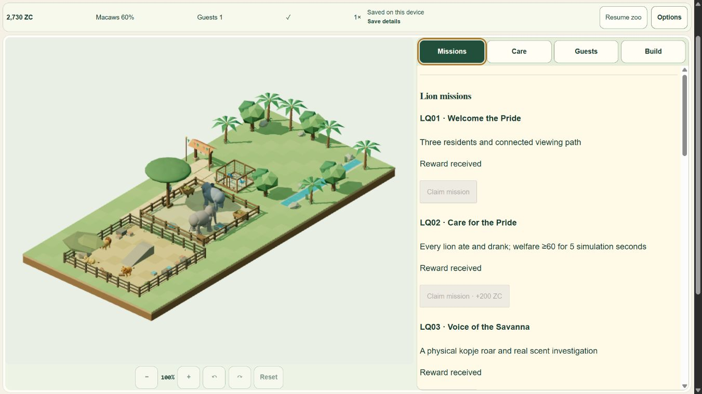

# Lion Savanna production release

Lion Savanna and both post-release fixes are deployed to myzootwin.com. Final production commit is `325223403a2dec1b805f05d9fb8d795d09568585`, runtime `src` tree `f671f91c39221ec4592af6f4db228981f27f462a`. Cloudflare production deployment `1f929842-00f0-4857-9a01-dea990b58f37` completed successfully at **2026-11-06 15:13:28 UTC**, official check `127971020598`. The authenticated deployment details confirm main, that exact source SHA, success, 24 uploaded assets, and the myzootwin.com/www aliases. Build logs report Node22.23.4, npm10.9.9, nine static pages and successful publication. No configuration or domain change was made.

User explicitly approved deployment and live testing, then requested the mobile picker fix and continuation until finished. Every UI test in this release used the internal browser. No desktop or native-app control was used. The existing apex game save was detected but never continued, reset or read for QA. Live gameplay used the separate production Pages origin, initially confirmed to have no saved sanctuary; local tests used explicitly named disposable UUID databases.

## Publications

| Source | Cloudflare deployment | Completed UTC | Purpose |
| --- | --- | --- | --- |
| 08048ca7e8648cccaa424b7a67436897cb68c72a | 278c901a-9657-4fca-81b3-d72f08239743 | 13:55:51 | Initial Lion Savanna |
| 447396930991e2a86c4d148000e2e96a2a92f264 | b3f8b72d-b9b6-48d5-a8af-fe42a58cc040 | 14:28:16 | Pride Care native option churn fix |
| 325223403a2dec1b805f05d9fb8d795d09568585 | 1f929842-00f0-4857-9a01-dea990b58f37 | 15:13:28 | Overlapping autosave drain/reward serialization fix |

All were normal fast-forward pushes of verified commits; no force push, reset, primary-save rewrite, old-format deployment or maintenance rollback was performed. Cloudflare may replace its initial in-progress check with a separate completed check; the completed commit check and dashboard are authoritative.

## Verified behavior

The live journey began in the previous Elephant binary with real paid construction/care, all four macaw claims and EH01. Reloading into V3 preserved the paused1290-ZC checkpoint and displayed residents/resources. Brief real Resume/Pause was necessary to enter Care; rounded needs can change by one during that interval. Native local tests separately prove exact lossless projections and original V1/V2 backups; no production raw save was read or exported.

Real care, bath use, connected outside viewing routes and paid visitors completed EH02-EH04. The separate Lion grant credited1800 once (2000 to3800). The live zoo purchased the750-ZC 7x7 habitat,615-ZC seven facilities and nine additional15-ZC paths (135 total). Raka, Sena and Tala actually ate, drank, rested, used scent/scratch, socialized and roared from the kopje. All three species remain in the same world and visitor economy.

The live journey exposed an intermittent false same-tab CAS conflict on reward claims. The original CAS guard refused optimistic credit and protected the checkpoint. A deterministic red test reproduced two overlapping ordinary drains racing the candidate; the fix now joins their finite in-flight follow-ups before taking its CAS revision. Independent-tab conflict protection remains in place. See [claim queue fix](LION_CLAIM_QUEUE_FIX.md).

On the final production bundle `PlayEntry...BlnC5Z-3.js`, LQ04's genuine100-tick/three-paid-viewer proof was ready. One keyboard claim succeeded with no conflict; all four Lion claim buttons became disabled with Reward received. The captured running saldo changed2482 to2742, which includes the displayed250 reward plus a10-ZC admission during the observation window; this is not presented as an isolated250-only balance delta. Exactly-once storage is additionally covered by the native CAS tests. After normal paid care and pausing, cold Continue retained **2730 ZC**, all four LQ claims, completed macaw/elephant achievements and both disabled received-grant controls. Seven residents and facility stocks remain present. Care was inspected after an explicit brief real Resume/Pause: names, lifetime consumption/proof counters and stocks match; two macaw needs rounded by1. The UI-only plan dropdown resets to its default on a fresh page, as expected; this is not an animal/save reset.

The source fix for the reported picker blinking avoids rewriting unchanged option text/aria attributes each simulation render. Native compiled-panel audits measured196 mutations in2.5 seconds before and0 after, preserving selection/control identity in ID portrait and EN landscape. Final live selection works at360x780 and780x360 with no horizontal overflow. See [picker investigation](LION_MOBILE_PICKER_FIX.md). This proves the option-churn repair; Android/iOS OS-popup behavior on the user's physical phone remains unverified.

All eight retained non-game apex routes were browsed successfully; title/H1/canonical receipts are retained. Their built HTML remains byte-identical to the preserved Elephant build. Production gameplay was deliberately exercised on the production Pages alias to protect the apex owner's save; the final hosting dashboard explicitly binds the tested release to the apex/www aliases. Earlier raw HTTP403 prevented a direct remote byte-for-byte file audit and remains an explicit limitation.

## Final candidate checks

- Full regression **768/768 passed**, zero failed/skipped/cancelled,277398.6915ms. TypeScript has no diagnostics; Astro358 files,0 errors/warnings/hints; nine-page build passes. The existing large-renderer-chunk warning remains.
- Actual internal-browser IndexedDB **9/9 passed**, including exact migration/backup, old-client barrier, independent-connection CAS, same-tab overlap, quota/abort/retry, future data, reset/Undo and malformed/invalid recovery. All six owned fault-test databases cleaned.
- Frozen325 soak: **1438252.7ms active1x (23.97 minutes)**,54897 frames, zero dropped simulation/wall time, strict-valid raw and persisted V3 equality/SHA, all four LQ, no invalid callback or serialization fault. Shared loop and pending-writer maxima both1. Resources58 geometries/6 textures/36 materials; heap sample range28.7-106.1MB, last-window median42.98MB versus58.06MB early. Disposal leaves0 owners,0 pending,0 geometries/textures/programs/materials and0 cleanup errors.
- Actual measured average **38.17 FPS**, median frame16.7ms/p9566.8ms, CPUmedian9.4ms/p9566.4ms. Earlier portions varied around18-28FPS. A Care-to-Build comparison and read-only process/codec timings did not establish the cause; no unsupported bottleneck diagnosis is claimed. This run does **not** certify sustained60FPS. The older59.41FPS soak remains a separate historical receipt, not substituted for this result.

The39-item engineering checklist is complete with these stated limits. Physical Android/iOS devices, GPU milliseconds and power state were not measured. The original approximately1FPS native-browser report was not independently reproduced or root-caused under the later internal-only restriction. These limits are not hidden behind a physical-device or performance certification.

## Recovery and evidence

The prepared fallback remains a **V3-compatible read-only maintenance pause**, not a V2 gameplay rollback. Its local build records3252234, localChanges=false and play SHA `0f2c8f1f0bec433a9d19937dc0abba564c3d5340a94f999e97c00db59f0a3dba`. Native read-only preservation was verified previously; deployment of that fallback is UNRUN. Fix forward to resume V3 play; never deploy the V2 binary as a resumable V3 rollback.

Receipts: [official release check](qa/lion-release/final-cloudflare-checks.json), [hosting build log](qa/lion-release/final-cloudflare-dashboard.txt), [build manifest](qa/lion-release/frozen-325-build-manifest.json), [full tests](qa/lion-release/final-forward-tests.txt), [native9](qa/lion-release/final-native-storage-9.json), [new soak summary](qa/lion-release/frozen-325-soak-summary.json), [raw soak](qa/lion-release/frozen-325-soak-native.json), [disposal](qa/lion-release/frozen-325-cleanup.json), [cold Continue](qa/lion-release/final-live-cold-after-missions.txt), [UI comparison](qa/lion-release/final-live-cold-comparison.json), [retained live routes](qa/lion-release/live-retained-routes.json). Historical receipts were preserved.

The owner's attached373610.jpg metadata/OCR was readable, but its pixels could not be materialized: the unchanged supported Windows Library helper and one bounded local retry both failed at os.setxattr. No URL guessing/helper bypass was used. This did not block source diagnosis and native DOM reproduction.

Task-owned QA servers and tabs were closed after checkpoints were saved. The user's existing Cloudflare tab was left untouched. The later evidence-only local commit is intentionally not pushed, so it does not trigger a fourth publication; production remains3252234.

