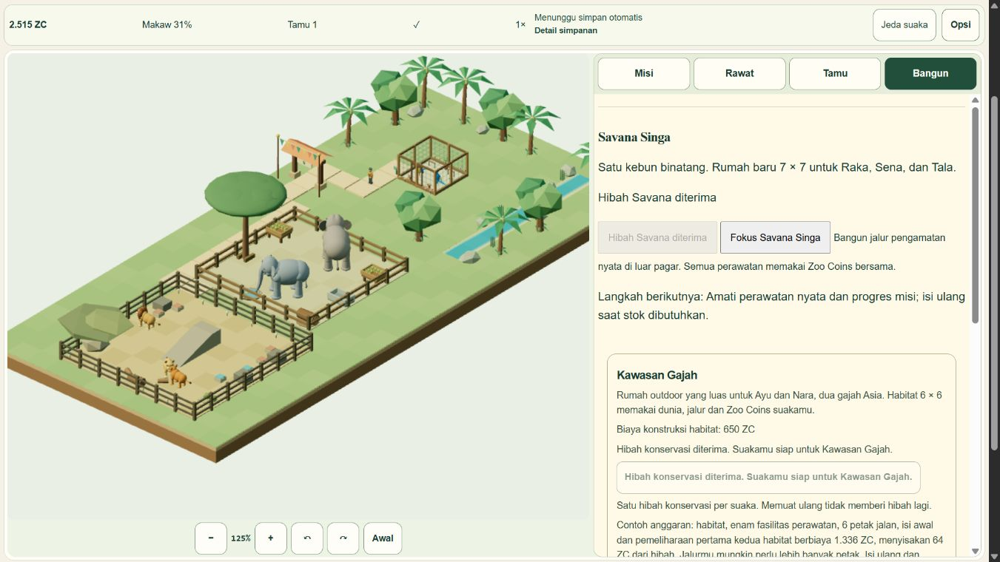

# Lion Savanna release handoff

**Superseded local freeze below:** User subsequently approved deployment and live testing. Final production is325223403a2dec1b805f05d9fb8d795d09568585, Cloudflare1f929842-00f0-4857-9a01-dea990b58f37, successful6November2026 at15:13:28UTC. Current checklist39/39 with explicit physical-device/performance limits. [Final release, fixes, tests and fallback](LION_LIVE_RELEASE.md) is authoritative. The remaining text records the earlier pre-release checkpoint and its then-applicable hold.

Runtime candidate: `c18f648a0976be5d1526fe9675d9d0463176e049`, source tree `ce5c03b2b4ea7b961663aedf231cff12662b72fe`. Later evidence-only commits may have a newer HEAD with the same source tree. Branch `lion-savanna` is local in the independent task clone. No push, merge, hosting change or deployment is authorized yet.

This candidate adds the adult pride Raka/Sena/Tala to the same macaw/elephant world, after EH04 and a separately claimed1800-ZC grant. It includes paid construction/care, physical ground/ramp behaviors, optional social contact, welfare explanations, original art, shared visitors/economy, LQ01-LQ04 and ID/EN interfaces. V1/V2 migrate losslessly to one canonical V3 database; old version2 clients are barred. Original checkpoints are backed up transactionally. Rewards/grant use durable CAS before presentation. The final shared-tick fix prevents observers from persisting incomplete visitor positions.

Verified baseline is production main `2aa836300304477f6e381413b4a39047c28bacf3`, deployment `2c7e695d-620f-49e7-acee-68f73ad281c8`, confirmed read-only in Cloudflare. Public raw HTTP requests returned403; browser asset references matched the release. Existing owner save was detected but never continued or read for QA. Original checkouts remain clean at63ce52a and377ec7d on the final read-only status check. EH39/39 is inherited; V1's five open gates remain46/51.

Verification: [native journey/fault/UI acceptance](LION_NATIVE_ACCEPTANCE.md), [764 full regressions](qa/lion/full-764-tests.txt), [24 subsequent UI regressions](qa/lion/ui-24-tests.txt), [Astro check](qa/lion/astro-check.txt), [release audit](qa/lion/release-audit.json), [production dependency audit](qa/lion/production-dependency-audit.json), and [living39-item checklist](LION_SAVANNA_PROGRESS.md). Final [soak summary](qa/lion/final-soak-summary.json) and [raw native receipt](qa/lion/final-soak-native.json) verify915380.5ms active1x/59.4135 averageFPS, exact persisted state, bounded resource/heap counts and zero serialization errors. The local checklist is38/39; production authorization/live smoke is the remaining item. Physical-phone/GPU tests remain UNRUN; supported viewport and synthetic touch-pointer checks are identified as such.

The built `dist` retains all9 routes and the sitemap. Eight non-game HTML pages are byte-identical to the preserved Elephant build; all9 title/H1/canonical values match. Added JavaScript totals75945 bytes uncompressed /21965 bytes gzip across entry and lazy renderer, far below the preferred750KB incremental gzip budget. The existing large renderer chunk warning persists; total JS gzip is327746 bytes versus305781. No runtime dependency was added; fake-indexeddb6.2.7 is pinned development-only. npm production audit reports0 vulnerabilities. Source review found no added runtime fetch, socket, beacon, remote URL or microphone use; saves remain local.

Art/rigs/geometry/materials and enrichment props are original procedural code; no external model, texture or roar audio was downloaded. The existing original ambient sound and license notices remain intact. New Lion code is reachable through the canonical entry and shared simulation/renderer, except the deliberate maintenance reader used only by the rollback build. Legacy input codecs, backups and species modules remain required; they were not removed for cosmetic cleanup. Type/unused checks are clean. QA harnesses live under scripts/tests and are not imported by the production entry.

The initial tracked repository was237361024 bytes/3143 files, predominantly inherited historical QA. The first candidate audit was238026400 bytes/3209 files, an increment665376 bytes. Bounded textual/raw-QA receipts add further evidence. Historical tracked QA was preserved. The task-owned111MB frozen source archive and its extracted duplicate were removed only after exact route-equivalence evidence was retained; node_modules, dist and `.qa` are ignored. No shared evidence directory was bulk deleted.

After separate release authorization, reconcile fresh origin/main with the verified baseline before publishing this source. Rebuild and retain exact source/build manifest, then smoke test the deployed version in an isolated QA database through the internal browser. Verify clean V1/V2 migration, old-client barrier, real three-species care/visits, grant/LQ exactly-once, cold Continue, locale/settings and retained journal routes. Do not test migration by overwriting an owner's primary save. Do not close LH6-06 until authorized production deployment and live smoke are evidenced.

Rollback is the tested **V3-compatible read-only maintenance response**, not an old V2 binary. Rebuild locally with `node scripts/qa/build-lion-maintenance.mjs` after `npm run build`. Output is `.qa/lion-maintenance-dist`, containing the retained journal routes and a maintenance `/play/`; `maintenance-receipt.json` records source, localChanges and play SHA. Current build records c18f648, localChanges=false and play SHA `0f2c8f1f0bec433a9d19937dc0abba564c3d5340a94f999e97c00db59f0a3dba`.

The maintenance page reads supported existing saves without upgrading/writing storage and displays the safe summary; it aborts creation when no database exists and blocks future/invalid formats. It pauses gameplay until a fix-forward release. Actual IAB verification preserved exact primary SHA before/after (see native acceptance). A V2 deployment after database3 would refuse opening it and cannot resume V3; never advertise that as a working gameplay rollback. A rollback deployment itself remains UNRUN and requires the appropriate release authorization.

