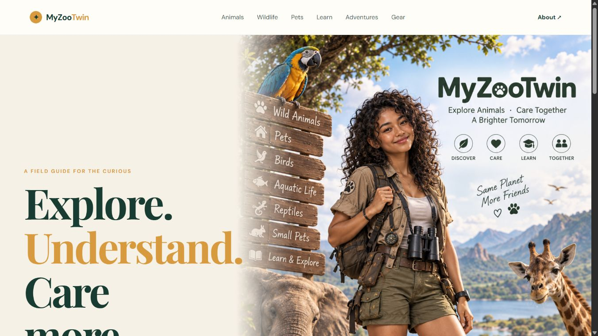
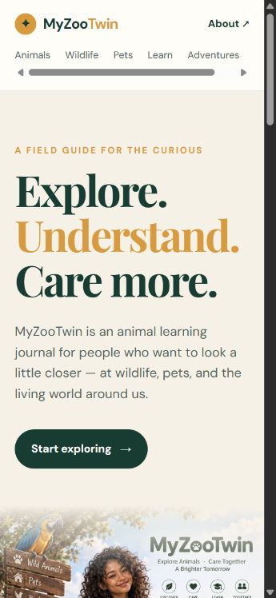
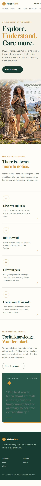

# M0-02 — Existing-site browser baseline and rollback plan

Date: 2026-10-31 UTC. Status: evidence complete; completion recorded in the canonical working PRD/checklist after this evidence commit. This is a baseline capture, not a new game feature or production release.

Source checkout: C:\\MyZooTwin. Tested local revision: 01b61f20f61dd0fae6430bf1381a80cf23bd4137. Its application/content/media files match the audited remote f10d037e84ad504e8f70b4908d20375a11c08917; the two local commits added documentation only. Git diff checks before completion confirmed no app/media changes from the audited baseline or working tree.

## Environment and bounded evidence

- Existing Node v24.12.0, npm 11.6.2, Astro 5.18.2; no installs or dependency changes.
- Supported isolated in-app browser, with agent-created temporary tabs only. No personal browser profile, extension profile, history scan, login, grant or owner focus was required.
- Browser evidence interval in baseline-results.json: 2026-10-31T15:25:15.533Z to 15:30:43.532Z. Local check/build ran earlier in the same baseline session.
- Requested CSS viewport sizes: desktop 1366x768 and 1920x1080, portrait 360x780, landscape 780x360. These are responsive browser viewport checks, **not physical Android, device touch emulation, Safari/iOS or hardware performance tests**.
- Eight original JPEG captures total **667,094 bytes**. Official screenshot pixel dimensions differ from requested CSS viewport sizes; artifact-manifest.json records actual dimensions and SHA-256 for each. No manual image resize/crop was applied. Exact capture-framing cause was not investigated; screenshot filenames identify the requested viewport.
- Evidence directory: [qa/m0-02](qa/m0-02/). Structured results: [baseline-results.json](qa/m0-02/baseline-results.json); file inventory/hash manifest: [artifact-manifest.json](qa/m0-02/artifact-manifest.json). No large videos, build output, source maps or credential/config snapshots added to Git.

## Verification performed

| Check | Result and practical limit |
|---|---|
| npm run check | PASS: 7 Astro files, 0 errors, 0 warnings, 0 hints |
| npm run build | PASS: static output; exactly 8 generated pages and sitemap |
| Public desktop direct URL + reload | 8/8: /, /animals/, /wildlife/, /pets/, /learn/, /adventures/, /gear/, /about/; expected headings, titles and matching canonicals retained |
| Public portrait direct URL + reload | 8/8 route identity/reload checks; one existing visual overflow recorded below, so this is not an all-clear mobile quality claim |
| Local built preview direct URL + reload | 8/8; headings/titles/canonicals match baseline; primary CTA leads to /animals/ |
| Desktop header navigation | Animals, Wildlife, Pets, Learn, Adventures, Gear and About click through successfully; brand link returns home |
| Mobile-width navigation and CTAs | Gear link reachable/clickable in horizontal nav; Start exploring -> /animals/; Meet the project -> /about/ |
| Keyboard | Tab reaches brand, six category links and About, each with visible solid focus outline; focusing Gear scrolls nav horizontally (~35.33px); Enter activates About |
| Console capture | No error/warning entries returned by the 24 per-route browser capture checks; this does not prove every network/request condition is error-free |
| Images and visual | Existing hero image decoded at natural 1024x1536; actual desktop, portrait, landscape, full-page and issue screenshots inspected |
| Source/media regression | PASS: app/content/media diff vs audited remote baseline and current working tree was empty |
| Preview ownership and shutdown | Bound only to 127.0.0.1:4321, observed owning PID 15756; stopped after testing; Get-NetTCPConnection confirmed no listener, reconfirmed before commit |

Local preview command: npm run preview -- --host 127.0.0.1 --port 4321. It used the existing build and was never bound to 0.0.0.0/LAN. No preview remains running. Browser viewport overrides were reset and all agent-created test tabs closed.

Local build has no PUBLIC_GA4_ID supplied and no Cloudflare edge injection, so its HTML has no analytics scripts; that differs intentionally from observed production GA4/Cloudflare Insights. No analytics configuration was changed. Current canonical URLs remain production URLs during local preview, as the existing layout specifies.

## Existing issues and observations (not new regressions)

- **BASE-01 — P2 mobile layout:** /animals/ at CSS viewport 360x780 has document width 387px. The unbroken “neighborhood.” heading is 351.24px wide, ending around x=387.24; its font size is 56px. Public and freshly built local preview reproduce the same horizontal overflow. [Screenshot](qa/m0-02/animals-mobile-existing-overflow.jpg). No CSS was changed in this baseline task.
- **BASE-02 — P2 accessibility:** homepage journal-card quote uses rgb(100,116,108) on rgb(40,89,74), measured contrast approximately **1.63:1** at 27.2px/weight 400. It falls below the 3:1 large-text threshold and is visibly hard to read. Threshold reference: [W3C WCAG 2.2 SC 1.4.3](https://www.w3.org/WAI/WCAG22/Understanding/contrast-minimum.html), checked 2026-10-31. The original selectors produce this before any application changes. Full-page evidence below. Remediation belongs in a separately scoped UX/regression slice.
- The existing mobile menu is a horizontally scrollable navigation row, not a hamburger. Its category link height is compact; true touch ergonomics are untested. Keyboard focus/click reachability does not establish physical touch usability.
- At 1920x1080 the existing hero measures ~1714px high and primary CTA starts at y~1166px, below the initial viewport. This is a baseline design observation; no new layout regression or user playtest conclusion is claimed.
- Animals and five section pages intentionally remain coming-soon placeholders. There is no game loop yet. No FPS, payload-speed, memory-soak, WebGL or save claims are made.

## Baseline screenshot examples

## Rollback plan — prepared, not executed

1. Preserve the audited application baseline **f10d037e84ad504e8f70b4908d20375a11c08917** and all existing media/content in Git. The tested pre-baseline local documentation checkpoint is **01b61f20f61dd0fae6430bf1381a80cf23bd4137**. Neither checkpoint was pushed by this work. These are recoverable source references, not proof of production deployment identity.
2. Keep future micro-features as small local commits. To back out a failed slice, preserve current work and use a reviewable local revert or an isolated checkout of the verified source reference; do not hard-reset, delete media/saves, rewrite shared history or indiscriminately clean the repository. Re-run check/build, original-route smoke and the relevant feature tests before any release.
3. Before the eventual release, resolve M0-01's external settings gap: actual source-repository binding, build command/root, auto-deploy policy and canonical production pointer. Record the live successful deployment and verify that a known good prior deployment is eligible for rollback. Do not assume README or the latest list row establishes those facts.
4. The existing authenticated Pages list observed candidate production deployment **5a755ea7-3513-41a8-8908-7dab1fa2b2cf** and preceding **c3fd7754-64a8-40ee-8096-fd6f8fa7138a**, both main/source ad20f2b. These are **observed candidates only**. Actual canonical pointer, rollback eligibility and a rollback action have **not been tested**. Source prefix resolves locally to ad20f2b90fc110e5f8a886174b3ddb816070df7d; only README differs from audited remote f10d037.
5. At an authorized release rollback, use only a confirmed eligible successful deployment, or revert the released source change and redeploy through the verified existing pipeline. Preserve local game saves and any necessary schema compatibility; never wipe player progress to hide a rollback issue. Then test the actual production URL, journal routes, game entry and save compatibility. No rollback or deployment was performed during M0-02.

## Completion boundary and next work

M0-02's outcome is captured baseline screenshots, actual browser smoke evidence and this rollback plan. Existing defects are recorded without being mislabeled as new implementation failures or silently fixed. M0-01 remains partial because external configuration facts are still unknown; this independent baseline does not close it. Once evidence is committed, mark only M0-02 complete: **1/51 (1.96%)**. Next micro-feature: **M0-03**, asset inventory/licenses/visual target and a feasible legal single bird species/model. No app feature, push, GitHub Actions or deployment is part of this change.
