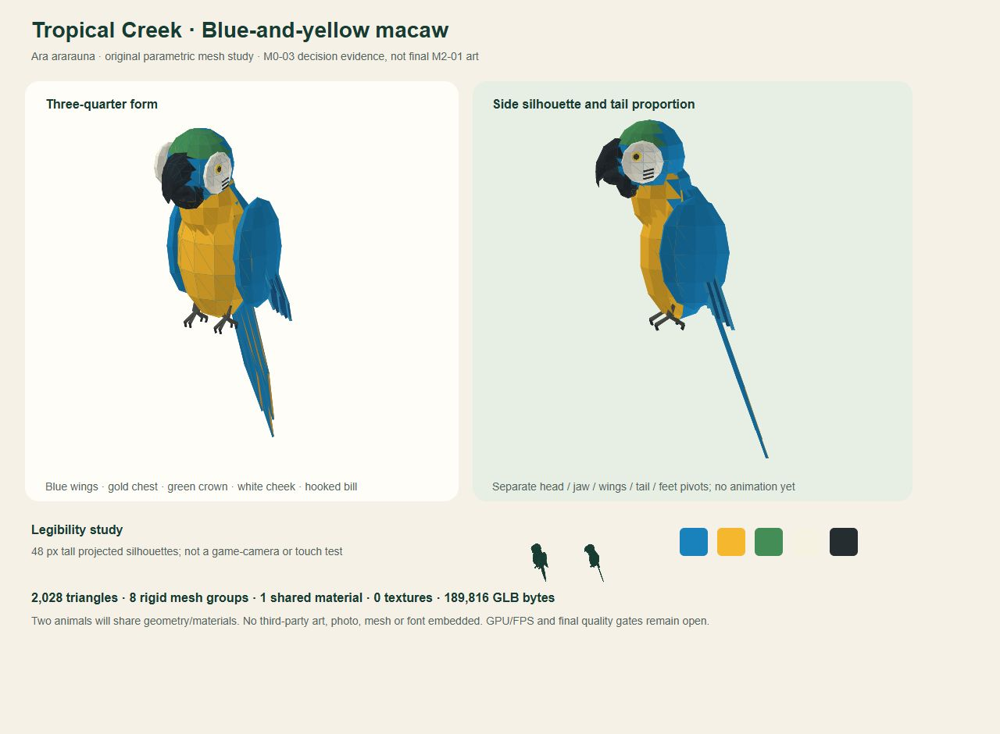

# M0-03 — Asset inventory, rights and macaw model decision

Date: 2026-10-31 UTC. Scope: inventory, source/license evidence, visual target and one bounded original mesh study. No game route, renderer, simulation, dependency or production change. Baseline revision: 3b06c6d8d2a920ad5894868059885c98a58217a6. M0-01 remains partial.

## Decision

Choose **blue-and-yellow macaw (Ara ararauna)**, UI label **Makaw biru-kuning / Blue-and-yellow macaw**, stable species ID blue_yellow_macaw. V1 uses two individuals of this one species in Tropical Creek. Use an **original parametric low-poly model**, shared geometry/materials with independent rigid-part transforms, rather than importing a stock model. No external model, texture, photograph or audio is incorporated or downloaded. No asset purchase, click-through agreement, login or new grant occurred.

The original model approach is selected; **final model quality and animation are not complete**. The actual study has a shaped body, separate head, curved hooked bill, face patches, marked cheeks, layered blue wings, grasping feet and long tapered tail. It is more informative than a capsule/block proxy, but remains a feasibility study. M2-01 must refine wing/tail thickness, beak/head transitions, foot/perch contact and every animation in the actual renderer before a final-quality claim.

## Verified species basis, separate from gameplay

- Scientific name/common name: [U.S. Fish & Wildlife Service](https://www.fws.gov/species/blue-and-yellow-macaw-ara-ararauna), checked 2026-10-31.
- Blue upper body, yellow underside, green head patch, bare facial area with fine feather lines and a dark curved bill guide recognition. These are factual identifying features, not copied artwork. [Stone Zoo species profile](https://www.zoonewengland.org/stone-zoo/animals/birds/blue-and-yellow-macaw/).
- Forested areas often near water, a tropical American range, plant foods including seeds/fruits/nuts, social grouping, and two forward/two rear toes support the creek setting, food icons and perch design. [Toronto Zoo species profile](https://www.torontozoo.com/animals/Blue%20and%20yellow%20macaw).

No zoo photograph, map, logo, recording, paragraph or proprietary model was copied into the asset. Sources provide fact checking only. Two birds, compressed need cycles, short flight distances, resource scores and the welfare formula are **game simplifications**, not husbandry advice, scientifically validated welfare metrics, real enclosure dimensions or a claim that two birds are always an adequate social group. V1 has no breeding or animal-trade instruction. Do not present stylized anatomy/proportions as a scientific illustration.

## Existing asset inventory and rights treatment

Machine-readable inventory and hashes: [ASSET_MANIFEST.json](ASSET_MANIFEST.json). Local measurements/package-notice hashes: [qa/m0-03/inventory-evidence.json](qa/m0-03/inventory-evidence.json).

| Asset | Measured size / source | Rights evidence and action |
|---|---|---|
| public/images/myzootwin-beranda.png | 3,001,357 bytes, RGB PNG 1024x1536; SHA-256 fd57bc337641b07eeae40a053e3db1032af805a553ecdddf81c99bcc2dc9e3b5; initial ad20f2b commit | Actual image inspected. No embedded metadata or repository attribution/license establishes its source. Retain existing journal usage and original bytes. Not selected as a game texture/model or export pack. Seek provenance before new distribution; do not assume AI origin or ownership from appearance. |
| public/favicon.svg | 328 bytes, 64x64 viewBox, basic vector animal face; initial ad20f2b commit | SVG source inspected. No external notice/source found. Preserve existing site integration; provenance remains unverified for independent redistribution. |
| DM Sans | External Google Fonts CSS import, requested weights 400/500/600/700; no local font binary | Upstream [DM Sans OFL](https://raw.githubusercontent.com/google/fonts/main/ofl/dmsans/OFL.txt) identifies SIL OFL 1.1. Credit/retain upstream copyright and license if later vendored; keep any reserved-name obligations. External transfer size is not measured or reported as zero. |
| Playfair Display | External Google Fonts CSS import, requested weights 600/700/800; no local font binary | Upstream [Playfair Display OFL](https://raw.githubusercontent.com/google/fonts/main/ofl/playfairdisplay/OFL.txt) identifies SIL OFL 1.1 and reserved name Playfair Display. Retain notices on redistribution and respect modified-font naming conditions. Existing integration unchanged. |
| public/robots.txt | 73 bytes | Site crawl configuration, not an art asset; preserved. |
| Audio / 3D models / game textures | None existed in the audited public/source assets | None silently licensed or downloaded. New environment/props and optional sound will use original procedural work unless a separately verified compatible asset is later selected. |

No root asset license/attribution file was present. Git authorship/history and public availability are not treated as a license. Unknown old-media provenance is a recorded limitation; it does not block the selected new original macaw/environment approach. Existing media is not deleted, altered or repurposed.

Direct package notice spot-checks: Astro 5.18.2 MIT, @astrojs/check 0.9.10 MIT, @astrojs/sitemap 3.7.4 MIT, TypeScript 5.9.3 Apache-2.0, confirmed against installed package metadata and license files. This is **not an audit of all 459 lockfile package entries**; full dependency/notice review remains M6-05. Three.js is not installed yet; its [upstream MIT license](https://raw.githubusercontent.com/mrdoob/three.js/dev/LICENSE) is compatible with the proposed approach subject to retaining its notice when actually included. No repository-wide open-source license is being assigned by this task.

## Original study: concrete feasibility evidence

Location: [art/studies/macaw-m0-03](../art/studies/macaw-m0-03/README.md).

| Measurement | Result |
|---|---|
| Exported study | macaw-study.glb, **189,816 bytes**; SHA-256 632a1f729d38b8481cb32ed32ec823faff6d3d8cc5f7f554f4f17b08a4219988 |
| Geometry | **2,028 triangles**, 8 named rigid mesh groups; binary geometry payload 182,520 bytes |
| Material/textures | 1 shared vertex-colour material, **0 textures**, no external URI or embedded image |
| Part layout | body, head, left/right wing, tail, left/right foot, jaw; jaw parented to head |
| Animation | **0 animation clips**; named pivots only, not an animation pass |
| Visual evidence | Actual SVG orthographic projection generated from the same mesh triangles, inspected in isolated browser at CSS 1280x940; captured JPEG 1280x940, 72,270 bytes |
| Structural checks | GLB header/chunk alignment, buffer/accessor bounds, finite positions/unit normals, index bounds, nondegenerate triangles, node reachability/hierarchy, material/texture counts passed; invalid magic and truncated-file cases rejected |
| Limits | Official glTF validator, GLB loader, WebGL rendering, culling/material appearance in engine, animation, mobile GPU/FPS and final quality **not tested** |

The geometry exporter follows the [Khronos glTF 2.0 specification](https://registry.khronos.org/glTF/specs/2.0/glTF-2.0.html), including linear normalized vertex colours and position bounds. Structural checks are a bounded local validator, not an official certification. Re-running the generator reproduced the same GLB hash. The SVG is a review projection, not a screenshot of a working 3D game.

The temporary review server bound only to 127.0.0.1:4322 (observed PID 24728), then stopped; no listener remains. Supported browser console capture returned no errors/warnings; server log had one incidental default favicon.ico 404 on the temporary art page. That page is not deployed or part of the application. Browser viewport was reset and the test tab closed.

## Visual and animation target for later slices

- Friendly, faceted low-poly animal with an expressive head and readable hooked bill/long tail. Preserve blue/gold/green/ivory/charcoal separation in low graphics; no photorealistic feather texture or generic capsule release.
- Tropical Creek uses original low-poly terrain, creek, repeated vegetation, wooden perch/fence, clear feeder/water shapes and a warm path. Keep birds legible against softer green surroundings and avoid photographic journal imagery in the game scene.
- The board includes exact 48px projected silhouette studies. This is a design check only; actual isometric camera, occlusion, selection, touch and in-game animal screen size must be tested in M1/M2.
- Planned state-driven motions: idle/perch head turns; walk/hop with feet/body movement; short flight with wing/tail articulation; eat with head/jaw movement; drink with head dip; rest with head tuck. Geometry pivots allow this direction, but no state transitions or clips are implemented here. Simulation remains authoritative for positions and needs.
- Two animal instances should share the one model's geometry/material buffers; only transforms/behavior state differ. One material and eight groups give a starting ceiling of eight base mesh draws per bird before shadows/passes, **not a measured frame budget**.

## Mobile budgets — allocations, not performance passes

Keep PRD first-play transfer **<=20 MB** as the hard design cap; use a tighter proposed <=6 MB allocation to leave headroom: engine/UI code <=3 MB, final shared bird <=0.5 MB, procedural environment/data <=0.5 MB, UI/font/icons <=0.25 MB, optional audio <=0.5 MB, reserve <=1.25 MB. These are proposed transfer allocations, not measured future bundle sizes. The current study's 0.190 MB raw GLB is the only model download measurement.

Target final bird <=4,000 triangles each (two birds <=8,000), one reused palette material, no required bird textures, low-cost rigid pivots and capped entities. Keep procedural repeated vegetation instanceable and low quality free of costly shadows. Actual renderer, first-play payload, frame time and memory must be measured in later baseline/profiling tasks; no Android 30 FPS or desktop 60 FPS pass is claimed.

## Verification and completion boundary

Inventory/hash/metadata measurements, installed direct-license evidence, primary species/license sources, original mesh generation, structural positive/negative checks, actual visual review and preview shutdown are recorded. Application/media/dependency diff remains empty; this unreferenced art study does not change any route or game payload. No app build was rerun after the unchanged-app M0-02 passing check/build; only the new art generator/validator and evidence checks were required here.

M0-03 is complete as **inventory + rights decisions + visual/model approach**, not M2-01 final art. Existing-media provenance, M0-01 external settings and the two pre-existing UI defects remain recorded; none were silently resolved. After evidence commit, mark only M0-03 in addition to M0-02: **2/51 (3.92%)**. Next: **M0-04**, add /play/start screen/navigation without breaking the eight original routes; no production change before the final gate.
