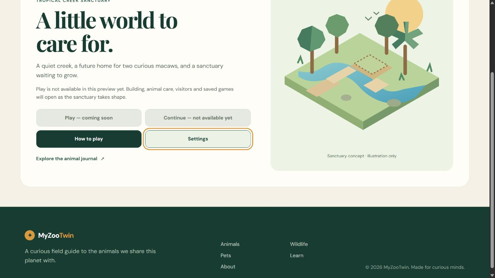
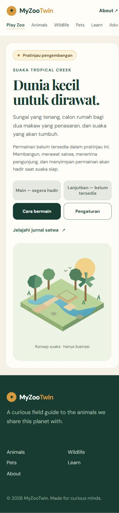

# M0-04 — Real /play route and honest entry screen

Date: 2026-10-31 UTC. Status: implementation and evidence complete; checkbox is recorded after this implementation commit. Baseline: 82634a1db0c806dad1a1893f6a6afac42e19bb11. Scope is the entry route only; no Three.js, canvas, simulation, animal gameplay, visitors, economy or game saves are implemented.

## Result

- New static Astro **/play** page with fixed canonical **https://myzootwin.com/play/**. Both /play and /play/ serve the new entry and survive reload; neither is the old homepage fallback. Sitemap now contains nine URLs, retaining all eight originals.
- Shared navigation gains a modest **Play Zoo** entry and current-page indication. Existing homepage/journal copy, routes, media, metadata defaults, fonts and conditional GA4 source block are preserved. No major homepage promotion or new telemetry.
- Start screen clearly says development preview and that building/care/visitors/saves are not available yet. **Play and Continue remain native disabled controls**. They do not pretend to launch or resume a game.
- **How to play** opens a four-step planned-game guide, explicitly labeled not playable yet. **Settings** opens a language selector. Native dialogs have heading focus, keyboard operation, Close and Escape; focus returns to the opener.
- Entry copy supports ID/EN, initial browser preference (id prefix -> ID; otherwise EN), manual selection and a versioned entry-only local preference. It never writes a game save or clears existing data. Storage failures return truthful temporary-choice status; malformed/unsupported preference data is ignored without deletion.
- A small **original inline SVG concept illustration** is labeled as illustration, not a rendered game world. It contains no third-party photo/texture/model. Added to [ASSET_MANIFEST.json](ASSET_MANIFEST.json).

The existing journal remains English. Header/footer language attributes identify that English chrome when the entry switches to Indonesian; the entry title/description, dialogs, controls, guide, status and illustration label are localized. This is **entry UI groundwork**, not completion of M5-05/full game localization.

## Source boundaries

- [play.astro](../src/pages/play.astro): actual route and explicit canonical.
- [PlayEntry.astro](../src/components/PlayEntry.astro): SSR fallback, native dialogs, original illustration and responsive layout.
- [play-entry.ts](../src/scripts/play-entry.ts): local entry enhancement, dialog interaction and locale rendering.
- [locale.ts](../src/game-entry/locale.ts): typed dictionaries and isolated preference read/write contract.
- [BaseLayout.astro](../src/layouts/BaseLayout.astro): only optional canonical override, Play Zoo link/style and English header/footer language declarations; analytics lines unchanged.
- [entry-preferences.test.mjs](../tests/entry-preferences.test.mjs): eight native Node tests; no test framework/dependency install or Actions added.

## Verification actually run

| Check | Evidence/result |
|---|---|
| node --experimental-strip-types --test tests/entry-preferences.test.mjs | 8/8 pass: locale default/override, malformed/unsupported data, blocked reads/writes, isolated write namespace and dictionary completeness |
| npm run check | 12 files; 0 errors, warnings or hints |
| npm run build | 9 static pages; sitemap generated; only entry client bundle added |
| Final entry bundle | 6,379 bytes raw, 2,628 bytes gzip measured from final build; not a full-game payload/performance pass |
| /play + /play/ | HTTP 200 locally; new entry marker, correct title/canonical, native disabled Play/Continue, working Help/Settings; direct URL/reload verified in browser |
| Existing eight routes | 16 desktop/portrait browser direct/reload scenarios match M0-02 title/heading/canonical; HTTP 200 + same metadata/heading; original page source/public media diff unchanged |
| Navigation/history | Homepage Play Zoo click, mobile horizontal Gear click, journal return link, back/forward, active nav state and restored entry preference verified |
| Dialogs/keyboard | Desktop and portrait guide/settings; Tab skips disabled game controls, reaches all nav links, opens dialogs with Enter; heading focus, Close and Escape checked; landscape dialog scroll/close checked |
| ID/EN | Actual ID selection, localized title/copy/status/dialogs, reload persistence, journal isolation, back/forward, then EN restoration verified; auto-ID and storage-failure branches tested at unit level |
| Responsive/visual | Actual isolated-browser screenshots at requested CSS 1366x768, 1920x1080, 360x780 and 780x360; portrait action targets >=48px; no new /play horizontal overflow |
| Console | No error/warning entries in recorded entry/journal checks and final build smoke |
| Cleanup | Preview bound only to 127.0.0.1:4321, observed PID 18096; stopped and no listener confirmed. Viewport reset; all owned QA tabs closed |

Browser evidence interval: 2026-10-31T16:10:02.168Z to 16:17:39.938Z. [browser-results.json](qa/m0-04/browser-results.json), [HTTP/SEO regression](qa/m0-04/http-route-regression.json), [artifact manifest](qa/m0-04/artifact-manifest.json). Nine JPEGs total **412,878 bytes**. Actual capture pixel dimensions are separately recorded from requested CSS viewport sizes; no manual image resizing/cropping. Tests used the isolated in-app browser, not a personal/extension profile. **Physical Android, real Chrome/Edge device runs, Safari/iOS, true touch, gameplay, GPU/FPS and full localization are not claimed.**

The final build was reloaded for a final guide-button-close/settings-Escape smoke after a small dialog close-fallback refinement. The fallback branch for browsers lacking native dialog methods was not exercised in an actual old browser. No-JavaScript explanatory fallback is present but browser scripting-disabled mode was not tested.

## Preserved issues and access limits

- BASE-01 remains: /animals/ document width 387px at 360px; no unrelated CSS fix.
- BASE-02 remains: pre-existing journal quote low contrast; no homepage restyling.
- First optional current-public-HTML comparison via Python urllib GET **https://myzootwin.com/** returned **HTTP 403**. That read was not retried or bypassed. Local regression instead uses captured M0-02 browser metadata plus verified unchanged original page/media source. No claim of a fresh public main-body equality comparison is made.
- M0-01 remains partial: exact external source/build/canonical deployment settings are unknown. New /play is **local only**, not deployed or production-tested. No login/new grant, push, deployment, account/security change or GitHub Actions run occurred.

## Screenshots

## Completion boundary and next

M0-04 is a working route/navigation/guide/language-entry slice, with unavailable game actions clearly disabled. It does not pass M0-05 or any gameplay gate. Existing source rollback references and untested production rollback candidates remain documented in M0-02_BASELINE.md; no rollback performed here.

After the implementation/evidence commit, mark only M0-04 in addition to M0-02/M0-03: **3/51 (5.88%)**. Next **M0-05**: 3D canvas, loading and WebGL failure state, followed by actual browser rendering/negative tests. No production release before the final gate.
