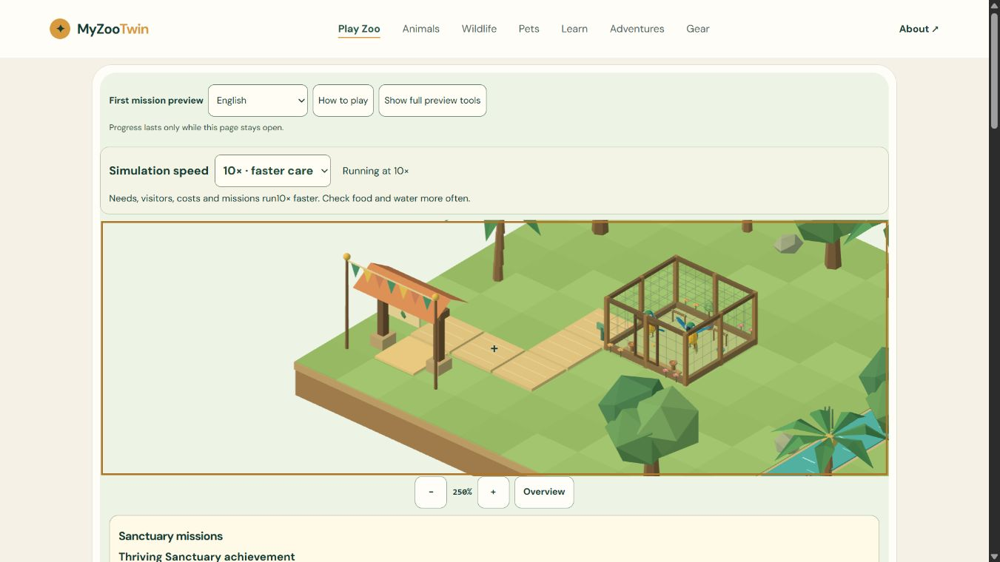
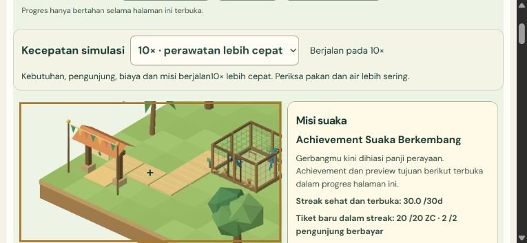

# M4-06 - Deterministic1x/10x simulation speed

COMPLETE - 2026-11-01 UTC. Implementation `e959fbd0b25b7f338a5697de739bef09b2ad8963` local only. **34/51 (66.67%)**, M4 **6/7**. Next **M4-07**. No production changes; M0-01 external Cloudflare source binding/build/root/autodeploy remains partial.

## Player outcome

An accessible44px ID/EN selector above the game canvas switches between1x and10x, announces actual running/paused rate and warns that needs, visitors, costs and mission timers move faster. Keyboard Home/End and native selection were exercised. Portrait/landscape text wraps without control overflow. Dialogs disable the selector; injected changes while paused cannot change authoritative rate. Scene metadata uses a separate attribute from the selector.

The normal desktop10x, portrait1x and landscape10x fresh user flows build the habitat/path, claim Q01, supply food/water/perch, welcome both macaws, prove consumption/welfare for Q02, admit/view real guests for Q03 and sustain genuine care/income for Q04. Exactly60 total mission coins; Q04 adds no cash. After unattended10x resource depletion, actual refills and continued care restored both birds to welfare61. This proves recovery, not final economy balancing or an unaided human playtest.10x needs active supplies management; final pacing/UX/performance remain later gates.

## Clock and state contract

The one existing RAF owns rendering and passes wall elapsed time to one deterministic clock. Each fixed tick remains100ms; accepted wall time is at most250ms per callback before scaling.1x runs at most3 ticks,10x at most25, executing every intermediate care/visitor/maintenance/mission tick. Long gaps are dropped and measured separately in wall/simulated units, saturating diagnostics safely; no infinite catch-up or offline income.10x does not schedule10 render callbacks or add a timer.

Actual rate changes are synchronous and emit a typed event, save the page-session memento and reanchor the browser timestamp. The first following RAF establishes a fresh anchor, so time before the input is not retroactively credited at the new rate. This deliberately discards at most one unaccepted frame interval on a real change; the already accumulated sub-tick simulated remainder is retained. Selecting the same rate does nothing. Existing pause transitions clear fractional catch-up and reanchor on resume. Equivalence is for equal **accepted simulated time**, not all elapsed wall time during pauses/stalls/switches.

`preferences.speed:1|10` is validated plain version1 save data, default1. Renderer retry/remount and codec roundtrip preserve it. New-game reset returns the constructor baseline (fresh1 or restored10). Full page reload is still wholly fresh1500/default1 until M5; there is no durable save claim or storage write introduced. Runtime RAF anchors, dropped-time counters and accumulator are not save data. A core caller may select a rate while paused for later resume, but product controls reject paused commands.

## Verification

- Local final source:381 tests pass (11 new speed tests),150 Astro checked files with0 errors/warnings/hints,9 built routes/canonicals/sitemap preserved.
- Seeded full-state equivalence1x/10x/fractional partitions,25-step batches with actual care events, real admission/income/mission rewards, support recovery and exact ledger reconciliation. Existing long checkpoint/replay/refund regressions remain passing. Fast repeated choices add no time/command/money; malformed rates rejected.
- Browser:23 sequential suites,280 cases/view at1366x768,360x780 and780x360,840 total including24 speed cases. Actual DOM/RAF care and missions; explicitly injected selector/failure/visibility/touch scenarios are labelled. No simulation-time injection in the browser.
-128 authoritative fields, including chosen rate, identical across intentional context loss/retry and3 true paused unmount/remount cycles. Native clock phases hold while paused and resume exact ticks; disposal leaves0 geometries/materials/textures/programs/subscribers/canvas/pending RAF, cleanup errors0, maxima one session/RAF.
- Native navigation to Animals/back/reload preserves public routes and correct `/play/` canonical. Same-page reopen preserves10x/four claims; full reload truthfully fresh1x/1500/no claims. Actual warn/error observations uncapped and empty; owned tabs/previews closed and viewport reset.

Run `20261101T171513Z-26e9b18a`; source `642a236db84d630b2d3dc18dffc70098099b7240629e7c613a7393fcea3998e7`; build `51e8f1fd1fedae475e0dfc4b158e218b78ea5bcd4e6701bd151a95a057f09b15`. `npm run qa:local`, supported isolated-browser recipe and `node scripts/qa/qa.mjs verify 20261101T171513Z-26e9b18a`. [Audit](qa/m4-06/independent-audit.json), [receipt](qa/m4-06/browser-receipt.json), [interaction matrix](qa/m4-06/interaction-matrix.json).

## Measurements and remaining limits

Shell195,705 raw; first preview909,072 raw/241,045 gzip level9 estimate. Relative M4-05 first904,496 raw/239,799 estimated gzip: +4,576 raw/+1,246 gzip. No new model/texture/dependency. Lazy chunk713,367 retains the existing >500kB warning, pending M6 profiling.

Populated sampled scene at10x: 55 draws/14,332 triangles, 36 geometries/25 owned materials/1 texture, two macaws and up to3 visitors. This is a sampled scene, not a bound on future content.

Five-second callback probes during concurrent QA:10x 14.40Hz, synchronous core/render-submit CPU p95 25.80ms;1x 46.20Hz/CPU p95 8.90ms. Shared load and evolving scene differ, so these are observations, not a controlled speed benchmark.10x's heavier CPU work is a measured M6 profiling risk. Neither number is presentedFPS/GPU time or a hardware target pass. Nonstandard shared/quantized heap estimates are preserved, not leak proof; owned resources zero after cleanup.

Physical Android/iOS/Safari, native background visibility, presentedFPS/GPU/network latency, complete-game15minute soak, human unaided test, durable storage/migration and live production remain **UNRUN**. Screen matrix is viewport testing. Tiny existing copy spacing (`run10x`/`berjalan10x`) is cosmetic and can be polished with later UX, without changing rules.

## Retained corrections

The initial new test incorrectly assumed the established command nonce started0; it now compares the initial nonce without changing product economics. Native preflight exposed a duplicated selector/stage metadata attribute; stage metadata now uses its own name. The labelled fixture wrapper initially omitted forwarding the new speed method; corrected explicitly and final source rerun. The first supposed paused remount sequence allowed real active ticks; preserved as nonacceptance, then true unmount/remount with explicit pause before open proved all128 fields identical. A retry lookup used English while UI was Indonesian; no click executed, DOM inspection found Coba lagi and actual retry passed. An old closure wrote a stale candidate receipt temporarily; final writer passes the current receipt/matrix explicitly and verification checks exact run/source/build/timestamps. All preliminary observations/logs remain available and never count as final acceptance. No denied action or approval bypass.

