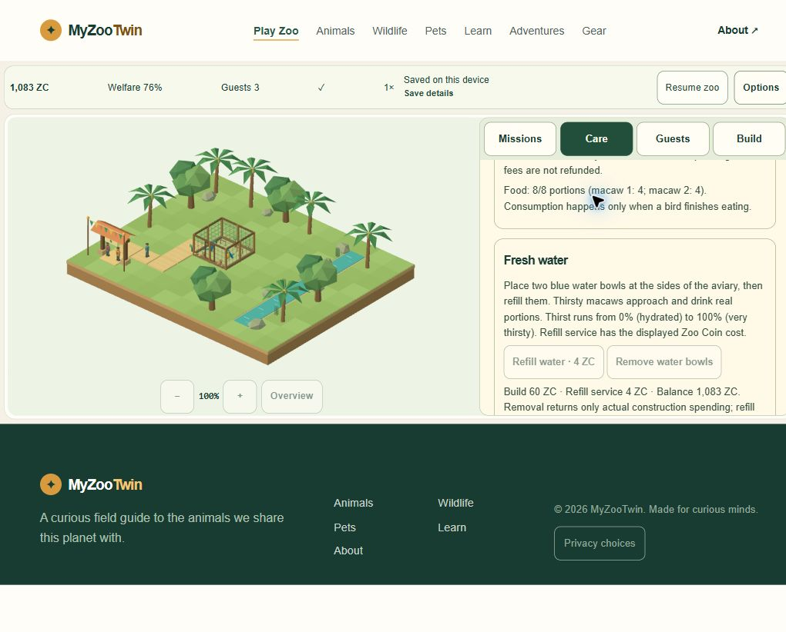

# M4-07 — final-source real-duration gameplay/soak

2026-11-02 UTC. Start checkpoint `988aa02cce2d33d49a6d07e63b891ff6b2b0487d`. **Duration/soak PASS scoped; required recording UNRUN;44/51 unchanged. No product changes.**

One bounded native Chrome session continued the isolated QA4363 sanctuary from the previous fresh final-source Q01–Q04 run. This is continued1×gameplay/soak, not a second fresh golden run or a fabricated single recorded episode. Owner origins/profile/saves were not accessed/reset. No new device/browser matrix, login, permissions, Cloudflare, push, deploy, Actions or prohibited QA46/download operation.

## Exact identity and duration

- Source `8e5af7f95ca28262b5fc8e3ae5f84e999682d1ccc0e9e060892c4b446fdbcd91`.
- Compiled build `b39d78e351cdba467a937aa8db78de32a5c006a01040f23b23b78722d8ffd9ab`.
- Start **20:08:48.731UTC**, active-end **20:25:02.737UTC**: **974.006s /16m14.006s wall**.
- Whole explicit pause operation **20:13:09.973–20:13:44.629UTC**, conservatively excluded **34.656s**.
- Unpaused window **939.350s /15m39.350s**, above the requested900s. All measured observations show native **1×**, visible document, one canvas, two birds, one habitat, visitor count0–3; only the explicit pause snapshots show paused state.

These are actual wall timestamps. They are not accelerated simulation minutes, exact tick-count/FPS measurements or proof of unobserved frames between samples. No simulation-time/state/save injection. The target was900unpaused seconds; final care/capture added a small bounded margin, then the game was paused and QA closed. [Acceptance](qa/m4-07-duration/acceptance.json), [28 timestamped observations](qa/m4-07-duration/steps.json), [pause interval](qa/m4-07-duration/pause-intervals.json).

## Meaningful gameplay and invariants

Native care checks used actual low stock and paid refill controls. Animals ate/drank/rested, visitors walked/viewed/returned, and cashflow advanced. Supplies sometimes depleted between samples; ordinary care recovered conditions. Sampled aggregate welfare ranged **45–88%**, ending **76%**; no claim that every moment stayed above a threshold. One bird inspector displayed current behavior/causes, and camera Zoom/Overview remained responsive while running.

During the manual pause, Settings was read and closed/discarded without applying preferences. Coins, supplies, habitat/path/animal/visitor fields stayed frozen; Resume proceeded normally with no false save conflict. A metadata-property typo occurred after the successful Resume; the action was not repeated, actual captured request/confirmation timestamps were retained, and the next DOM observation confirmed running. It was bookkeeping, not a product failure.

The entrance was closed for **47.814s wall**. Ticket totals/admission receipts stayed fixed; existing visitors returned safely to zero active, and upkeep still applied. Opening it again resumed genuine arrivals and revenue. No object reset, economy fixture, free recovery grant or reward replay was used.

Displayed cashflow comparison starts at the first Guests baseline20:09:18.437UTC, about30s after the timer start:

| Field | Baseline | Final | Delta |
|---|---:|---:|---:|
| Paid admissions |15|45|+30|
| Ticket income |150ZC|450ZC|+300ZC|
| Supplies expense |132ZC|276ZC|−144ZC|
| Upkeep expense |26ZC|56ZC|−30ZC|
| Balance |957ZC|1,083ZC|**+126ZC**|

Mission rewards60ZC and construction595ZC remained unchanged. **300−144−30=126** reconciles the actual balance delta. The timer-start balance was947ZC; an early genuine ticket precedes the Guests baseline, so these two baselines are intentionally distinct. Completed views rose **14→43** across the measured session. The title “cashflow since session began” is the product's persisted cumulative view; this report uses differences rather than pretending counters reset on the new tab.

No crash, blank canvas, duplicated canvas or false external-tab save conflict was observed. This is scoped functional evidence, not global zero defects or a heap/GPU leak certification. Current heap/GPU/presentation FPS were not measured. Prior M6-02 lifecycle/memory evidence and historical GPU/import uncertainty remain separate.

## Final save and actual cold-tab Continue

The final game was manually paused and visibly Saved at **1,083ZC /4missions /2birds**. The original QA tab was closed and a genuinely new Chrome tab opened at the same isolated origin. Continue restored that balance and all16compared habitat/occupancy/path/resource/visitor/speed DOM fields, paused before any Resume. Whole save-byte/RNG/position equality was not directly inspected natively; existing codec tests remain separate.

[Cold-tab Continue](qa/m4-07-duration/T02-cold-Continue.jpg), [mid-session actual canvas](qa/m4-07-duration/S09-care-sample.jpg), [live animal inspector](qa/m4-07-duration/S07-native-animal-inspection.jpg). Default native desktop viewport was used; no repeated matrix or new viewport override. Bounded final cold-tab console query returned no warn/error entries; the original soak-tab console was not captured before close, so no full-session console-clean claim is made. Timestamped DOM and server-request logs are retained.

## Verification, cleanup and STOP

The server required exact canonical source/build fingerprints before serving, and final source remained identical. The prior same-source **486tests/207check/build** and nine-route evidence are **reused, not rerun** because product code/dependencies/assets did not change. No performance/device/recording claims were inferred from them. [Executed duration audit](qa/m4-07-duration/executed-audit.py), [server receipt](qa/m4-07-duration/server-final.json), [source/owner/archive guard](qa/m4-07-duration/cleanup-guard.json).

Both owned Chrome tabs closed and fresh tabs.list returned empty. Owned loopback server stopped gracefully; seven named ports verified free. Protected owner olddist and five rollback/failure/legacy archive hashes remain exact. No owner or QA save deletion/reset. No new denied, pending or uncertain action; recording capture remains **UNRUN because no approved recorder capability was available**, not an invented video or a bypass attempt.

Duration work is complete. **M4-07 stays unchecked for recording/evidence-format acceptance; all seven unchecked PRD items remain unchanged.** Fresh Q01–Q04 and this continued soak are separate episodes on identical final source. [Updated release handoff](MYZOOTWIN_V1_RELEASE_HANDOFF.md), [seven exact criteria](qa/m4-07-duration/seven-open-gates.json), [three concise morning input groups](qa/m4-07-duration/morning-inputs.json). Test waivers cannot create license rights, unknown hosting facts, legal clearance or historical causal explanations.

**STOP awaiting owner-dependent gates. No further validation loop or feature work.**
