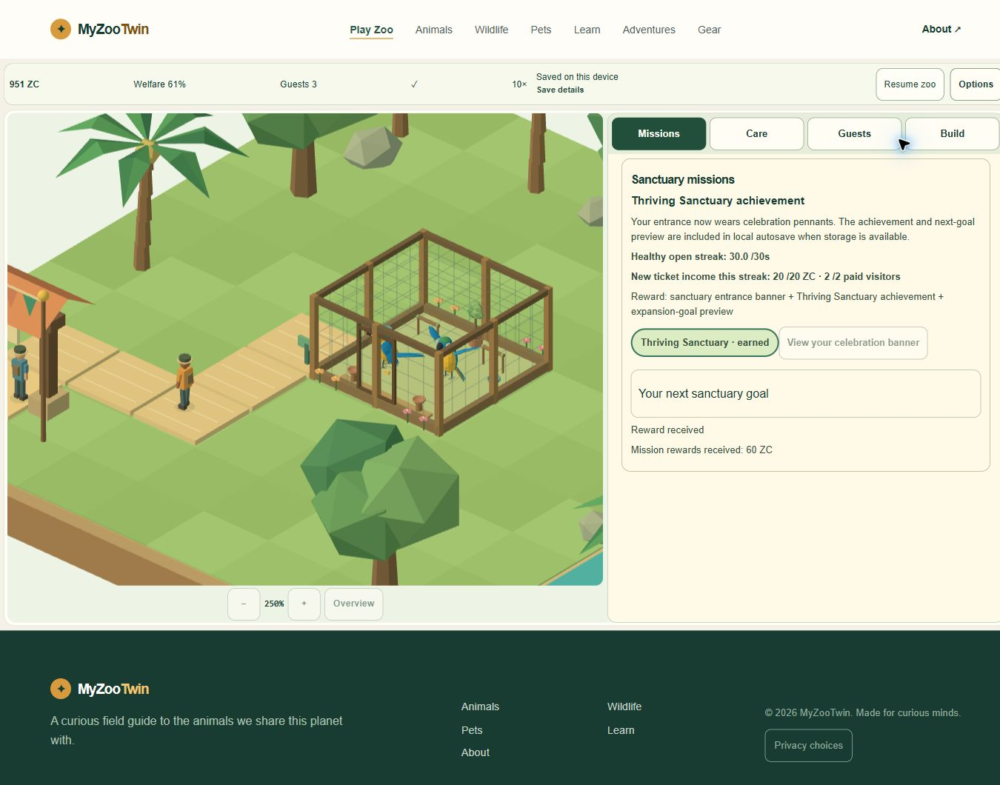

# Fresh final-source golden journey — verified locally

2026-11-02 UTC. Starting checkpoint `9e4dacc8f70d6d8b8e1ebc108400aa9fb161f448`. **No product changes.** This closes the fresh-final-source coverage gap following the autosave race correction; it does not complete every M4-07/release criterion.

The entire new game Q01–Q04 and actual cold-tab Continue used the same final source:

- Source: `8e5af7f95ca28262b5fc8e3ae5f84e999682d1ccc0e9e060892c4b446fdbcd91`.
- Compiled build: `b39d78e351cdba467a937aa8db78de32a5c006a01040f23b23b78722d8ffd9ab`.
- Code correction already included: `294a28fed1f832c5cc20a83c77c06ed3df42be49`.

The local helper required both canonical source and build fingerprints to match before serving, and source remained identical after shutdown. It served exact candidate bytes on fresh **127.0.0.1:4363**, separate from prior QA4361 and owner origins. Extra QA-only self CSP blocked external sources; optional analytics was refused. Actual authorized Chromeextension3/native product controls were used. No imported fixture, save/state/time injection, reset, owner data access, unsupported browser driver or denied operation.

## Observed journey

| Step | Actual evidence |
|---|---|
| Fresh entry/new game | Native “No saved sanctuary yet”, Continue unavailable, then1,500ZC. |
| Q01 | Free habitat Cancel;300ZC habitat; five15ZC path cells; real connection;1,125ZC before20ZC claim,1,145ZC after. |
| Interrupted/repeated autosave | Three native removal-review/Keep cycles on the selected path, then Pause/Resume. No false external-tab conflict; visible Saved status. No object removed or refund generated by cancellation. |
| Actual care | Empty feeder/water/rest built and supplied through actual paid controls; two macaws welcomed. Q02 records both meals/drinks and5 consecutive simulation seconds of qualifying welfare; flowers claimed. |
| Q03 | Real paid admissions reach3; actual viewing completes;40ZC/badge claimed. Native care/refill actions maintain supplies. |
| Q04 |30-second healthy/open streak and20ZC from two new paid visitors recorded; banner/achievement claimed. Current needs remain real and can worsen after an objective is recorded. |
| Save/cold tab | Paused Saved state at951ZC,4missions,2birds. Viewport reset succeeded before closing original tab. A genuinely new Chrome tab finds the save; Continue restores951ZC,4missions,2birds and all16compared resource/path/visitor DOM fields, still paused. No Resume after restore. |

[32 timestamped native observations](qa/final-source-golden/steps.json), [independent acceptance/comparison](qa/final-source-golden/acceptance.json), [browser receipt](qa/final-source-golden/browser-receipt.json). They are one journey, not32 independent test cases. Camera/selection are transient UI and reset normally. Whole save-byte/RNG/position equality was not directly inspected natively; existing unit codec coverage remains separate.

[Cold-tab Continue](qa/final-source-golden/G19-cold-tab-Continue.jpg), [Q01 ready](qa/final-source-golden/G05-Q01-ready.jpg), [autosave interruption](qa/final-source-golden/G08-interrupted-autosave-paused.jpg), [actual birds/resources](qa/final-source-golden/G09-two-birds-supplied.jpg).

## Timing and acceptance boundary

New game **19:47:01.296UTC**, Q01 claim19:47:15.319, Q02 ready19:48:08.832, Q03 claim19:48:42.385, Q04 complete/paused **19:49:01.868**, cold Continue **19:49:29.853**. Elapsed **120.572s to Q04**, **148.557s through cold Continue**. Initial building used1× and later care/visits used the native10× option; bounded real UI refill polls were used. These are real wall timestamps, **not** a10–15minute real session, soak test, human pacing result or recording.

M4-07 therefore stays unchecked: required supported recording is unavailable, and this short accelerated pass is not fresh final-source10–15minute recorded proof. Earlier real-duration evidence is preserved as historical evidence. A single real-duration final-source run could be done independently after dispatch; no further validation loop was started here. A recording/evidence-format waiver must be explicit and cannot be described as a passed recording test.

The raw receipt has30requests:26successful responses match exact candidate files;4requests to unreferenced /favicon.ico return404. The declared /favicon.svg returns200. Initiator was not traced; this is a nonblocking conventional-icon compatibility observation, not a failed declared game asset. All404s are retained in the [served-byte audit](qa/final-source-golden/served-byte-audit.json), rather than claiming every request succeeded. No product change or extra browser loop was added.

The exact-source prior gate `s20261102T192224Z` (486tests,207checked files,build) and nine-route evidence are **reused, not rerun**: no product source changed. This pass adds the previously missing fresh native final-source Q01–Q04/Continue evidence. Chrome bounded console query returned no warn/error entries; no global/network-panel clean claim or physical/Edge/native-background/speaker/process-restart/FPS certification.

## Cleanup and handoff

Both owned tabs closed; immediate post-close list briefly reflected asynchronous stale state, then fresh authorized tabs.list returned empty. Viewport reset completed while the original tab still existed. Owned server stopped gracefully; seven named QA/owner ports verified free, protected olddist and all five rollback/failure/legacy archive hashes unchanged. QA4361 and4363 saves remain recoverable; no deletion. [Guard](qa/final-source-golden/cleanup-guard.json), [server receipt](qa/final-source-golden/server-final.json).

The evidence reader initially expected collapsed save-detail text in the accessibility snapshot. It was corrected after independently inspecting visible “All missions complete” and the recorded save-summary DOM fields before/after; game state and source were not changed or rerun. A fresh browser REPL also required reinitializing the known authorized Chrome handle before any UI action. These are evidence/setup issues, not product failures. No new policy denial or unresolved action occurred. Inherited QA46/frozen-baseline/recovery-download restrictions remain untouched.

**V1 remains44/51 (86.27%)**. The seven actual unchecked PRD items and minimum actions are in the [release handoff](MYZOOTWIN_V1_RELEASE_HANDOFF.md) and [exact criterion mapping](qa/final-source-golden/seven-open-gates.json). No active P0/P1 was reproduced in this scoped run; that is not an overall zero-defect, legal, device or release certification. Stop for parent review, no push/deploy/Actions/login/permissions or further loop.
