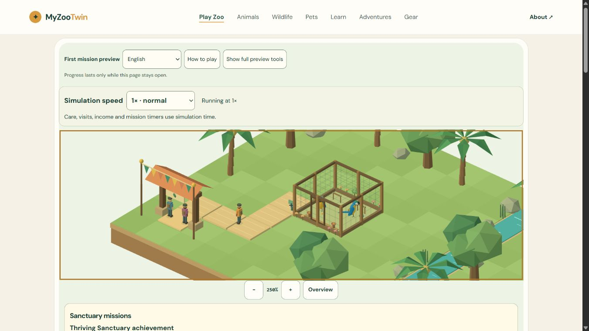
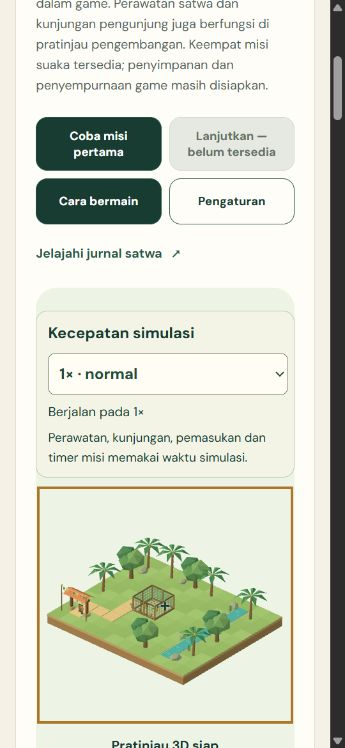
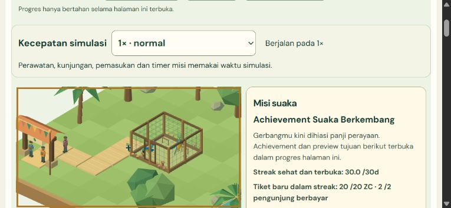

# M4-07 - Real-time gameplay QA and recording capability gap

**PARTIAL. Functional gameplay QA passes; screen recording is unavailable. Keep the checklist unchecked and V1 at34/51 (66.67%).** M4 remains6/7. This is not a complete V1 release or a video-recorded playtest. No app-source change from `153a69abe765a3e7dc8c992266b65c57e6f98073`.

## Actual native product sessions

All sessions start from the real built `/play/`, a fresh1500 ZC state and two reserve birds, using only native product buttons/selects and supported browser actions. No whole-state fixture, synthetic gameplay event, simulation advance call or elapsed-time injection was used. Scripted operator input is not an unaided human user study. Wall-clock durations come from actual UTC start/finish timestamps, not accelerated simulation minutes.

| Viewport session | Actual wall duration | Final balance | Real ticket income | Mission rewards |
|---|---:|---:|---:|---:|
| desktop | 754.446s | 1071 ZC | 260 ZC |60 ZC |
| portrait | 722.780s | 1081 ZC | 290 ZC |60 ZC |
| landscape | 675.043s | 1209 ZC | 450 ZC |60 ZC |

Desktop1366x768, portrait360x780 and landscape780x360 all remain within10-15 real minutes. Desktop's real removal dialog holds observed money/care/bird/mission state, portrait close/reopen retains all observed progress, and landscape continuously remains active through viewport rotation. Known pause/closed intervals are recorded explicitly; even subtracting those intervals leaves over10 wall minutes per session. This is not a measurement of every accepted simulation millisecond or of presentationFPS.

Each session cancels an actual habitat preview without cost, builds a valid habitat and connected path, claims Q01, places/refills food and water, adds perch, welcomes two macaws, observes actual consumption/welfare and claims Q02, opens the gate, admits/views real visitors, claims Q03, sustains genuine welfare/new ticket income for Q04 and continues repeated care/revenue after all four missions. Native10x bursts change actual needs/visits/mission timers; all sessions return to1x. Exactly60 total mission coins remain stable through continued operations; Q04 adds no cash.

At every recorded native observation, balance equals1500 plus net, and net equals ticket income + mission rewards + refunds minus construction, supplies, upkeep and undo. Rewards match mission aggregates, ticket income stays a multiple of10, balance never goes negative, visitor count stays at most3 and bird IDs remain unique/bounded to2. These are actual rendered authoritative aggregates; individual ledger-entry IDs are not exposed by the native UI. Existing381 white-box/integration tests provide separate journal/checkpoint/replay/atomicity coverage. Do not confuse the two evidence sources.

## Interruption, distress and recovery

- Real food-removal dialog: disabled speed selector and stable balance/cashflow/bird needs/missions/care while paused; Cancel keeps resources and resumes.
- Portrait renderer Close/reopen: observed balance, cashflow, bird summaries, mission and stocks identical, then continued operation. Later post-session same-page desktop reopening also retains all four claims.
- Real entrance Close: ticket income stays120 ZC across the recorded closed interval despite continued care; reopening restores real arrivals.
- Natural food depletion at actual10x: stock reaches0, then a low-welfare alert appears. Actual refill and continued food/water/rest interaction recover both birds. First short recovery watch was still in the documented recovery band and is preserved as not-yet-recovered; later observation proves recovery.
- Alert investigation INV-01: needs-care may remain around60 because hysteresis enters below60 and clears at65. Core rules, existing Schmitt-threshold test and bilingual in-game formula explicitly explain it. Expected anti-flicker policy, not a manufactured fix.
- Same native landscape session resized to portrait/back through supported viewport controls; canvas, controls, state and economic invariants remain valid. This is viewport emulation, not physical orientation/touch testing.
- Full reload truthfully returns to1500/default1/no claimed missions until M5. Durable save remains unimplemented and is not reported as working.

Screenshots sample actual scene/animal/visitor/control pixels. They cannot prove every intervening animation frame; video is unavailable. The first fresh-entry text-label observation used a missing-label sentinel-1, while recorded stage stocks correctly show0; subsequent stock observations use the actual stage data. No negative game stock is inferred from that reader sentinel.

## Verification and measurements

Fresh local gate `npm run qa:local`:381 tests pass,150 Astro files with zero diagnostics,9 built routes/canonicals/sitemap preserved. Source `642a236db84d630b2d3dc18dffc70098099b7240629e7c613a7393fcea3998e7`; build `51e8f1fd1fedae475e0dfc4b158e218b78ea5bcd4e6701bd151a95a057f09b15`; run `20261101T173806Z-09fc9bbd`. Final supported-browser receipt consistency check passes. No product fixes were needed after investigation, so source remains unchanged; the prior M4-06 840-case regression is historical supporting coverage, not falsely rerun here.

Native real-session warn/error captures use limit200 and are empty/uncapped. Each native session has one canvas while ready and0 after Close. Separately labelled populated diagnostic fixture checks exact clock pause/resume, intentional context loss/retry, one session/RAF/subscriber and zero owned renderer resources after disposal. That fixture is not the native long-session state and does not establish full-game memory/FPS performance. Optional heap estimates are nonstandard/shared; callback cadence and synchronous CPU submission are not presentedFPS or GPU time. M6 profiling and full15minute soak remain required.

## Recording blocker and exact acceptance status

Action: obtain screen recording via supported runtime. Target: isolated browser session for the actual product. Result: **UNAVAILABLE CAPABILITY**, not a permission denial or an uncertain execution. Browser capabilities advertise only visibility/viewport; tab capabilities advertise pageAssets/WebMCP. Tool discovery finds no supported screen/video recorder. No external recorder, private browser/profile, CDP route, new grant, screenshot slideshow or synthesized video is substituted.

The PRD M4-07 Verify explicitly requires screen recording and zero blockers. Functional tests found0 gameplayP0/P1, but the recording requirement remains unverified. Timestamped original screenshots, full native action/DOM traces, UTC durations, logs and source/build identities are available for concrete review. The parent may explicitly accept this alternative or provide a supported recorder; until then, leave M4-07 unchecked. **Progress remains34/51 (66.67%).**

M0-01's independent external Cloudflare source binding/build/root/autodeploy gap also remains partial; no login/grant was attempted. Physical Android/iOS/Safari, native background behavior, presentedFPS/GPU/network, full15minute soak, human unaided test, durable storage and live production remain UNRUN. Existing mobile full-tools layout/known small copy spacing belong to later UX polish; no final mobile-quality claim is made. No push, deploy, Actions, login, grants or package changes.

Next independent feature: M5-01, versioned durable autosave/Continue with safe checkpoints, real refresh/reopen and truthful storage-unavailable behavior, preserving current economic/mission proofs. No M5 implementation is included here.

