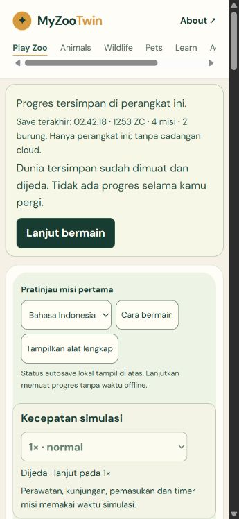
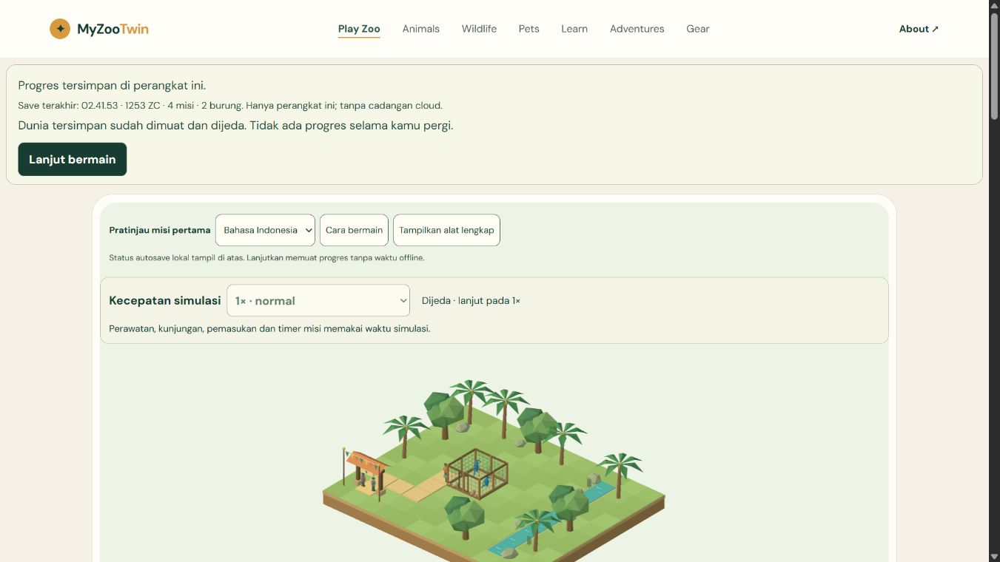

# M5-01 - Durable autosave and Continue

**COMPLETE as the durable checkpoint/Continue slice. Verified V1 is 35/51 (68.63%), M5 1/7.** Implementation `63db0ea6fd008c7cc69232c7dc8c22f1ceec7c52` (local). M0-01 and M4-07 remain partial. This does not pass the final V1 release gate.

## Player behavior

The actual `/play/` now checks device-local progress before enabling Play or Continue. A saved game opens paused with an explicit Resume action. Refresh and closing/reopening the tab preserve the sanctuary, two macaws and their resource/behavior state, money and admission proofs, full Q01-Q04 rewards/unlocks, visitor journeys, RNG/time and required preferences. Resume starts a new wall-clock frame anchor, so time away cannot generate income, consume supplies or alter missions. ID/EN status distinguishes checking, empty, available, changes pending, saving, confirmed saved, temporary storage-unavailable play, unreadable data, failed writes and stale-tab conflicts.

Storage is specific to browser and origin, with no account/server/cloud backup. The displayed Saved status follows an actual successful IndexedDB transaction. Pending writes can be lost if the process is forcibly terminated before confirmation; the last confirmed checkpoint remains protected. Actual tab close/reopen was tested. Full browser-process restart/crash, disk power-loss durability and physical-device behavior were not tested.

Obsolete copy claiming refresh resets progress was corrected in ID/EN throughout habitat, path, bird, ticket, guide and achievement hints. Undo history is explicitly session-only; committed edits and their financial proofs are saved. No reset/erase workflow was added in this slice.

## Atomic bounded persistence

- `game/persistence/durable-backend.ts`: database `myzootwin-progress-v1`, store `checkpoints`, only `primary` and `previous`. Envelope format 1 includes monotonic revision, bounded writer identity and representable timestamp; full existing `ZooSaveV1` validation and 1,000,000-character payload bound are reused. No Mesh/DOM/class instances are stored.
- One readwrite transaction validates the current primary, checks the expected revision, copies it to previous-good, then writes the next checkpoint. Quota/abort rolls back both puts. A corrupt/unknown-version primary is never erased or silently replaced. Detailed migration, recovery from previous-good and user-facing recovery choices belong to M5-02.
- `autosave.ts`: one 2,000ms debounce timer, one in-flight transaction and one latest snapshot getter. Ordinary ticks coalesce; construction, spending, rewards, language/speed and pause/close request a logical safe checkpoint. Snapshotting occurs after the synchronous simulation action/frame finishes, not midway through an atomic ledger mutation. A later dirty snapshot drains after the in-flight write. No additional simulation or render loop.
- Entry/controller integration keeps same-page state through renderer replacement, flushes on real pause/close/pagehide when possible, cleans timers/backend/connections and isolates best-effort BroadcastChannel notification failure from already successful storage commits. Opening a DB that resolves after disposal closes its late connection and rejects the waiting read.
- CAS guards against lost updates even if tab notifications are unavailable. Normal same-origin BroadcastChannel notices pause stale active tabs and show Reload saved progress. The losing branch cannot overwrite the winner. A temporary game discovering a hidden old or malformed save on retry freezes safely and preserves it.

All serializable authoritative state is retained: world occupancy/structures/paths, two bird IDs/needs/targets/animation state, food/water/perches, visitors and paid markers, compacted economy totals/replay/refund proofs, mission state/rewards/unlocks, game time/RNG, speed and locale/graphics/mute/reduced-motion preferences. Existing UI exposes locale/speed now; complete functional graphics/audio settings remain M5-06. Camera/selection/ghost and editor Undo history are transient and deliberately excluded from durable progress.

## Verification and source identity

Final run `20261101T194003Z-fdf1450b`; source `b11ae3d9d5e5b90f0bea468f8a12b5bb49f385b6475b62eb9089399dbd7f2a7a`; build `1e7f22d2eb5afffed6df0412b6668547050f8a3bba45bf1c21b361add32dca77`. Commands from `C:\MyZooTwin`:

```powershell
node scripts/qa/qa.mjs local
node scripts/qa/qa.mjs serve
node scripts/qa/payload.mjs
node scripts/qa/qa.mjs verify 20261101T194003Z-fdf1450b
```

404 unit/integration cases pass, including 23 autosave-specific cases; 155 Astro files have zero errors/warnings/hints. Nine existing/product routes, original journal titles/H1/canonical and sitemap pass. No package install or Actions. Final-source receipt validation and independent raw evidence audit pass.

Three separate types of evidence are explicitly distinguished:

1. **Native product actions:** candidate 7 starts on a verified empty localhost origin with 1500 ZC, builds/cancels habitat/path, genuinely cares for birds, welcomes paid visitors and claims Q01-Q04. Four actual reload/Continue pairs compare balance, cashflow, mission, per-bird summaries, world and speed exactly, plus saved tick; actual cold tab reopen also matches. No native state/time/DB fixture injection. The original 127.0.0.1 candidate save was preserved; localhost is a separate loopback test origin, not production or a remote service. Candidate7's full source/build IDs remain attached to the archived evidence.
2. **Final-source native verification:** later changes are only listed in `native-source-provenance.json`: obsolete copy, timestamp metadata bound/test and matching QA expectation/wrapping. Final built product opens the actual complete saved sanctuary without resetting, repeats cold tab reopen, ID/1x settings/reload, real refill/care/reload, two-tab stale-writer lock/reload, close/flush, journal Back and direct reload. Native three-viewport screenshots are actual final built pixels. All recorded active-state cashflow reconciles with 1500 starting coins; 4 claims retain exactly 60 mission coins and valid visitor income. Closed entry metadata is not misread as an active fresh simulation.
3. **Labelled fixtures:** 9 actual IndexedDB scenarios per desktop/portrait/landscape =27, including full compacted 4-mission exact payload hash, real resumed refill, quota and abort after the previous-record put, last-good byte equality, safe retry, unavailable access/hidden save, malformed no-overwrite and concurrent CAS. These are injected failures/starting snapshots, not physical quota exhaustion or native fresh progression. Separately, the memory-only renderer fixture runs 23 suites/280 cases and validates pause/retry/remount/disposal; it does not claim its own durable storage.

The EN and ID ticket assertions still demanded the obsolete `Refresh starts over` / `Refresh memulai ulang` text in two sequential candidates. Original failure is preserved; the corrected assertion checks honest qualified local-save guidance and still checks zero initial admissions/money conservation. No gameplay invariant was removed. Earlier type/hint failures, a redundant gate after a formatting-sensitive helper aborted before mutation, a read-only inert-property reader mismatch and superseded candidates remain clearly labeled. No denied action was retried or bypassed.

## Visual, resource and artifact observations

Actual 1366x768,360x780 and780x360 product views have no document overflow. Mobile viewport testing is not physical Android/native touch. Saved/paused instructions and 44px Resume/Retry controls are readable in ID/EN. A QA-only metadata wrapper previously overflowed at 595px on a 360px viewport; its wrapping was fixed and actual negative screenshots/DOM geometry rechecked, with original failure retained. Early development labels and small preexisting copy-spacing/full-tools layout polish remain later UX work; no full M5-04/05/06 claim.

Final renderer diagnostics keep one session/subscriber/RAF, exact tick/event/visual clocks, stable authoritative fields during injected context loss/retry and no owned geometries/materials/textures/programs/subscribers after disposal. Callback/CPU submission and nonstandard shared heap observations are not presentedFPS, GPU time or a memory-leak proof. No extra models/textures/assets were introduced. Shell 290,173 raw bytes; first lazy renderer opening 923,819 raw/245,776 level9-gzip estimate, compared with M4-06 first open 909,072/241,045. Shared validation code becomes available to load the save before lazy Three.js starts. Lazy renderer is 633,646 bytes; the warning is retained for measured M6 optimization. External Google Fonts bytes, actual transfer, first interaction and physical-device performance remain unmeasured.

Original source transcripts, journal routes/media/SEO/analytics, dependencies and prior simulation/economy/care rules are unchanged. Evidence and failures are bounded, raw byte-hashed and retained. Before pruning only owned ignored `.qa/runs`, archives are checked by CRC and every-entry SHA. Native progress is preserved, no broad cleanup. Owned tabs/servers close and both loopback ports return free; no push/deploy/Actions/login/access grants.

## Remaining gates

M5-02 still owns explicit schema migration strategy and corrupted-storage recovery without silent wipe. M5-03 owns restart/reset confirmation and full background controls; M5-04/05/06 own final responsive/localization/settings polish. Physical Android/iOS/Safari, native background, browser-process restart, presentationFPS/GPU/network, full 15-minute populated soak, human unaided testing and production smoke remain UNRUN. M0-01 external Cloudflare source binding/build/root/autodeploy and M4-07 unavailable recording stay unchecked. 12 M7 items remain deferred. Next **M5-02**.




