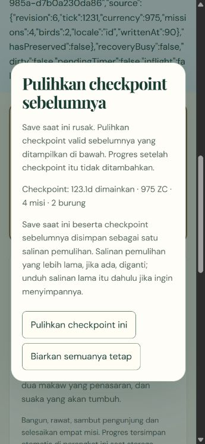
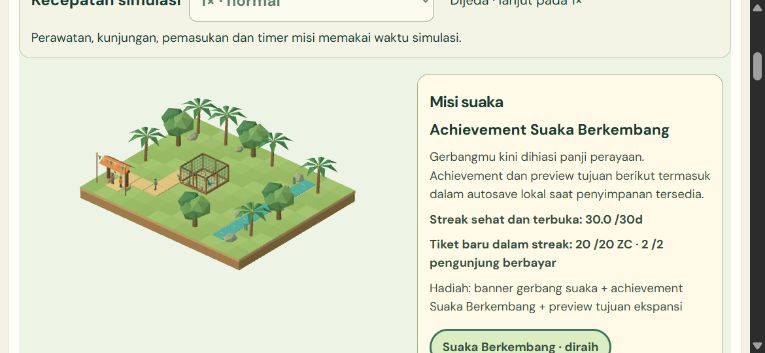

# M5-02 - Save validation, migration and explicit recovery

**COMPLETE for the PRD validation/migration/corruption-recovery slice. V136/51 (70.59%), M5 2/7.** Local implementation `8e693f753f4d5f30765495de1f7d35993f6e99b7`. Optional download verification remains **BLOCKED/UNRUN** as detailed below; no downloaded-file success is claimed. Production unchanged. M0-01 and M4-07 remain unchecked.

## Player behavior and data preservation

An unreadable save blocks Play/new-game overwrite and Continue. The player can review a validated previous checkpoint, see its simulated time, coins, mission count and placed birds, then Cancel or explicitly confirm restoration. Cancel leaves all stored records exactly unchanged. A successful restoration keeps the unreadable current record and previous checkpoint together as a recovery copy, installs only the validated previous state, and enables paused Continue. Progress after that checkpoint is not invented. With no valid backup, unsafe unrepresentable source data, or unsupported future version, automatic recovery stays blocked and the original is retained. There is no silent wipe, guessed default state, reset or offline catch-up.

The actual existing M5-01 envelope format1 is supported. Before Continue, the player reviews and confirms format migration. Full state payload bytes stay unchanged; format2 adds a generation identity so recovery cannot make an old writer appear current merely because a numeric revision matches. `ZooSaveV1` remains game schema1; no historical schema0 was invented. Unknown envelope/game schema versions are rejected without downgrade even when an older backup exists. Complete existing world/occupancy/path/reference, animal/resource, visitor/admission, economy/compacted ledger/refund/reward, mission/unlock and preference validation is reused before any state enters the simulation.

Critical states, explanations and controls are bilingual. Dialogs use native focus/Cancel semantics,44px-plus controls, constrained scrolling in landscape and text cues beyond color. Errors do not render raw stored strings as HTML. The game is paused before review and closed before a confirmed transition; successful recovery clears transient session/Undo data only after the atomic storage transaction, then waits for explicit Continue/Resume. Failed recovery never enables new-game overwrite.

## Atomic storage and conflict rules

The same local IndexedDB database/store is reused, with three bounded keys: `primary`, `previous`, `preserved`. Ordinary commits retain the prior valid primary as previous-good. A migration/recovery uses one readwrite transaction that rechecks both raw records against a one-use review quote, archives both source records, and writes the new generation checkpoint. Quota/abort after archive-put rolls everything back. A changed primary or backup invalidates the quote before replacement. Duplicate confirmations can commit only once.

The archive is **one latest recovery copy**, not unlimited version history. Its replacement is explicitly disclosed in the confirmation dialog; an earlier recovery copy can be retained separately by the player before confirming. Ordinary autosaves retain it. The optional export representation is bounded tagged data preserving values that lossy JSON serialization would conflate. Actual browser download completion has not been verified and must not be assumed.

Exact bounded raw signatures distinguish missing/undefined/null/nonfinite numbers and negative zero, sort object keys, and reject cyclic/nonplain/deep/oversized inputs. This signature is used for compare-before-replace, not as a claim that malformed progress is playable. Complete state validation remains mandatory. Stored content is untrusted data; no eval, arbitrary code, Mesh/DOM/class instances or remote transmission.

Normal commits compare numeric revision plus the generation actually observed by that backend instance. A restored checkpoint rotates generation even if its revision is lower or numerically equal, preventing ABA stale-writer overwrite. BroadcastChannel messages include generation; an old active tab freezes on changed generation. CAS still protects storage when notifications are absent. A previously started successful write cannot clear an already received conflict. The same single2s debounce/latest-reader/inflight coordinator is retained; no duplicate simulation or render scheduling.

## Final-source evidence

Run `20261101T203855Z-16809bd3`; source `bd3cd7f386e1c85d45cd74a6357a3f3678d92715ecd9089497932822f36f4e4b`; build `84ab52f3470a5a758067c1b52bc3d2ee0cf9fd6695ac1f92229433718afaf779`. Evidence is read-only observed through the approved isolated in-app browser and source-bound local runner. Commands:

```powershell
node scripts/qa/qa.mjs local
node scripts/qa/qa.mjs serve
node scripts/qa/payload.mjs
node scripts/qa/qa.mjs verify 20261101T203855Z-16809bd3
```

- **418 unit/integration tests PASS**, including14 new recovery cases;159 Astro files, zero errors/warnings/hints. Nine routes, direct `/play`, original journal titles/H1/canonical and nine-URL sitemap pass. No dependency change or Actions.
- **54 recovery browser cases PASS**,18 each at1366×768,360×780 and780×360: legacy Cancel/exact migration, malformed/truncated/oversized/ledger/occupancy/missing-field/missing-primary restore, interrupted/quota atomic rollback/retry, future envelope/state rejection, no-backup preservation, stale primary/backup review, duplicate confirmation, temporarily unavailable storage and same-revision generation ABA. These are explicitly seeded own-DB fixtures and injected native storage exceptions, not naturally occurring physical disk exhaustion. Every final fixture asserts **0 export requests**.
- **27 prior storage cases PASS**,9 per viewport, retain M5-01 full compacted state, money/reward replay and concurrency protection. No repeated full280-case renderer chain was claimed in this slice; current418 tests, targeted lifecycle checks and native gameplay are final-source evidence.
- **Fresh native Q01→Q04 on the final built product**: new sanctuary starts1500 ZC, actual free cancelled preview, real habitat/five added path tiles, two birds, food/water/perch use, paid visitor journeys and all four real claims. Four actual reload/Continue pairs preserve exactly six visible groups (balance, cashflow, mission, per-bird summaries, world, speed) plus saved tick. No state/time injection. After Q04, balance973, ticket income50, mission rewards60, construction595, supplies36 and upkeep6 reconcile to1500; no duplicate mission money. Later continued care/visits also reconcile. This new evidence closes the earlier M5-01 candidate-source boundary without relabeling its history.
- **Actual legacy native save migration**: existing localhost M5-01 format1 checkpoint was reviewed/confirmed once. Saved tick, coins, four completed missions and two birds remain equal; paused Continue advances no offline time. A truncated tool-output outcome was checked through saved observations/tab closure before further action; migration was not repeated blindly.
- **Cold tab reopen/settings/two tabs**: actual close/new tab on the same fresh origin restores Q04 exactly; ID and1×/10× survive reload. Real second-tab Continue locks the older active tab with actual inert controls and unchanged balance; user Reload retrieves the winner without reset. This is not a complete browser-process restart.
- **Actual visuals**: desktop/portrait/landscape product canvas and EN/ID recovery dialogs are inspected pixels. Dialog button geometry is47.7px high, mobile document widths345/765 inside360/780. Initial fixture screenshots inherited EN through shared settings, so their filenames were corrected to EN and a separate actual ID dialog captured. The landscape dialog intentionally scrolls; keyboard Tab reaches Cancel. This does not pass later whole-HUD M5-04 polish or physical Android/touch.
- **Lifecycle**: real fixed ticks pause/resume, explicit `WEBGL_lose_context` failure/retry, three paused remounts preserving117 authoritative fields. One session/subscriber/RAF maximum, exact event/tick/visual clocks; final zero canvas/pending frames/geometries/materials/textures/programs/subscribers and zero cleanup errors. Injected failure logs remain separate from empty uncapped native product console. Callback timing/shared heap are not presentationFPS or GPU proof.

The fresh test origin127.0.0.1:4332 preserves the existing127.0.0.1:4321,localhost:4321 and candidate4331 saves. All are local owned test origins, not remote production. No origin was used to retry the cancelled download. Original source transcriptions, media, journal content/metadata/analytics, dependencies, deterministic gameplay/renderer rules and earlier receipts are unchanged.

## Cancelled download permission incident

One optional test cell registered a download event waiter and attempted the preserved-copy button on `http://127.0.0.1:4322/tests/browser/.generated/recovery-harness.html`. A permission card repeatedly appeared; owner reported the loop and parent cancelled the pending card. The blocked cell eventually reset its browser session. It is **uncertain whether the click reached the page or the event subscription triggered the gate**; no produced file or completed download was established. Read-only source audit found one click handler with one anchor click, no auto-export/loop/retry in app or fixture. The gate's internal repetition cause is unverified, so no claim is made that an app loop was fixed.

The recoverable QA behavior is corrected: routine recovery and prior storage fixtures explicitly disable export at mount, hide the control, return before backend export/Blob, and assert zero export requests. A unit regression proves load/review/migration/recovery/Continue never auto-export. The repeatable recipe prohibits download waiters/clicks in routine QA. Production export remains an explicit user action with truthful prepared/complete-or-cancel browser copy, not a false saved-file claim. **Actual download verification is BLOCKED/UNRUN. No retry, alternate download route, permission widening or further owner approval request.** Source/audit/cancel evidence retained in `qa/m5-02/attempts/download-approval-block.json`.

## Payload, hygiene and remaining gates

Shell302,275 raw bytes; first preview935,921 raw/249,639 gzip-level9 estimate. M5-01 first preview923,819 raw/245,776 estimated gzip; this slice adds12,102 raw/3,863 estimated gzip bytes. No new model/texture or dependency. Lazy renderer633,646 bytes is unchanged; its existing chunk warning remains for measured M6 work. Actual network transfer, first interaction, GPU/presentedFPS and physical-device performance remain UNRUN.

Initial type/Node strip-types/unused-import/paused-test failures and candidate2 evidence retain original identities and hashes; none are claimed final-source passes. Final raw logs, eight screenshots, source fingerprints and bounded archives are retained. Before generated-only pruning, CRC and every-entry SHA are verified; exactly three ignored QA runs remain. Source/media/rollback/original native saves are not deleted. Owned tabs and preview servers closed; viewport reset and4321/4322/4331/4332 free.

M5-03 pause/background/restart/reset confirmation is next. M5-04/05/06 retain responsive/localization/settings completion; no full UX gate claimed. M0-01 external Cloudflare settings and M4-07 unavailable recording remain unchecked. Physical Android/iOS/Safari, native background, whole browser-process restart, presentedFPS/GPU/network, full15minute populated soak, unaided human testing and live production remain UNRUN. No push/deploy/Actions/login/new permissions. Stop by **08:00 WIB2 November /01:00 UTC2 November2026**, preserve a safe checkpoint and wait for further owner instruction.




