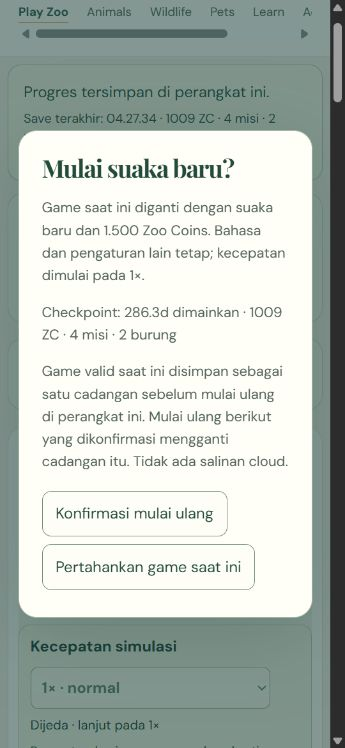
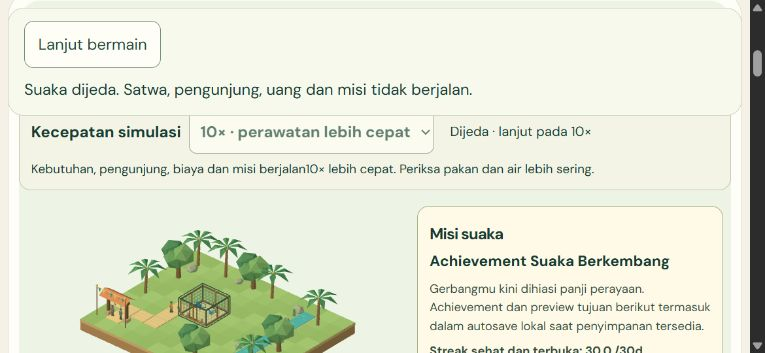

# M5-03 - Explicit pause and recoverable restart

**COMPLETE for pause/background logic and confirmed restart. V137/51 (72.55%), M5 3/7.** Local implementation `ba7860ab9f959787cf6a2b380b336ddb41a29838`. Native background could not be exercised by the supported IAB surface and remains UNRUN; injected listener coverage is explicitly separate. No production changes.

## Player behavior

The running zoo has a visible sticky Pause/Resume control with ID/EN explanation. Pause freezes animal needs/behavior, visitors, economy and missions, preserves chosen speed and requests a safe local checkpoint. A returning or continued game remains paused until the player explicitly resumes. Hiding/pagehiding the document also holds the game paused and flushes the checkpoint; foregrounding alone does not authorize catch-up or resume. Fixed-clock wall anchors reset on resume, so time away produces no income, maintenance, resource consumption or mission progress.

Manual, Continue, background, storage conflict and replacement holds have separate ownership. Closing Help, a care confirmation or another overlay cannot release a manual/background/storage hold. Renderer-local care dialogs retain their own temporary hold; the outer app hold is separate. Displayed status includes every open dialog. PAUSE-503-01 was found through real native interaction: care confirmation stopped the simulation but the new session status said running. The display was corrected without conflating pause owners, and final native/three-viewport regressions pass. No second simulation, timer-based game loop or RAF chain was added.

Restart is a review/Cancel/Confirm action. The review first pauses and drains current pending progress, displays checkpoint time/coins/missions/birds, and explains the backup boundary. Cancel/Escape does not replace data and leaves the game safely paused. Confirm installs a genuine fresh saved game with1500 ZC, zero missions, reserved birds and1× speed; other preferences remain. Continue then opens it paused. A visible restore option can return the full pre-restart game once, also after reload. It replaces rather than merges progress, so money/rewards cannot be duplicated. Its cancellation leaves the fresh game unchanged.

Reset tests use only new verified-empty4333 candidate/4334 final test origins and bounded `myzootwin-qa-restart-*` fixture databases. Earlier native save origins are untouched. No unrelated owner save was reset.

## Storage and lifecycle contract

The existing game schema1 and storage envelope2 remain compatible. IndexedDB now has four bounded keys: `primary`, `previous`, `preserved`, `restart`. The restart record stores one pre-restart primary/previous pair and a restored marker. A later **confirmed** restart replaces that one backup; this is disclosed before confirmation. The earlier unreadable-original `preserved` copy remains unchanged. Restoring marks the backup used but retains its data, and moves the replaced current checkpoint into previous-good. There is no destructive default wipe or unlimited archive.

A one-use quote checks exact primary, previous and backup values inside the same atomic readwrite transaction that stores the backup and new generation checkpoint. Quota/abort after backup-put rolls everything back. Concurrent changes invalidate review; duplicate quotes cannot commit twice. Generation rotates even at the same numeric revision, so an older tab cannot overwrite a fresh/restored game. Corrupt/future saves must follow validation/recovery instead of using reset as a bypass. Storage failure reports unchanged last-good data, and safe Retry can persist the old active game. Late asynchronous metadata reads cannot restore obsolete UI after replacement.

The coordinator's replacement hold is synchronous before old renderer closure. New authoritative session data is cleared only after a successful durable replacement; failure retains the old game. Continue rehydrates with a new wall-time anchor, preserved economy/admission/reward proofs and no offline progress. Background/pagehide, cancelled imports, error/retry and remount release owned resources and retain exactly one lifecycle owner.

## Verification

Final run `20261101T212337Z-ff879b47`; source `ffec32a23b89c9454604240b4647fccde4a2e6e934adee3efc97afde14d73e00`; build `d183c7cad874a9a8b546ec5cdd72098858c04e6f02f73387e9816c37189611f1`. Commands from `C:\MyZooTwin`:

```powershell
node scripts/qa/qa.mjs local
node scripts/qa/qa.mjs serve
node scripts/qa/payload.mjs
node scripts/qa/qa.mjs verify 20261101T212337Z-ff879b47
```

- **433 unit/integration tests**, including15 new pause/restart tests;163 Astro files with zero errors/warnings/hints;9 route/canonical/sitemap checks pass. No install or Actions.
- **48 actual-IDB restart cases** (16 per desktop/portrait/landscape) cover review/Cancel, exact backup, fresh Continue/remount, full compacted4-mission restore/exact-once rewards, normal autosaves/repeated reset, quota/abort rollback/retry, stale review, same-revision generation ABA, duplicate confirmation, corrupt/future rejection, manual pause/dialog closure, real care-confirmation pause status/Cancel, injected visibility and injected pagehide. Failures/starting snapshots are explicit fixtures, not naturally occurring quota exhaustion or native background.
- **54 previous recovery and27 autosave browser regressions** pass on the final source. All recovery/restart fixtures disable export and report zero export requests. The prior cancelled download remains untested; no download action or permission request occurred here.
- **Native final product:** fresh habitat/path, two-bird food/water/perch care, real paid visitors and Q01–Q04 claims; real Pause/Help-close and reset Escape/Cancel; reset/reload/Continue verifies1500 coins,0 missions,0 placed birds,tick0 and1×. Confirmed restoration/reload recovers the original six visible groups plus saved tick exactly, with no repeat restore button. Original balance999 with60 mission coins is restored intact. Native care Cancel changes no player-command or refund transaction. Cold tab close/reopen is exact; full browser-process restart remains UNRUN.
- Native phone ID at360×780 and landscape ID at780×360 verify pause at1×/10× and reset cancellation. Real second-tab Continue locks stale reset/resume controls; Reload retrieves saved progress. Journal navigation/Back/direct reload leaves zero canvas and correct canonical.
- Three paused renderer remounts and explicit context-loss retry preserve117 authoritative fields. One session/subscriber/RAF maximum; paused ticks hold and resumed ticks advance. Disposal leaves zero canvas/RAF/geometries/materials/textures/programs/subscribers and zero cleanup errors. Injected failure logs are separate from empty uncapped native console observations.

The actual native background probe creates/closes a second owned IAB journal tab and reads `document.hidden/visibilityState`. This surface reports visible throughout, so **native background is UNRUN**. No browser/OS workaround or new permission was attempted. The explicit own-document getter/Event and PageTransitionEvent cases exercise the actual app listeners and are labelled injected. Viewport testing is not physical Android/native touch; no native background, full browser restart, presentedFPS/GPU, network, full15minute populated soak, unaided-human or live-production pass is claimed.

## Evidence identity and hygiene

During final packaging, a persistent REPL helper closure still referenced its original candidate3 folder/object after variables were reassigned. Product tests ran against the final build, but native observations accumulated in a mixed raw log with an old container header. The raw log is preserved unchanged. Exactly14 final native rows are selected unchanged using the exact final entry script, `native-final` labels and timestamps after final browser start;15 candidate rows are excluded. Final fixture files independently carry final-run database identities, and the current final six-case receipt carries final run/source/build IDs. Independent verification checks the extraction, source/build identity, timestamps, actual screenshots and cleanup. See `writer-scope-provenance.json` and `writer-scope-raw.json`; candidate evidence is not silently relabelled. The older reader's fallback label for unnamed dialogs is not used as dialog identity proof.

Initial4 check hints, the absent formatter helper, superseded local gates and the actual candidate3 pause-status defect are retained with honest status. Candidate3's browser receipt remains incomplete; final acceptance uses the new final-source observations. Eight actual screenshots and bounded raw logs/archives are retained. Before pruning only named owned ignored QA runs, CRC and every-entry SHA are verified. Exactly3 generated runs remain. Original requirements/source transcriptions, journal content/URLs/SEO/analytics, media, dependencies, earlier evidence and native saves are preserved.

Built shell314,726 raw bytes; first preview948,372 raw/252,656 gzip-level9 estimate. Compared with M5-02 this adds12,451 raw/3,017 estimated gzip bytes. Lazy renderer633,646 raw bytes is unchanged; existing chunk warning remains M6 profiling work. Fonts/actual transfer/first-interaction/FPS are not measured. No new art/assets/dependencies. Owned tabs/servers close, viewport resets and4321/4322/4333/4334 are free.

Next **M5-04 responsive HUD/input**. Current mobile HUD density and development copy remain later UX/localization polish, not a full quality claim. M0-01 exact external Cloudflare settings and M4-07 unavailable recording remain unchecked;12 M7 items deferred. The old download cancellation remains BLOCKED/UNRUN and was never retried. No push/deploy/Actions/login/access changes. **Hard stop01:00 UTC /08:00 WIB2 November2026**, preserve a checkpoint and wait beyond that cutoff.




