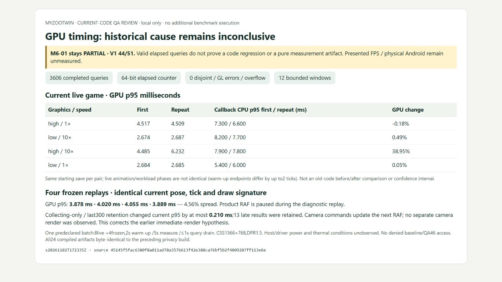

# M6-01 bounded GPU timing investigation — 2 November 2026 UTC

**Result: INCONCLUSIVE historical cause.** The bounded investigation is complete; M6-01 remains **PARTIAL**, V1 **44/51 (86.27%)**. Valid new timer results do not establish that the old increase was a code regression or a pure measurement artifact. No product optimization was justified or made. Local QA implementation **`87517d75cfff5f5572f37efeb0909817bbcc5cba`**; [acceptance](qa/m6-01-gpu-investigation/acceptance-matrix.json), [independent analysis](qa/m6-01-gpu-investigation/independent-analysis.json), [next step](qa/m6-01-gpu-investigation/next-step.json).

## Comparison plan and source boundaries

[Plan](qa/m6-01-gpu-investigation/comparison-plan.json) was written before new sampling. One batch only: eight current live windows in order High1,Low10,High10,Low1,Low1,High10,Low10,High1, followed by four replays of the same paused current scene/pose/tick. Each has2s warm-up,5s measurement and at most1s asynchronous query drain. Actual drain11.1–22.7ms. CSS1366x768,DPR1.5,visible document. No concurrent build/unit/CPU benchmark during collection; unrelated host work, power and thermals were not controlled or claimed absent.

Current pairs use exact matching initial save hashes and buffers. High1192x957 and Low795x638 match original desktop buffer sizes. Live warm-up endpoints differ by up to2 simulation ticks; animation/visitor/draw phases remain variable. The four frozen replays have the **same core save hash/tick and identical62draw/14820triangle/1192x957 signature** in one current context. Product RAF is paused; a bounded diagnostic RAF replays captured scene/camera arguments without simulation updates. All frozen core hashes remain equal. This is GPU workload repeatability evidence, not playable-session speed or FPS.

Historical before/after values were single5s windows with1s warm-up (plus one final desktop repeat). Old summaries retain endpoint counts and GPU aggregates, not individual query data. The owner preview was live then and is absent now; later code/build dependencies and the new warm-up differ. Current results are therefore **not a historical before/after rerun**. Seven historical JSON receipts were read;64original evidence hashes match. The frozen baseline archive was not extracted or executed, and port4323/QA46 was not used.

## Timers, results and correction

Sampler records asynchronous completion latency, origin, draw counts, buffer, CPU submission and callback time; verifies elapsed-counter bits, disjoint, GLerror, bounds, skipped/pending/invalid records. [Khronos timer guidance](https://registry.khronos.org/webgl/extensions/EXT_disjoint_timer_query_webgl2/) requires delayed availability and disjoint checks; these query elapsed values are not displayed-frame measurements. The masked environment is Chromium WebGL2 / WebKit WebGL, requested actual context low-power/antialias:true. No physical GPU model/power/thermal identity is inferred.

**3,606 complete64-bit queries**, zero disjoint flags, GLerrors, overflow, skipped, invalid or pending results. [Raw rows](qa/m6-01-gpu-investigation/raw-current.json) retain all samples. Independent recomputation of nearest-rank percentiles matches all summaries exactly. CPU callback includes simulation/UI/submit work; synchronous renderer-submit CPU is separately measured, and neither is GPU elapsed time. Render-submit p95 ranges1.2–1.8ms in live windows; full callback p955.4–8.2ms. No reciprocal FPS claim.

Descriptive live values, milliseconds; no confidence interval or independent-sample significance claim:

| Graphics | Speed | GPU p95 first | GPU p95 repeat | Callback CPU p95 first / repeat |
| --- | --- | --- | --- | --- |
| high | 1x | 4.517343 | 4.509062 | 7.30 / 6.60 |
| low | 10x | 2.674166 | 2.687239 | 8.20 / 7.70 |
| high | 10x | 4.484843 | 6.231875 | 7.90 / 7.80 |
| low | 1x | 2.683541 | 2.684947 | 5.40 / 6.00 |

High10 live p95 varies **38.95%** between these current-code windows, with different warm/live phases; that is not a version-change regression. Frozen p95 values are **3.878333,4.019895,4.055260,3.889270ms**, a4.56% range relative to the minimum. The controlled frozen result shows current repeatability, not proof that the old doubling was noise.

Computing the old collecting-only/last300 retention rule from the **same new rows** excludes13late completions; maximum absolute current p95 difference **0.209634ms**. This quantifies a current retention effect, but the old raw records are unavailable, so its historical magnitude cannot be reconstructed or asserted as the explanation.

**Correction:** the initial concern that camera commands cause separate immediate GPU renders is not supported. Source delegates to camera controls that update the transform; the next RAF renders it. The new eight live windows have four camera commands each and all timed submissions are RAF-origin; frozen submissions are replay-origin. The earlier M6-01 report sentence claiming immediate extra camera renders is corrected. The initial pre-sampling hypothesis remains preserved in the audit, explicitly superseded by this finding.



## Verification and preservation

Final **`s20261102T172335Z`**, source **`45145f5fac6380f8a011ad78a3576613f42e388ca76bf5b2f4009287ff113e6e`**, isolated build **`86adcf5502d7aa8b5b86f5a0d3964bfcde144638254569b4041f55028c5cc69a`**. **485unit tests PASS** (four measurement-integrity additions); **205checked files/zero diagnostics**, build/directplay/sitemap/nine-route smoke PASS. New tests use labelled synthetic rows for drain/truncation/disjoint/invalid/error paths; the12windows use actual WebGL queries. Generic browser-template field remains UNRUN; no physical/touch/cross-browser/nativebackground/speaker/browser-process restart/presentationFPS claim.

First new harness gate failed only the strict zero-hint criterion: unused replay callback argument,485unit PASS/0check errors/0warnings/1hint. The argument was removed and final gate passed; [initial failure](qa/m6-01-gpu-investigation/initial-failed-check/check.log) remains intact. This is unrelated to the unexplained original M6-03 fixture-import failure, which remains open.

All24emitted product artifacts byte-match the preceding privacy build by relative path; build IDs include different run paths, so ID inequality is not treated as changed output. Only QA scripts/tests changed. Eight contexts disposed, at most one product RAF pending; all geometry/texture/program/material/subscriber/frame/error counts return to0. Owned QA tabs24/25 closed, viewport reset; product/source QA and script-free result-review servers stopped. Ports4322/4323/4345/4346/4347 free. Owner4345 was already absent, never restarted or accessed; olddist and three existing rollback archives exact unchanged. Original source/media/saves and failed evidence retained. One new final build retained; no cleanup deletion in this pass.

Reproduce only current-code permitted QA:

```powershell
$env:PUBLIC_GA4_ID = 'G-QACONSENT000'
$env:MYZOO_QA_SCOPE = 'gpu-m6-01'
node scripts/qa/settings-isolated.mjs local
node scripts/qa/prepare-gpu-attribution.mjs
node scripts/qa/settings-isolated.mjs serve
```

Open the generated current-only `gpu-attribution-harness.html` through the supported browser, verify identities and run its one12window batch once; close own contexts and type `stop` afterward. This recipe does not authorize any previously denied historical comparison. Report screenshot is a script-free review of completed raw data, not an additional profile or actual-canvas quality test. Screenshot encoded pixels can differ from CSS viewport scaling.

## Remaining gate and next action

No confirmed local renderer regression was found that could justify changing shaders/quality. Historical attribution stays open because the original raw query/workload/host traces were not retained and the optional frozen historical repeat remains **BLOCKED/UNRUN**. The exact denied action was navigation of QA46 to `http://127.0.0.1:4323/tests/browser/.generated/populated-performance-harness.html` after a browser-generated `data:` connection-error page; later viewport cleanup was also denied and Close UNRUN. None was retried or bypassed; recovery download likewise untouched. No new denial/pending permission or uncertain mutation in this pass.

For a causal conclusion, a separately permitted controlled before/after design needs matched workloads/raw query records plus host/driver/power conditions. This is **not** authorization to retry the denied operation. Actual target-device/presentation measurements remain required for the hardware gate or parent must explicitly decide acceptance handling of documented limits. The next independently actionable recommendation after review is the minimal permitted **M6-03 import-failure investigation**; it was not started here. Notices/legacyart/legal/Cloudflare/human/recording and other inherited gates remain unchanged. No push/deploy/Actions/login/credentials/permissions changes. Stop for parent review.
