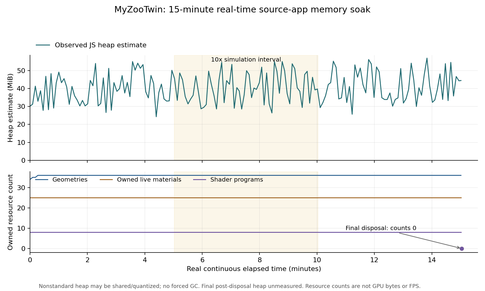
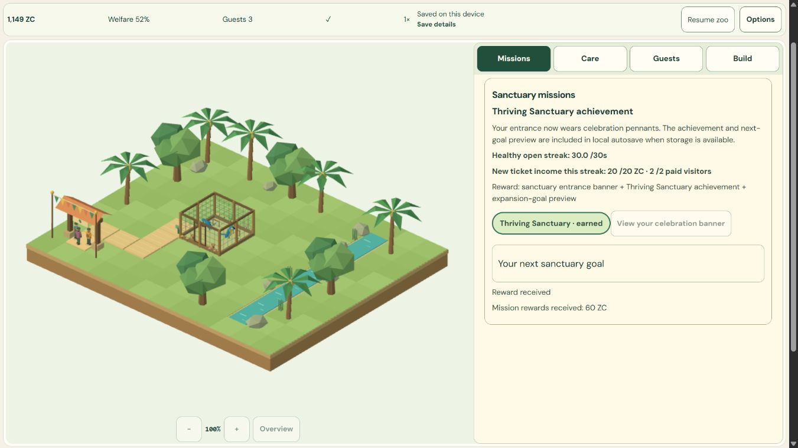

# M6-02 payload, memory and error recovery - COMPLETE

2026-11-02 UTC. Local only. V1 **41/51 (80.39%)**, M6 **1/8**. This completes M6-02's measured-bundle/soak gate; it does not clear M6-01's GPU/presentation/physical-device gate or authorize production release.

## Acceptance and source identity

Canonical requirement: "Compress/lazy-load game assets, review initial payload / memory leak / error boundary. Verify: measured bundle and soak test."

| Required result | Evidence and boundary |
| --- | --- |
| Measured initial assets/lazy loading | PASS first-party graph: shell 354,769 raw, first play 990,113 raw bytes; gzip9 estimate 263,201, Brotli11 estimate 221,628. Renderer absent before opening and requested once after Continue. |
| Justified optimization | PASS allocation scope: 10,000 muted/unstarted audio inspections previously allocated 10,000 Float32Array sample buffers /20,480,000 transient bytes; final code allocates none of those buffers. Identical status output; real audio signal/lifecycle separately checked. Other JS objects still allocate. |
| Populated real-time soak | PASS 900.675s continuous wall-clock session, 956.237s including preconditioning; actual app/RAF/IDB, real visible-control care,1x/10x and settings. Eight initial remounts + final exact Continue,10 disposed sessions. |
| Memory/resource lifecycle | PASS observed scope: max1 active renderer/RAF; every disposed geometry/material/texture/program/RAF/subscriber count and cleanup error returns0. Optional heap fluctuates; not proof of all future leaks or retained/GPU memory. |
| Error boundaries/recovery | PASS actual WebGL retry, explicit unavailable/init/import/context-loss/render faults, delayed-import unmount, actual audio graph/unavailable factory, storage quota/abort/unavailable/CAS and backup restoration. Original save protected. |
| Native compiled regression | PASS final actual compiled Continue, care purchases,1x/10x, pause, ID Low portrait, EN High landscape/desktop and exact reload. Existing owned Q01-Q04 save retained; no state/clock injection in this product run. |

Implementation **`54aa5b87e48f982f8ce93244386e7ae956d9a1fb`** local only. Final run `s20261102T080144Z`, source **`fbfd5750dd265ae81847d3f2d82d087f5493de986daf295abf9e783b65a25027`**, build **`5ce3d9d208270702ee9c71b77e0ed45a3367aa672f6377de6eda06527579d0c7`**.457 unit/integration tests; Astro check186 files,0 errors/warnings/hints;9 routes/canonicals/direct-play/sitemap.63 targeted browser fixture cases: recovery19,storage9,HUD19,restart16. The generic six-case browser template remains **UNRUN**; targeted evidence is explicit and separate.

[Independent audit](qa/m6-02/independent-audit.json), [local gate](qa/m6-02/final-local/report.json), [payload and module attribution](qa/m6-02/final-local/payload.json), [complete fixture matrix](qa/m6-02/regression/matrix.json), [native receipts](qa/m6-02/native/results.json), [final raw soak](qa/m6-02/soak/final.json).

## Changes and measured payload

No new dependencies, external model/audio downloads, engine migration or arbitrary chunk splitting. Existing minification and optional renderer import retained. The lazy renderer is635,344 raw bytes; the >500kB Vite warning remains visible. Retained pre-minification module attribution shows Three core/render modules dominate the renderer; locales, actual preview UI and save validation dominate the entry. Those retained module lengths are not additive compressed transfer attribution. No justified removal of original journal assets or correctness code was found.

Actual final-build delivery observer logged **4 responses / 989,785 raw / 263,709 gzip6 body bytes**, excluding its health fetch. Favicon328 bytes was not re-requested on the reused owned QA origin; the conservative five-file graph above includes it. Each observed body SHA matches the final graph. This delivery occurred before a fixture-assertion-only revision; byte-for-byte graph comparison bridges it to final build. Earlier full fresh-origin delivery is retained in candidate history with its own source identity. No cache/profile inspection or clearing.

The local Astro HTML response also reported gzip and its decoded bytes match the exact build. gzip9/Brotli11 values are offline estimates; the static observer used actual gzip6 body lengths. HTTP headers, opaque/external fonts, browser cache effects and Cloudflare/mobile latency are excluded. A read-only browser performance API was unavailable; no private API/driver route was tried. This is not a universal first-interaction or total-network certification. First-party graph is below20MB; complete static build including preserved journal content is4,055,731 bytes.

## Recovery defect found and fixed

**MEM-602-01:** when the primary checkpoint was unreadable, entry initialization cached Auto/normal-motion/muted defaults. Restoring a valid backup later adopted its state but Continue re-applied stale cached preferences, overwriting Low/reduced-motion/sound-on. Diagnostic full-state comparison proved exactly those three fields changed.

Effective saved settings now refresh after recovery/reset replacement and before Continue opens the renderer. Explicit manual menu choices retain precedence; sound is never unlocked by hydration. All six damaged/missing-primary variants now compare the entire resumed payload exactly. A new manual-precedence case validates all gameplay fields, exact preserved corrupt original and valid preceding checkpoint while correctly allowing normal sequential preference autosaves to rotate previous. Unreadable originals, previous checkpoint at transition, money/rewards and missions are protected.

Historical failures remain: initial new-tool JS inference errors; original product mismatch; new-test duplicate Settings selector; two overstrict post-autosave backup assertions. Those test corrections use visible entry controls and distinguish atomic restoration from later legitimate autosave rotation; they do not relax full game-state/original-preservation validation. A closed-stdin helper required stopping its exact identity-verified QA child; its nonzero process exit/cleanup receipt is retained.

## Final soak and interpretation



Whole valid four-mission starting fixture, two autonomous macaws, care objects, connected habitat, paid visitors and real autosave. No state/time patches during timed gameplay. Eight5-second preconditioning run/close/Continue cycles, four full entry remounts; then15 real minutes with1x/10x/1x, actual care refills and Auto/Low/High plus ID/EN settings. Short intentional settings pauses are part of the real session, not offline catch-up. Final full entry remount compares exact payload while paused. Default muted audio; real graph and failure/disposal checked separately.

184 bounded samples. Final saved tick37455, 1467ZC,4 missions/reward60ZC,2 birds, 125 paid admissions/1250 ticketZC, 2 journal compactions. No dropped simulation time. Max1 renderer and pending RAF; final0. All10 released sessions have0 live owned counters/subscribers/cleanup errors. Every9 roundtrip payload hash pair matches.0 export requests.

Heap estimate observed 24.25-56.89MiB across all samples, with rises and falls. Nonstandard heap may include shared/quantized runtime/QA state; no forcedGC or final post-disposal heap sample. Renderer counts are not GPU allocation bytes. This is a real source-integration app/renderer soak through Vite with builtCSS, not minified-bundle retained-heap profiling. Separate final compiled native smoke supplies actual product/pixel evidence. Callback counts are not displayed FPS. The earlier900.459s healthy soak is archived as a pre-recovery-fix baseline, never relabelled final.



Actual compiled product at DOM-verified1366x768,360x780 and780x360 CSS viewports; delivered JPEG bitmap sizes differ and are recorded separately, not physical display dimensions; ID Low/reduced motion and EN High. Native reload retained tick/balance/missions/birds/generation exactly before explicit Resume. The final screenshot follows a brief Resume/Pause, so its tick can be later than that exact comparison. No physical Android/touch/browser-process restart/native-background/speaker/presentedFPS claim. Audio signal was actual WebAudio; no microphone or OS-audio settings.

## Error and cleanup limits

Standalone preview fixture's delayed-load Return control was in a nonvisible HUD slot: direct close UI **UNRUN**, no force-click. Its authored unmount cancellation and late-resolution/no-canvas/RAF test passed; actual context/render Retry controls passed. Warnings from deliberate context loss remain labelled. Native compiled console receipt is empty. Supported API observation timed out/reset once during recovery; the already-running tab was inspected first and returned19PASS, with no rerun of an uncertain action.

Owner **4345/PID18816**, earlier dist and saves remain untouched. Only owned permitted QA contexts/servers were closed, viewport reset. Old QA46 close remains **UNRUN** after the earlier denied connection-error-page action; not revisited. Recovery download **BLOCKED/UNRUN** from owner-cancelled permission loop, never attempted here. No login/grants/Actions/push/deploy. GPU-query regression from M6-01 remains **UNRESOLVED**; no GPU optimization/target-FPS claim.

Source/media/immutable PRD transcripts and historical failure evidence retained. Exact named generated caches were CRC/every-entry-SHA archived before cleanup; newest3 memory runs retained. Raw evidence uses `-text` attributes and byte checks. [Candidate history manifest](qa/m6-02/candidate-history-manifest.json), [generated history manifest](qa/m6-02/generated-history-manifest.json), [final guard](qa/m6-02/m6-02-final-guard.json).

## Reproduce

```powershell
$env:MYZOO_QA_SCOPE='memory-m6-02'
node scripts/qa/settings-isolated.mjs local
node scripts/qa/settings-isolated.mjs serve
node scripts/qa/payload-isolated.mjs --http
```

Use the approved in-app browser on the displayed loopback fixtures, verify run/source/build IDs, and run `memory-soak-harness.html` once at1366x768. Leave visible for8 remounts +15 real minutes; do not accelerate the wall clock. Read bounded `#qa-soak-results` through supported DOM observation and retain PASS/FAIL separately. Product4354 is optional owned compiled QA, never owner4345. Storage/recovery/HUD/restart fixtures use only bounded named own databases; export remains disabled. Stop owned QA helper with `stop` + Enter using an interactive PTY. No standalone driver/CDP/browser-profile access. Payload script rejects stale source/build/module analysis.

M0-01 external Cloudflare settings, M4-07 recording, M5-07 unaided human study and M6-01 physical/presentedFPS/GPU attribution remain partial. Next **M6-03 black-box end-user checks**, after parent review. Production not deployed.
