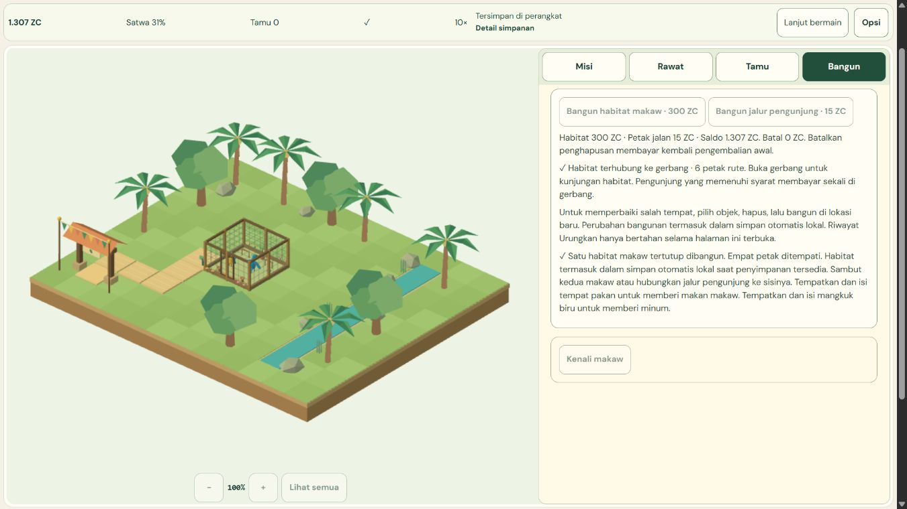

# M6-03 black-box QA - PARTIAL

2026-11-02 UTC. Engineering journeys and two UI corrections verified; **actual physical/cross-browser device acceptance remains UNRUN**. Keep M6-03 unchecked. V1 **41/51 (80.39%)**, M6 **1/8**. No overall-release pass.

Canonical requirement: "Black-box end-user tests across devices, including failure/recovery. Verify: full test evidence." The PRD device matrix names Android Chrome360x780/landscape, desktop Chrome/Edge1366x768 and1920x1080, Safari/iOS if available. This run uses the authorized in-app browser on the Windows host. CSS viewport emulation/native browser clicks are not physical Android, real touch or separate Chrome/Edge/Safari certification. No independent human participant is claimed.

## Verified changes and identity

Implementation **`9c1d6f36c255175877cf778a114befdf024e07e8`**, local only. Final run `s20261102T091845Z`, source **`bf1db4be44ad9d776020d2ce4ae8d26f9dfcd67208787704a1dda399625c6e56`**, isolated build **`24c50c02179cddb4ef329d0c3c091ed97f10881fc15815e4ec489eab4a9205d5`**. [Audit](qa/m6-03/independent-audit.json), [acceptance matrix](qa/m6-03/acceptance-matrix.json), [final local report](qa/m6-03/final-local/report.json), [source reuse bridge](qa/m6-03/source-bridge.json).

**BB-603-01, corrected:** after Continue, renderer DOM metadata reported1 habitat/6path cells/connected, while Build said no habitat/1path cell. Save/world data stayed intact. Repeated loading refreshes cleared cached initial access events before ready. Transient view caches now reset once when entering a nonready state, preserving initialization events during repeated loading notifications. The added integration case compares actual restored topology with user-visible feedback. Final native desktop, portrait and landscape Continue all show6path cells/connected, retaining prior tick, balance, missions, birds and generation before explicit Resume. [Before-fix proof](qa/m6-03/findings/access-cache-before-fix.json), [final native comparisons](qa/m6-03/final/native-continues.json).

**BB-603-02, corrected:** model preview still said English full welfare "arrives later". EN/ID now direct the player to return to the world and open Care for live needs/welfare. Actual clip, angle, animation Pause/Play, habitat scale and return controls were exercised; this preview never claims autonomous care. Corrected EN/ID notices were read in the compiled copy candidate; those locale bytes are unchanged in final source.

**QA-603-01, corrected:** archived M6-02 receipt scripts began participating in Astro checks, producing one unused-variable hint. Strict Astro settings remain. `dist`, dependencies and immutable `docs/qa` snapshots are excluded; **all173 previously resolved live src/tests/scripts remain included**, with no live file lost. Seven archived scripts removed from compiler discovery. Failed gate and raw historical script bytes retained. [Resolved-file proof](qa/m6-03/compiler-inclusion.json). No suppression of live diagnostics.

## Acceptance coverage

| ID | Journey | Result | Evidence scope |
| --- | --- | --- | --- |
| BB01 | Fresh entry, Help, default/manual language | ENGINEERING PASS | D01-D02; P01; L01 |
| BB02 | Habitat/path preview, free Cancel, real costs | ENGINEERING PASS | D03-D05,D10; P02-P04 |
| BB03 | Disconnected topology blocks Q01; Undo reconnects | ENGINEERING PASS | D06-D09; actual15ZC refund/repayment |
| BB04 | Two birds, food/water use, rest and causal welfare | ENGINEERING PASS | D11-D13; P05-P06; paused inspector |
| BB05 | Visitors, paid versus queued, ticket/cashflow feedback | ENGINEERING PASS | D14-D15; P07; source-preserved economy tests |
| BB06 | Actual Q01-Q04 completion and idempotent visible progression | ENGINEERING PASS | D09-D17; P04-P08; final rewards retained on Continue |
| BB07 | Depleted resources/low welfare recover through real care | ENGINEERING PASS | D16; bounded native care polls, no state/time patch |
| BB08 | 1x/10x, Pause and read-only information | ENGINEERING PASS WITH UX LIMIT | D12,D14-D17; P05-P21; Q02 mission guidance disabled while paused, Care Inspect works |
| BB09 | Save/reload, browser Back/Forward, actual cold tab | ENGINEERING PASS | D21-D22; P20; final3exactContinue comparisons |
| BB10 | Reset Cancel/confirm, backup review/Cancel/restore | ENGINEERING PASS | P10-P16; actual4missions/2birds/991ZC exact restore; generation changes |
| BB11 | Apply/Cancel, quality/motion, persistent ID/EN, keyboard/Escape | ENGINEERING PASS | D19-D20; P17-P21; actual menus |
| BB12 | Model clips/angles/pause/scale/return and truthful scope copy | ENGINEERING PASS WITH UX LIMIT | L03-L06; copy-candidate EN/ID actual correction; outer session label still manual-pause state |
| BB13 | Occupied placement cannot confirm; safe cancellation | ENGINEERING PASS | Copy-candidate FINAL-INVALID, disabled native confirm; no forced click |
| BB14 | Final restored connectivity feedback agrees with6path cells | FINAL SOURCE PASS | Final3nativeContinues +newHUDregression |
| BB15 | Storage/corruption/conflict and protected original recovery | FINAL SOURCE INTEGRATION PASS | 19recovery +9usability; labelled owned fixtures,0exports; source-identical storage core |
| BB16 | Renderer/audio failure recovery | REUSED ENGINEERING EVIDENCE | M6-02 explicit failures and true audio graph, unchanged renderer/controller/audio source; not repeated wholesale |
| BB17 | Routes/SEO and journal integration | FINAL SOURCE PASS | 9route/canonical/directplay/sitemap checks; native Animals/Back/Forward |
| BB18 | 1366/1920 desktop,360portrait,780landscape | ENGINEERING PASS WITH CAPTURE LIMIT | CSS viewport/geometry/native controls;1920 viewport bitmap cropped/scaled differently, full-page verified |
| BB19 | Physical Android Chrome, real touch, distinct Chrome/Edge/Safari devices | UNRUN | No authorized physical browser surface provided; emulation is not device certification |

Full raw native observations, screenshots, step timestamps, actual care polls, initial copied-notice/cache failures and pre-final local runs are CRC/every-entry-SHA archived in [walkthrough history](qa/m6-03/walkthrough-history.zip); [manifest](qa/m6-03/history-manifest.json) names each member. Header/footer/journal content and existing URLs were preserved.

## Native journeys and evidence boundaries

Fresh desktop EN: free habitat Cancel,300ZC build, five15ZC path tiles, explicit path-removal Keep/confirm,15ZC refund, Q01 blocked on disconnect,15ZC Undo restores connection,20ZC Q01 claim, food/water/rest construction and real refills, two birds, actual meals/drinks and5-second welfare Q02, paid versus queued visitors and completed viewing Q03, sustained care/new visitor income Q04, manual1x/10x, Pause and actual reload. Journey ended with4missions/2birds/1307ZC before later explicit Resume. ID Low/reduced-motion settings, Cancel semantics, journal Animals link and browser Back/Forward were verified.

Fresh portrait ID: same habitat/path/care/Q01-Q04 loop through native controls; paused at tick7831/991ZC/4missions/2birds. Actual reset review/Cancel preserves progress; confirmed reset +Continue shows1500ZC/0missions/0birds at1x. Restore review/Cancel preserves that new world; confirmed backup restore +Continue exactly returns tick7831/991ZC/4missions/2birds with a new generation. Restore action then disappears, preventing UI replay. Subsequent explicit Resume earned another genuine10ZC ticket; **that later1001ZC is not a duplicate restore reward**. Actual tab close/new tab returns the same then-current saved state, EN language, Low/reduced motion and Pause gate. [Reset/restore](qa/m6-03/portrait-reset-restore.json), [cold tab](qa/m6-03/portrait-cold-tab.json), [settings/keyboard](qa/m6-03/portrait-prefs-keyboard.json).

Independent fresh landscape EN reached Q01 and actual model controls; the completed portrait game was also rotated to landscape for ID restore and EN settings/keyboard checks. These are not six independent complete games. Landscape dialogs were checked inside780x360. Desktop1920 controls/DOM geometry and full-page canvas were inspected; viewport screenshots showed a different cropped/scaled capture boundary, retained as a capture limitation rather than a proven application overflow. Physical1920 display behavior is not certified.

Native actions read actual visible guidance and manipulate product controls, with no game-state/time injection. Read-only DOM save metadata supplements visible balance/mission/save summaries; hidden DOM text can retain old HUD values after leaving a game and is not treated as a visible outcome. Long agent/tool gaps at10x depleted resources and lowered welfare; bounded native refills restored conditions and Q04 qualification. These timings are not unaided-human pacing or retention measurements. Completed objectives remain recorded even when current welfare later falls.

Full fresh journeys used the M6-02 baseline source. Final source differs only in five named paths: preview UI cache reset, two model-notice strings, QA scope, one HUD regression and compiler exclusion. Core/world/animals/visitors/economy/missions/persistence/renderer/assets/dependency source hashes match. Source-unaffected prior evidence is reused explicitly. **No claim of a newly rerun complete fresh final-source golden path**: final changed-path evidence is three exact native Continue/access checks plus48 affected browser integration cases.

## Final verification and failures retained

457 unit/integration tests; Astro check182 files,0 errors/warnings/hints; isolated build and9route/canonical/direct-play/sitemap checks PASS. Owner dist was not replaced.48 final integration cases: HUD20,usability9,recovery19. Actual corrupt/malformed/future/quota/abort/CAS cases use labelled owned fixtures; they are not physical device failures. Recovery export stays disabled and0 requests. [Matrix](qa/m6-03/final/regression/matrix.json).

First HUD execution failed its initial canvas wait with an import/load fallback. Vite logged new dependency optimization near that first fixture; cause remains unproven. Failure/diagnostics are retained; one later serial run20PASS, while all three actual compiled native paths loaded. Do not erase the initial failure or call it a proven product defect/environment cause. Generic six-case browser template remains UNRUN; targeted receipts are separate. Failed selectors were corrected only after current DOM inspection: tab switches clear selection; native animation resume says Play animation; tab roles avoid the root's duplicate data attribute. No hidden/disabled force-clicks.

Known nonblocking UX considerations: Q02 mission navigation is locked with other mission actions while paused, but Care/Inspect/dismiss remains readable and safe; model preview internally freezes sanctuary time while the outer session label reflects manual Pause state, although its notice explains the freeze; singular missing-path count still uses plural English wording. No undisclosed P0/P1 data-loss defect remains from this run. Physical/cross-browser verification and unresolved M6-01 GPU attribution still prevent a release claim.



## Reproduction, cleanup and next gate

```powershell
$env:MYZOO_QA_SCOPE='blackbox-m6-03'
node scripts/qa/settings-isolated.mjs local
node scripts/qa/settings-isolated.mjs serve
```

Use only the approved browser runtime, verify displayed run/source/build, and execute labelled HUD/usability/recovery buttons. Actual product journeys use owned loopback4358/4359/4360 serving the exact isolated build; helper source is retained under evidence tools. No standalone driver/CDP, profile access, fake browser events in native journeys, login or new grants. Stop owned interactive helpers with `stop` + Enter. Sources, original media, immutable PRD transcriptions and old failures remain intact; three generated black-box runs retained, no destructive cleanup needed.

All permitted QA tabs/servers closed and temporary viewport reset by09:28UTC, before the09:45 checkpoint boundary. Owner **4345/PID18816**, old build/saves remain untouched and HTTP200. [Final guard](qa/m6-03/final-guard.json). Old denied QA46 closure stays UNRUN, recovery download stays BLOCKED/UNRUN; neither retried. No push/deploy/Actions/login/access change.

Hard stop **2026-11-02 10:00UTC /17:00WIB** remains. M0-01/M4-07/M5-07/M6-01/M6-03 remain partial;12M7 items deferred. V1 **41/51 (80.39%)**. Next **M6-04 white-box invariants**, only after parent dispatch; not started here.


## Later bounded import investigation - 2026-11-02 UTC

[Investigation](M6-03_IMPORT_FAILURE_INVESTIGATION.md) establishes loader rejection before factory, but historical cause remains INCONCLUSIVE.46archive members verified; original exception/request/timing/cache details missing. No new browser rerun or speculative fix. Current485tests/205check/9staticroutes/24identicalartifacts are regression evidence only. M6-03 remains PARTIAL;currentV1 44/51.


## Later supported Chrome desktop pass — 2026-11-02 UTC

[Current desktop report](M6-03_SUPPORTED_DESKTOP_VERIFICATION.md) adds actual authorized Chrome coverage and fixes a separately reproduced autosave reentrancy defect. Edge/physical/native-background/process-restart gates remainUNRUN;Firefox owner-excluded. Historical initial fixture-import cause above remainsINCONCLUSIVE and is not explained by the new defect. M6-03 remainsPARTIAL;44/51.
