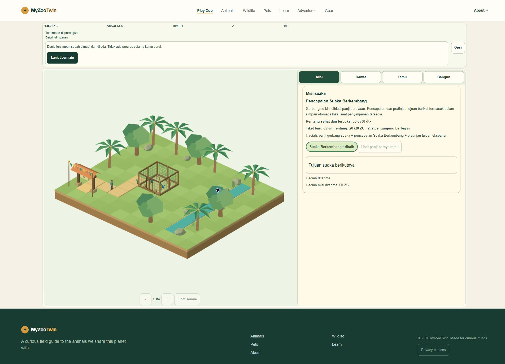

# M6-03 — supported desktop verification (PARTIAL)

2026-11-02 UTC. Start: `9d20aec558ab8aac0c1e089bbfce9cc1ad3c38dd`. Local correction: **`294a28fed1f832c5cc20a83c77c06ed3df42be49`**. V1 remains **44/51 (86.27%)**; whole M6-03 and release remain held.

Actual authorized Chrome was available and exercised. One recoverable autosave concurrency defect was found, reproduced, fixed and retested. This is neither a full cross-browser/device certification nor an explanation of the older M6-03 fixture import failure.

## Browser and device matrix

| Surface | Observed availability | Result |
|---|---|---|
| Chrome, authorized extension browser3, family `chrome` | Fresh owned tabs, native browser controls | Main journey and targeted interruptions verified; CSS1366×768 and1920×1080, EN/ID. Version not exposed by permitted DOM sandbox. |
| Edge | No independently supported Edge surface in inventory | **UNRUN**. Installed status unknown; no install, launch workaround or permission change. |
| ChatGPT in-app browser2 | Available; existing owner public tab left untouched | Prior evidence only; **not counted as another desktop browser/engine** in this pass. |
| Firefox | Owner removed from scope | **EXCLUDED**, not a pass or an inferred waiver of other targets. |
| Physical Android / real touch / presentedFPS | No authorized physical test surface | **UNRUN**. Desktop layout resizing is not physical evidence. |

[Initial inventory/method](qa/m6-03-desktop/engine-matrix-initial.json), [controlled browser/tab identities and limits](qa/m6-03-desktop/browser-identities.json). No personal-tab enumeration, browser history, profile/credential inspection, standalone Playwright/CDP driver or browser/system setting change. Browser-native viewport capability was used for the requested desktop sizes only. New tab initially used its actual default1036×468 before the second explicit desktop size.

## Confirmed correction: reentrant autosave writer

During native Q01→editor interaction on the initial compiled source, cancelling a removal review unexpectedly produced **“Game changed in another tab”** on the sole game tab created in fresh QA origin4361. The game paused safely and preserved the last checkpoint. [Original screenshot](qa/m6-03-desktop/F01-unexpected-save-conflict.jpg), [steps C05/F01](qa/m6-03-desktop/steps.json).

Code inspection found a concrete race: `flush()` emitted its `saving` notification **before publishing `inflight`**. A synchronous UI pause/checkpoint/flush during that callback could start another write using the same revision. The focused exact-CAS reproduction failed before the fix with `conflict !== saved`. The fix publishes the guard before notifying the UI; subsequent checkpoints drain serially. It does not ignore real external conflicts, relax validation, change the schema/ledger or reset data. A regression also checks that the newer locale snapshot, not only the first payload, survives.

[Exact pre-fix failure](qa/m6-03-desktop/reentrant-cas-exact-before.log), [reproducer snapshot](qa/m6-03-desktop/exact-before-reproducer.mjs), [focused24-test pass](qa/m6-03-desktop/autosave-after.log), [source bridge](qa/m6-03-desktop/source-bridge.json). The original native call stack was not instrumented; the code defect is demonstrated and the affected native flows now pass, without claiming it is the sole imaginable cause of the earlier observation. The historical fixture loader rejection remains a separate **INCONCLUSIVE** finding.

## Native results and evidence reuse

All actions below used actual product controls in isolated Chrome tabs, without state/time injection or save-file edits. The compiled bytes were served on loopback-only **127.0.0.1:4361**. No owner-origin save was accessed or reset.

- **Fresh entry/Q01:** homepage essential-only refusal → Play → free habitat Cancel →300ZC habitat → five15ZC path tiles → real connected Q01/20ZC reward. This phase used pre-fix source. World, animals, economy, missions, UI, assets and dependencies are unchanged in final source; only autosave notification ordering and its regression differ. Final source loaded that saved Q01 safely. **No claim of a second fresh full Q01–Q04 run on final source.**
- **Final repeated editor:** three removal-review cancellations produced no conflict. Habitat removal refunded300ZC: **1,141→1,441**, Undo repaid300: **1,441→1,141**; occupancy **4→0→4**, connection **1→0→1**, six path tiles retained. No duplicate free object/refund was observed. [Independent comparisons](qa/m6-03-desktop/independent-comparisons.json).
- **Final actual care/Q02–Q04:** two macaws, feeder, water and rest kit, real portions/drinks and welfare streak; Q02 flowers, three distinct paid admissions/completed viewing for Q03, then Q04's actual30-second healthy streak and20ZC from two new paid visitors. Genuine UI1×/10× changes and bounded native refill polls were used. Delayed agent/tool gaps at10× depleted supplies and lowered current welfare; recorded objectives correctly persisted. This is not unaided-human pacing, continuous15-minute soak or recording evidence.
- **Pause/settings:** actual pause froze care/economy; Low/reduced-motion Apply persisted, later High edit was discarded. Muted sound stayed muted. Cold-tab settings retained ID/Low/reduced-motion. Native1366/1920 dialogs and actual canvas inspected. Speaker output was not tested.
- **Actual cold tab:** closed the owned game tab and opened a genuinely new tab at the same QA origin. Continue restored **1.029ZC, four missions, two birds**, all compared resource/topology/guest DOM fields and1×, paused before explicit Resume. This compares visible state/DOM mirrors, not every save byte. The later **1.039ZC** followed an explicit Resume and a genuine ticket before the next manual pause; it was not offline restore income.
- **Privacy/navigation:** journal refusal persisted; native local Allow→essential-only withdrawal was exercised with synthetic property and an extra **QA-only self CSP** blocking external script/connect/font sources. Actual provider collection/cookies/retention were not tested or certified. The game then Continue-restored **1.039ZC/four missions/two birds**; native Back/Forward and another Continue retained that balance and paused state. No real analytics sink was permitted by the QA shield. Bounded console queries returned no entries, which is not a browser-wide/network-panel error-free claim.

[Raw39 timestamped observations](qa/m6-03-desktop/steps.json) are not39 independent gameplays. [Acceptance mapping](qa/m6-03-desktop/acceptance-matrix.json) has11 scoped rows. Original failures and initial generic-backend versus exact-CAS test refinement are retained. [Execution notes](qa/m6-03-desktop/execution-notes.json).



[English full-page completion](qa/m6-03-desktop/C18-full-page.jpg), [actual cold-tab restore](qa/m6-03-desktop/C22-cold-tab-Continue-ID.jpg), [1920 settings](qa/m6-03-desktop/C23-settings-1920-ID.jpg), [local withdrawal](qa/m6-03-desktop/C27-withdrawal.jpg). Some1366 HUD viewport bitmaps were1351×610 despite CSS1366×768; full-page captures and DOM geometry resolve that capture boundary. No physical-display certification or application-overflow inference is made from that cropped viewport image.

## Final-source automated and HTTP checks

Run **`s20261102T192224Z`**, source **`8e5af7f95ca28262b5fc8e3ae5f84e999682d1ccc0e9e060892c4b446fdbcd91`**, build **`b39d78e351cdba467a937aa8db78de32a5c006a01040f23b23b78722d8ffd9ab`**:

```powershell
$env:PUBLIC_GA4_ID='G-QACONSENT000'
$env:MYZOO_QA_SCOPE='blackbox-m6-03'
node scripts/qa/settings-isolated.mjs local
```

**486/486 tests**, zero failed/cancelled/skipped/todo; Astro check **207 files, zero errors/warnings/hints**; nine-page isolated build PASS. [Raw final gate](qa/m6-03-desktop/final-gate/report.json). Fresh all-nine HTTP200/exact-body hashes and unchanged metadata against previous candidate PASS. [Routes](qa/m6-03-desktop/routes-final.json). Source fingerprint remained identical after verification. QA server source is preserved as an [executed local snapshot](qa/m6-03-desktop/executed-server.mjs), not a portable CI runner; it only serves exact compiled files and a neutral QA page, with extra protective headers.

Recent485-test/207-check and original-asset evidence was reused only before the code fix or for unchanged historical claims. The486-test gate above is fresh after the fix. No GitHub Actions, push, deploy, credential/login/permission change, denied recovery download or QA46/frozen-baseline retry.

## Native lifecycle limits and cleanup

Opening an owned neutral tab did **not** make the game document hidden or acquire a background hold in the supported workflow. Native background remains **UNRUN**; no synthetic visibility event was substituted. A safe isolated browser-process lifecycle API is unavailable, so whole-process restart remains **UNRUN**; no owner process was closed.

Owned Chrome tabs567531595/567531599/567531603 closed; a subsequent authorized `tabs.list()` returned empty. Final viewport `reset()` was sent after last-tab close and returned detached: **reset outcome unconfirmed**, no live owned target remains and no workaround was attempted. Final C31/identity files were already saved. Both QA servers stopped gracefully; named ports4322/4323/4345/4346/4347/4361 are free. Owner olddist fingerprint and all five rollback/failure/legacy archives remain exact. QA4361 saves remain recoverable locally; no reset/deletion. [Cleanup guard](qa/m6-03-desktop/cleanup-guard.json), [final server receipt](qa/m6-03-desktop/server-final.json). Historical denied QA46 close remains unverified, untouched.

## Remaining gates for parent/owner

[Current risk register](qa/m6-03-desktop/risk-register.json), [owner-ready dependency list](qa/m6-03-desktop/owner-dependent-gates.json).

1. **Required facts/access:** exact Cloudflare repo/root/build/autodeploy/Node configuration; privacy controller/contact/retention/property/hosting facts; authoritative three tooling-package permission texts or a properly assessed broader redistribution scope. This pass did not investigate those facts or contact publishers. A test waiver cannot create third-party rights or establish unknown hosting facts.
2. **Required supported test evidence:** Edge, physical Android/real touch/presented performance, native background/speaker/browser-process restart, genuine unaided human study and supported recording. Arrange a suitable supported environment/participant/capability when convenient; no owner microtest request was sent.
3. **Optional explicit acceptance decisions:** Firefox is already owner-excluded. Any further test deferral/scope change must be explicitly recorded as waived/UNRUN with residual risk, never as PASS. No further waiver is assumed. Historical GPU and fixture-import causes remain inconclusive; new green tests do not explain them retroactively.

Whole M6-03 remains unchecked; **44/51**, M6 **4/8**. M0-01/M4-07/M5-07/M6-01/M6-06/M6-08 also remain partial/unreleased. Stop for parent review; no next feature or external release work started.
