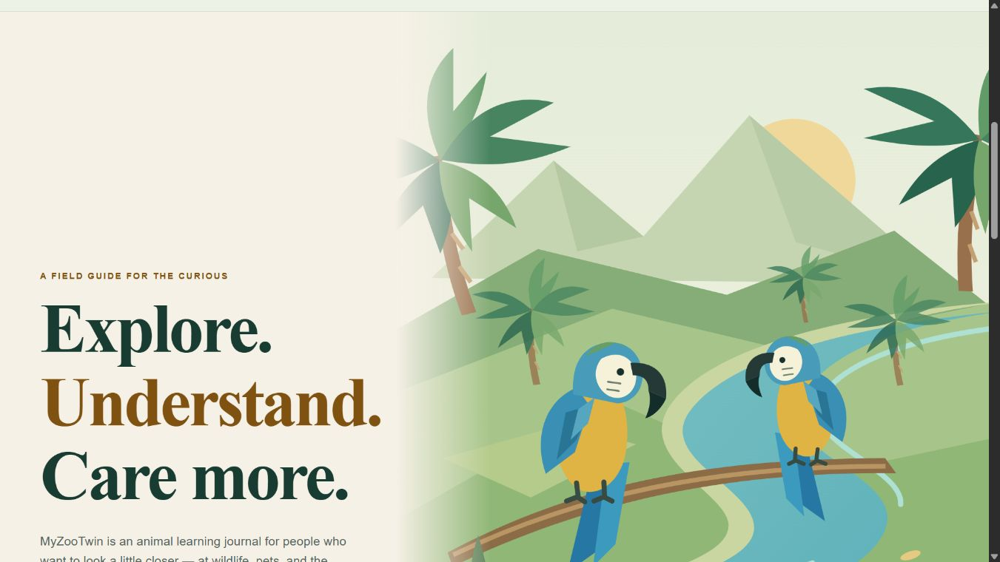

# M6-06 — original site artwork remediation (local only)

Date: 2026-11-02 UTC. Starting checkpoint: `d2c7b25a2fb58c83e19247a501af26fa72c38418`.
Implementation: **`4dde232acba3653f0d96058c7d2c6a00b248aec3`**, local, not pushed.

The current candidate no longer distributes either unresolved legacy artwork file. A handwritten SVG composition shows two blue-and-yellow macaws above Tropical Creek and an open field journal; the favicon is an original macaw profile. Geometry, palette and identity refer to this project's original game scenery and macaw work. No legacy tracing, external image/font/model, download, purchase or invented license was used. This closes the candidate's reliance on those two artworks; it is not a conclusion about historical rights or overall legal clearance.

## Current assets and preserved URLs

| Output | Dimensions | Bytes | Distribution |
|---|---:|---:|---|
| `public/images/tropical-creek-journal.svg` | 1024×1536 | 6,173 | Primary homepage journal illustration |
| `public/images/myzootwin-beranda.png` | 1024×1536 | 171,632 | New original SVG raster export at the old image URL |
| `public/favicon.svg` | 64×64 | 793 | New original SVG at the unchanged favicon URL |

[Generator](../art/site-assets/generate.mjs), [exact source/output hashes and toolchain](../art/site-assets/generated-manifest.json), [living asset manifest](ASSET_MANIFEST.json). The existing installed sharp0.35.5/libvips8.18.7 rasterizes the new SVG only, on Node24.12.0. No dependency/lock change. `node art/site-assets/generate.mjs --verify` regenerated all outputs in memory and compared exact bytes. The generated SVGs contain no script, external resource, font, embedded raster or animation; internal references and intrinsic image formats/dimensions passed [source audit](qa/m6-06-original-assets/source-asset-audit.json).

The homepage's existing English journal text, dimensions and navigation remain; only the illustration source, accurate alt and base image positioning change. The SVG has no visible localized text. Existing ID/EN game UI is unchanged. `object-position:center center` keeps the birds visible in the wide landscape crop; the previous top crop cut them off. The original portrait override remains. The [first framing issue](qa/m6-06-original-assets/before-framing-home-journal-landscape.jpg) and [source-labelled observations](qa/m6-06-original-assets/browser-first-source.json) are retained.

The original actual-game JPEG remains byte-identical and is still the homepage/play OpenGraph and Twitter image. No illustration is presented as a gameplay screenshot. Favicon URL/type remains `/favicon.svg`, `image/svg+xml`, on all nine routes.

## Recoverable originals outside new distribution

Before either overwrite, the exact originals were copied into Git-ignored local `.qa/archives/m6-06-original-assets/legacy-site-assets.zip` (2,952,683 bytes), SHA256:

`187dc44b46c565c1066262ee0b5e3742bc54f29ae41078031f38dacbca037a00`.

Archive CRC and every member hash passed. An **actual restore to a new empty workspace directory** passed both original hashes; no in-place or production rollback was performed. [Receipt](../art/site-assets/legacy-retirement.json), [preservation evidence](qa/m6-06-original-assets/legacy-preservation.json), [final validation](qa/m6-06-original-assets/final-audit.json). Original source history at the starting checkpoint also remains. The archive is a provenance/rollback copy, not a shipping asset pack. No infringement assertion or third-party permission claim is made.

All **25** candidate files were inventoried: zero matching original hashes; no archive, `.qa`, art source, docs, test, Git or sourcemap file shipped. Requests for the archive/source paths returned404 in the isolated candidate server. The old PNG URL returns200 with correct PNG MIME, new original bytes and original dimensions; favicon returns200 with new SVG bytes. Protected old owner `dist`, historical QA builds and rollback archives deliberately retain their historical bytes and are not this candidate distribution.

## Verification actually run

Final isolated run **`s20261102T190218Z`**:

- Source fingerprint: `db5d8e11a555177ce124edd83f0185ecebb1eb5a63c85a0f7e6ea890da7f4ded`.
- Build fingerprint: `a6ce7e856bdf287fdadd8ef92754ec684a29036e1f5bac76307aa2f228a2d175`.
- `PUBLIC_GA4_ID=G-QACONSENT000 MYZOO_QA_SCOPE=assets-m6-06 node scripts/qa/settings-isolated.mjs local`: **485/485 unit tests**, zero failed/cancelled/skipped/todo; Astro check **207 files, zero errors/warnings/hints**; nine-page isolated build PASS. [Raw gate/logs](qa/m6-06-original-assets/s20261102T190218Z/report.json).
- Fresh local HTTP/body checks: all nine routes200, exact candidate bytes; direct `/play` canonical, sitemap9, image MIME/hash/dimensions, icon links, social metadata, no legacy bytes/exposed archive PASS. Compare with `.qa/builds/n20261102T181134Z`: all nine ordered main-text token sequences, titles and decoded metadata unchanged. [Audit and complete inventory](qa/m6-06-original-assets/final-audit.json), [executed audit snapshot](qa/m6-06-original-assets/executed-audit-snapshot.py). Snapshot records the actual local paths used; it is not a portable CI runner.
- Approved isolated IAB: native homepage/journal actions, keyboard Enter to Animals, back/reload, final actual pixels at desktop1366×768, portrait360×780 and landscape780×360. Favicon swatches16/32/64CSSpx on light/dark inspected at desktop and portrait. Both SVG and PNG decoded/visually matched the composition. [DOM/console observations](qa/m6-06-original-assets/browser-final.json): no captured warn/error entries (bounded200 query), no document overflow in recorded product views. Separate fresh tab27 was needed for mobile swatches because tab26's reload retained its prior image scroll; the earlier misleadingly named `favicon-portrait.jpg` is not used as favicon proof.
- Raw distribution: **4,195,948 → 1,372,868 bytes**, delta **−2,823,080**, 24→25 files. This is file inventory, not transfer/interaction timing, compressed network payload or FPS.

[Portrait](qa/m6-06-original-assets/home-journal-portrait.jpg), [landscape](qa/m6-06-original-assets/home-journal-landscape.jpg), [desktop icon swatches](qa/m6-06-original-assets/favicon-and-exports-desktop.jpg), [mobile icon swatches](qa/m6-06-original-assets/favicon-mobile-swatches.jpg), [PNG compatibility rendering](qa/m6-06-original-assets/original-svg-png-exports.jpg).

Earlier receipts are reused only as historical context: prior gameplay, GPU, browser matrix and legal findings are not relabelled as new tests. No fresh full-game Q01–Q04, physical Android/real-touch, native OS/tab-chrome bitmap, distinct browser, native background/speaker/process restart, presentedFPS, human study, recording, Cloudflare or live-site test is claimed by this slice.

## Failure evidence and cleanup

The initial pre-framing source `s20261102T185128Z` passed automated gates but exposed the landscape crop in browser. Intermediate `s20261102T190100Z` correctly **FAILed** the runner's `Source changed during gate` guard when the corrected UTF-8 framing edit landed during that run; it is not final pass evidence. Raw logs/report remain. The first UTF-8 helper attempt failed decoding before an edit. [Execution notes](qa/m6-06-original-assets/execution-notes.json).

Final server's stdin unexpectedly closed after verification. Its in-memory request log could not be flushed. PID28484 executable/command and loopback4347 ownership were inspected before targeted `Stop-Process`; independent HTTP/body evidence remains. Owned tabs26/27 closed; viewport reset. Named ports4322/4323/4345/4346/4347 verified free. Canonical QA fingerprint confirms protected old `dist` unchanged (`e06d975a30b49470a1e80e915fbe39ce22ba102f16447dbef8776e7088d38b05`); every protected rollback/failure archive and the new archive SHA matches. A custom Python fingerprint initially asserted because Windows Path ordering differs from canonical JS string sort; the canonical implementation proved exact identity. [Cleanup](qa/m6-06-original-assets/cleanup.json).

No owner save was read/reset, no owner preview started/replaced, and no unrelated process stopped. Historical denied QA46 closure remains unverified and was not retried. No recovery download, permission expansion, external tracking, login, push, deployment, GitHub Actions or publisher communication.

## Acceptance and remaining gates

This **bounded original-asset remediation is complete**. Whole **M6-06 remains PARTIAL**, **44/51 (86.27%)**, M6 **4/8**. [Acceptance mapping](qa/m6-06-original-assets/acceptance-matrix.json), [current risk register](qa/m6-06-original-assets/risk-register.json), [prioritized plan](qa/m6-06-original-assets/next-gates-plan.json).

The three exact-version tooling permission texts (`am-i-vibing0.5.0`, `piccolore0.1.3`, `process-ancestry0.1.0`) remain unresolved; current browser module map excludes them, so broader tooling/source redistribution and browser shipping must be distinguished. Controller/contact, retention/property/hosting facts and privacy/legal review remain open. Legacy provenance is needed if the retired originals are restored/reused, not to represent the new candidate artwork as unchanged legacy material. GPU historical cause, original fixture-import cause, physical/cross-browser, native background/speaker/restart, human usability, supported recording and exact Cloudflare/Node builder settings remain open. Local Node24.12.0 compatibility does not establish remote Node>=22.23.4.

Next parent decision: select any justified bounded diagnostics/engineering gap, or arrange authoritative owner/publisher/legal/hardware/runtime evidence; avoid another unsupported historical reproduction loop. Verify external deployment configuration through existing authorized read access when available. M6-08 remains held until required gates are resolved/explicitly handled. This task stops for parent review.
