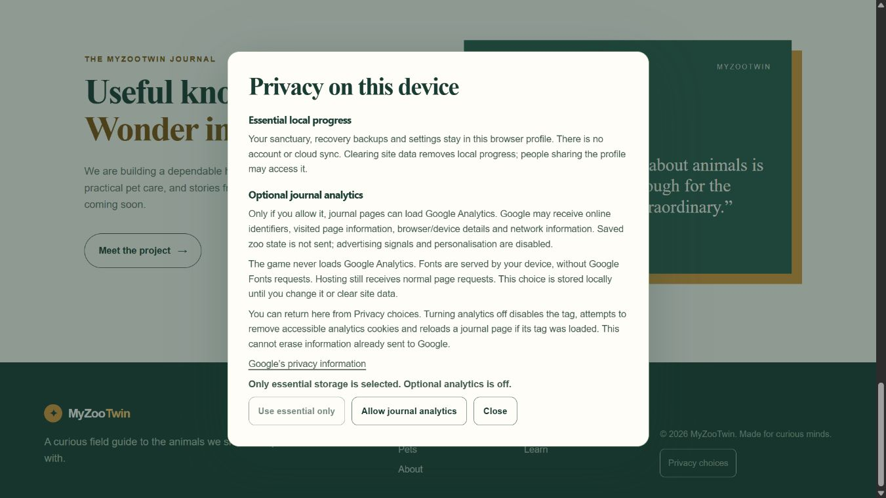

# M6-06 privacy and notice gap closure — 2 November 2026 UTC

The authorized technical slice is verified locally at **`cacdd9f740e7d870f8687293f101c6a3c1e546b3`**. Whole M6-06 remains **PARTIAL**, V1 **44/51 (86.27%)**, M6 **4/8**. No push, deployment, Actions, login or access changes. [Acceptance mapping](qa/m6-06-gap/acceptance-matrix.json), [current risks](qa/m6-06-gap/risk-register.json), [prioritized plan](qa/m6-06-gap/next-gates-plan.json).

## Privacy behavior

Journal pages retain the existing `PUBLIC_GA4_ID` configuration as eligibility, while provider loading now requires an affirmative verified local choice. Unknown, invalid, unavailable storage, game pages, browser privacy signals and query/hash-bearing pages stay off. Merely opening/closing a dialog does not consent. This uses a basic loading boundary: no Google script or consent command queue before opt-in, rather than loading a denied-state tag that could send cookieless pings. See [Google basic versus advanced consent behavior](https://developers.google.com/tag-platform/security/concepts/consent-mode).

The strict local preference has a schema version and no user identifier/time. A changed grant/revocation refreshes the eligible document, with generation checks preventing stale async loads/cross-tab events from reversing a decision. Withdrawal sets the documented local opt-out flag, removes our tag, attempts only accessible provider cookies and reloads the touched document; it does not erase game data or information already received by Google. [Google opt-out guidance](https://developers.google.com/tag-platform/security/guides/privacy?hl=en) supports the flag, not a blanket guarantee of deletion. If a browser refuses saving a changed choice, the current visit stops and displays an error; an old stored grant may apply to another page if it could not be overwritten. No durable withdrawal is falsely reported in this failure case.

The adapter disables automatic page views, ads/signals/personalisation, sends one explicit page view per eligible document and supplies origin/path only with blank referrer; query/hash URLs do not load it. These follow [page-view configuration](https://developers.google.com/analytics/devguides/collection/ga4/views) and [configuration options](https://developers.google.com/analytics/devguides/collection/ga4/reference/config). They do not establish that provider collection is anonymous or legally cleared. Google Fonts requests were removed; the existing font-family stacks use device fallbacks, with no new font binaries.

English/Indonesian privacy UI explains browser-local saves/backups/preferences, shared-profile access, clearing-data consequences, optional provider identifiers/page/device/network information, ordinary hosting requests, stored-choice duration and withdrawal limits. Footer and game Settings reopen it. Keyboard focus containment/Escape/return, narrow portrait/landscape scrolling and nested Settings/privacy/manual pause ownership work; the global modal pauses the existing game clock rather than adding another simulation loop. Existing journal prose/URLs remain intact.

## Exact verification and limits

Final run **`s20261102T163123Z`**, source **`329fa948e30b26eafd266bfc4743dccb2cf3057d5da8b487fcc48409162a7e6b`**, build **`4909ff9cfe3c75cd6c5d1f4e752ad87cb48545df194d57485f56eec39480a105`**. Reproduction in PowerShell (isolated output, preserving owner `dist`):

```powershell
$env:PUBLIC_GA4_ID = 'G-QACONSENT000'
$env:MYZOO_QA_SCOPE = 'privacy-m6-06'
node scripts/qa/settings-isolated.mjs local
node --experimental-strip-types scripts/qa/prepare-privacy.mjs
node scripts/qa/settings-isolated.mjs serve
```

Run `node --experimental-strip-types scripts/qa/privacy-locked.mjs` in a second terminal for compiled negative-case inspection with external network blocked; type `stop` in both owned servers after QA. This synthetic test property was never enabled against Google. The runner's generic browser-template field remains **UNRUN**; targeted privacy fixture/native receipts below are separate evidence and do not assert a full generic/physical-device pass.

**481 tests PASS**, including12 new consent/adapter cases; Astro check **201 files, zero errors/warnings/hints**, nine-route build PASS. [Raw local results](qa/m6-06-gap/final-local/report.json). The existing lazy-chunk warning remains visible. [Structural audit](qa/m6-06-gap/structural-audit.json) preserves all eight journal main-text sequences, titles/metadata/canonicals, public media, package/lock and full public Three notices byte hashes against M6-07; no static provider/font resources. [HTTP audit](qa/m6-06-gap/http-artifacts.json):24 exact artifacts, direct `/play` and nine sitemap URLs PASS. Current emitted browser dependency modules contain only Three; notice work adds no native/build tool code to the browser.

[Nine authored source UI cases](qa/m6-06-gap/consent-fixture-first.json) PASS using isolated in-memory storage/fake provider/reload, including positive grant/withdrawal, late responses, failures, cross-tab and disposal; native clicks/keyboard on that fixture prove fake positive controls. Actual compiled UI tested default-off/essential-only/reload, footer dialog, keyboard focus/Escape, nested game pause, ID portrait/landscape, manual pause and actual reload/Continue preserving1500ZC/ID/one canvas. [Native observations](qa/m6-06-gap/native-compiled.json), [resource inventory](qa/m6-06-gap/compiled-observed-assets.json), [game resources](qa/m6-06-gap/compiled-game-assets.json); captured native/fixture consoles contain no entries. The final compiled server applied a **QA-only self-only response CSP**, preventing real off-origin requests; this is not production journal header configuration. No real provider was enabled. Adapter cookie/command tests used fake DOM; actual provider delivery/cookie scope remains UNRUN by design, not passed from this substitute.




Screenshot JPEG bitmap dimensions are recorded separately from CSS viewports in the structural audit. Viewports are not physical Android, real touch, distinct browser coverage or presented FPS. Prior native-background/speaker/browser-process restart, human study, recording and GPU uncertainty remain open. The prior M6-03 initial import failure is still unexplained. [First source-lookup/selector/whitespace observations](qa/m6-06-gap/failures-and-limits.json) are retained; passing later checks do not invent root causes.

## Notice evidence and remaining rights

[Exact build-tool texts and provenance](licenses/build-tooling/README.md) account for **8 of the previous12 direct text findings**. Three already-installed `LICENCE` files were false positives in the old spelling-limited scan; five absent direct notices are supplied from pinned matching upstream/parent sources. Corrected inventory:281 installed packages, **nine physical standalone-file absences** in unchanged node_modules. The repo supplies nine exact text files (eight direct plus Rolldown's release-pinned external-project notice). Exact Git-staged hashes were checked; original license line endings and terminal blanks are deliberately preserved. No SPDX declaration was expanded into invented permission/copyright text.

Four full permission texts remain unresolved: **am-i-vibing0.5.0, boolbase1.0.0, piccolore0.1.3, process-ancestry0.1.0**. Exact inspected source refs/declarations and missing matching evidence are recorded individually. Their current exposure is tooling/type/native, not emitted browser modules. Vendor Rolldown notices are not an independently exhaustive native/Rust audit. Neither this inventory nor shipped Three notice establishes whole-source/native redistribution clearance. Legacy hero/favicon bytes remain unchanged with uncertain provenance; uncertainty is not proof of infringement.

## Preservation and next priorities

Only own QA tabs22/23 and servers were closed; ports4322/4345/4346/4347 are free. Owner4345 was already absent and was not restarted, navigated or reset. Protected old `dist` hash remains exact; original saves/media and both existing rollback archives unchanged. Five superseded generated candidates were archived with50 unique blobs, CRC and every file SHA verified before removing only checked absolute targets under `.qa/builds`. **16,688,839 bytes net reclaimed**,10 loose builds remain. Original reports/failures and final build remain; no in-place archive restore claimed. [Archive manifest](qa/m6-06-gap/candidate-build-archive.json), [final guard](qa/m6-06-gap/final-guard.json).

Prioritized next work, subject to parent dispatch:

1. **Autonomous:** investigate the four remaining notice texts from authoritative matching releases; keep broader native/transitive scope explicit. Separately isolate GPU timing and original fixture-import risks using permitted contexts.
2. **Proposed asset plan, not implemented:** original repo-native SVG habitat/book/macaw journal illustration and leaf/feather favicon at new paths, preserving old assets/history/rollback and checking old-image URL/SEO handling before replacement. Parent review first; owner provenance may instead close this gap.
3. **Owner/legal/service facts:** legacy-art provenance or replacement authorization; entity/contact, analytics/legal/retention requirements, GA property and hosting-log facts. Technical controls do not supply these facts or certify jurisdiction compliance. No upstream messages sent.
4. **Supported hardware/human/runtime:** physical Android/touch/distinct browsers, native background/speaker/process restart; unaided human session and supported recording. Emulation/agent walkthrough cannot close these gates.
5. **External deployment configuration:** exact Cloudflare source/build/root/autodeploy and builder Node; local Node24.12.0 meets Astro7.4.4's >=22.23.4 requirement, remote compatibility remains unknown. Existing exact11 vendor advisory ranges remain in the prior audit; no dependency change or new audit-zero claim in this slice. M6-08 requires a separate release dispatch after unresolved gates close.

Inherited recovery download and QA46 remain **BLOCKED/UNRUN, never retried**. No new denial/pending permission or uncertain mutation remains in this slice. Stop here for parent review. M0-01/M4-07/M5-07/M6-01/M6-03/M6-06/M6-08 remain unchecked.


## Later four-package notice review - 2026-11-02 UTC

[Current review](M6-06_FOUR_PACKAGE_NOTICES.md) adds a qualified matching-version/code boolbase1.0.0 ISC source notice.9/12original directfindings accounted;3fulltexts remain,not the earlier4. Earlier evidence stays historical/immutable. Installed9physicalfileabsences remain;no wholelegal/native clearance. M6-06 stillPARTIAL.
