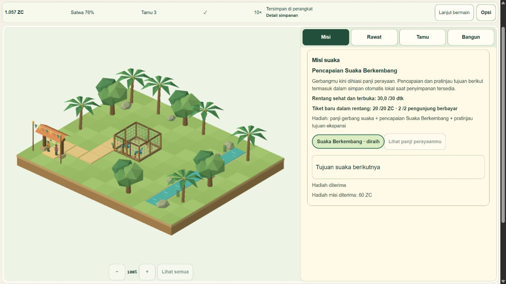

# M6-06 — Security, privacy and accessibility review

**PARTIAL — technical remediation verified; overall legal/security sign-off withheld.** Implementation `e94aa6de28af40f8acdb61c180cdef8ba5516433` is local only. V1 remains **43/51 (84.31%)**, M6 **3/8**. The M6-06 checkbox stays unchecked. [Acceptance mapping](qa/m6-06/acceptance-matrix.json), [risk register](qa/m6-06/risk-register.json), [independent audit](qa/m6-06/independent-audit.json).

## Verified changes

`/play` now excludes the existing optional GA integration and remote Google Fonts even when an analytics ID is configured. An early scoped meta CSP restricts scripts/connections/fonts to this origin, blocks objects/forms and disallows inline script/eval; required dynamic inline styles remain allowed. Game referrer policy is `no-referrer`. Existing journal integrations remain separate. This is a meta policy, not a verified production response-header policy or anti-framing guarantee; see [MDN meta policy limitations](https://developer.mozilla.org/en-US/docs/Web/HTML/Reference/Elements/meta/http-equiv) and [Cloudflare static headers](https://developers.cloudflare.com/pages/configuration/headers/).

The game stores simulation/checkpoints/restart backups in local IndexedDB and preferences in localStorage. A same-origin BroadcastChannel shares writer/revision/generation notifications; it is not a remote upload. ID/EN Settings explains local-only progress, no account/cloud sync, shared-profile access and the consequence of clearing browser data. Inspection found no game network telemetry/save upload, personal free-text/login input, geolocation or camera/mic request. Normal hosting requests/IP logs, prior same-origin cookies, browser extensions and external journal integrations are outside this no-collection claim. Untrusted stored data remains strictly validated, and backend error details stay out of visible status. This is a scoped engineering review, not exhaustive penetration testing.

Native keyboard testing found Settings Tab escaping to BODY. A lifecycle-aborted focus boundary now wraps first/last controls while preserving native Escape and focus return; original FAIL and final PASS receipts are retained. The shared shell gains a keyboard skip link/main target. The existing mobile heading overflow and dark quote contrast are fixed narrowly: actual 360px viewport, document width 345px; measured quote foreground #fffdf8/background #28594a gives **7.89:1**. ID/EN game controls/privacy dialogs fit desktop 1366×768, portrait 360×780 and landscape 780×360. Selected checks do not establish full WCAG, screen-reader or physical-touch compliance. Focus behavior follows [WAI modal guidance](https://www.w3.org/WAI/ARIA/apg/patterns/dialog-modal/).

## Dependency decision and vendor ranges

Initial npm audit reported 10 affected package nodes (1 critical/6 high/2 moderate/1 low), with 11 direct Astro advisory records. These are package/advisory counts, not 10 demonstrated application exploits. Anonymous exact vendor advisory API reads are preserved in [vendor-astro-advisories.json](qa/m6-06/vendor-astro-advisories.json), including discrepancies from npm. No advisory suppression or `--force` was used.

| Vendor advisory | Vendor severity | Vendor affected | Vendor patched | npm affected |
|---|---|---|---|---|
| [GHSA-j687-52p2-xcff](https://github.com/withastro/astro/security/advisories/GHSA-j687-52p2-xcff) | medium | <= 6.1.1 | 6.1.6 | <6.1.6 |
| [GHSA-xr5h-phrj-8vxv](https://github.com/withastro/astro/security/advisories/GHSA-xr5h-phrj-8vxv) | low | < 6.1.10 | 6.1.10 | <6.1.10 |
| [GHSA-jrpj-wcv7-9fh9](https://github.com/withastro/astro/security/advisories/GHSA-jrpj-wcv7-9fh9) | medium | <= 6.4.2 | 6.4.6 | <6.4.6 |
| [GHSA-f48w-9m4c-m7f5](https://github.com/withastro/astro/security/advisories/GHSA-f48w-9m4c-m7f5) | low | <=7.0.3 | 7.0.5 | <7.0.6 |
| [GHSA-7pw4-f3q4-r2p2](https://github.com/withastro/astro/security/advisories/GHSA-7pw4-f3q4-r2p2) | low | >= 3.10.0, < 7.0.4 | 7.0.4 | >=3.10.0 <7.0.4 |
| [GHSA-4g3v-8h47-v7g6](https://github.com/withastro/astro/security/advisories/GHSA-4g3v-8h47-v7g6) | medium | >= 2.9.0, <= 7.0.9 | 7.1.0 | >=2.9.0 <=7.0.9 |
| [GHSA-2pvr-wf23-7pc7](https://github.com/withastro/astro/security/advisories/GHSA-2pvr-wf23-7pc7) | high | <= 6.4.4 (core; the chain is present on main HEAD) | 6.4.6 | <6.4.6 |
| [GHSA-8hv8-536x-4wqp](https://github.com/withastro/astro/security/advisories/GHSA-8hv8-536x-4wqp) | high | 6.3.1 | >= 6.3.3 | <6.3.3 |
| [GHSA-26w7-cxv4-gfx2](https://github.com/withastro/astro/security/advisories/GHSA-26w7-cxv4-gfx2) | critical | < 7.2.8 | 7.2.8 | <7.2.8 |
| [GHSA-376h-93r7-7g6f](https://github.com/withastro/astro/security/advisories/GHSA-376h-93r7-7g6f) | medium | <= 7.2.3 | 7.2.4 | <=7.2.3 |
| [GHSA-98hj-9722-w3j8](https://github.com/withastro/astro/security/advisories/GHSA-98hj-9722-w3j8) | medium | < 7.3.2 | 7.3.2 | <7.3.2 |

A 5.x or 6.x patch cannot close the vendor AVIF critical range `<7.2.8` or subsequent JSX/MDX range `<7.3.2`. **7.3.2 is a lower bound for the latest listed Astro advisory, not a version proved inadequate here.** We selected npm's offered stable 7.4.4, tested the resulting complete graph, and pinned it exactly;7.4.4 is not claimed to be the only safe version. Vendor/npm distinctions are retained, especially GHSA-f48w (vendorLow/<=7.0.3/patched7.0.5 versus npmModerate/<7.0.6), define:vars and spread/slot ranges. Final7.4.4 exceeds all listed patched bounds.

Exposure differs from upstream affected status: this site is `output: static`, has no server islands, runtime SSR image endpoint, authentication/base-path middleware, MDX/CMS or attacker-controlled JSX/spread/slot/ViewTransition values. The existing image is a checked-in PNG; no untrusted AVIF optimization path was found. The journal's define:vars GA ID is trusted build configuration. These facts reduce observed application exposure but do not make the old dependencies patched; the graph was remediated rather than ignored.

Exact local commands were `npm install --save-exact --ignore-scripts astro@7.4.4`, then compatible `npm audit fix --ignore-scripts` for the residual transitive finding, and final `npm audit --json --ignore-scripts --package-lock-only` plus `npm ls --all --json`. Audit now reports **0 advisories** and the installed graph is valid. This is a dated advisory-database observation, not universal security proof. Astro5.18.2→7.4.4 moves Vite6→8.3.5/Rolldown1.2.16. [Astro7 upgrade guidance](https://docs.astro.build/en/guides/upgrade-to/v7/) and [Astro6 guidance](https://docs.astro.build/en/guides/upgrade-to/v6/) were reviewed. No game engine/Rust/WASM migration was introduced. The only needed tooling adjustment resolves Astro's declared package CLI instead of hard-coding its old path. Simulation/economy/save schemas were not migrated or edited for the upgrade.

Existing **Node24.12.0/npm11.6.2** meets Astro's recorded minimum **Node>=22.23.4/npm>=9.6.5**; no Node/global setting was installed or changed. Per-process QA telemetry is disabled. Cloudflare builder Node and exact build settings remain unverified under M0-01, so production compatibility is **not** established.

The upgrade is bounded to package/lock plus compatible CLI handling, accompanied by security/UI changes within this feature. No broad application rewrite was necessary. Original package/lock bytes are preserved in evidence; baseline commit`b061713aa548c401d5576a5267957a3bec6df822` and protected old`dist` provide a local rollback reference. A future authorized rollback can revert implementation`e94aa6de28af40f8acdb61c180cdef8ba5516433` and reinstall its exact prior lock with scripts disabled; it has **not** been executed or production-tested. An alternative 7.3.2 graph would need its own full audit/test, while retaining 5.x/6.x would leave the vendor ranges unresolved. No push/deploy occurred.

## Final verification and evidence limits

Final run`s20261102T135958Z`, source`a40bbd3e57daa0081c367c78e1813ebe45c4471500b13fabd861858b07dbf208`, build`c5f3924df19f8f98d482054ce5ac66e111dd5f484f3306afcd0edafc7648d283`: **468 tests**, **188 checked files/zero errors,warnings,hints**, local build PASS. Commands: `$env:MYZOO_QA_SCOPE='security-m6-06'; node scripts/qa/settings-isolated.mjs local`, then `serve`. Owned4346/4322 previews were stopped using their runner. [Final logs/identities](qa/m6-06/final-local/report.json).

All 9 routes/canonicals, direct`/play`,9 sitemap entries and 8 journal metadata comparisons pass. Before/after raw SEO comparison initially failed on Adventures/Gear solely because Astro emits`&amp;` instead of`&#38;`; the failed receipt is retained and decoded values match. An **unserved** second build with synthetic `PUBLIC_GA4_ID=G-QASECURITY000` verifies journal GA/font tags remain and `/play` excludes them; no analytics request/event was sent. This does not certify real journal event delivery/consent. Current observed real game assets were same-origin CSS/entry/lazy scene; this is observed page-resource evidence, not a complete hosting network audit.

Supported isolated browser regressions: **5 security +20 HUD +19 recovery cases PASS**, export requests**0**, download policy disabled. Injected CSP inline canary was blocked by the actual policy; its policy-violation event is retained; the captured console contains only Vite debug connection entries. HUD/recovery are source fixtures under the same final dependency graph, distinct from native compiled-page evidence. No unexpected warnings/errors were observed in recorded native compiled views.

Native compiled gameplay continued the isolated pre-upgrade QA save, built the missing connected path/care objects, performed genuine consumption and admissions, claimed Q01–Q04 and recovered care depletion while moving between 1x/10x. Tool gaps at 10x depleted supplies; intermediate unsuccessful care states remain in raw evidence. After pausing, actual reload/Continue preserved displayed tick 20054, 1057 ZC, 4 missions, 2 birds and generation; revision advanced as expected. This is DOM-visible continuity, not a complete payload assertion; strict payload/relationship validation is covered by unit/recovery tests. It was **not** a fresh unaided-human study, browser-process restart or required 15-minute wall-clock recording. Portrait/landscape then resumed and paused intentionally; later tick/balance changes are legitimate native progress.

Final entry 267,380 bytes and lazy scene 643,075 bytes; only Three appears in emitted client dependency modules. The >500KB warning remains unsuppressed. These are emitted raw bytes, not first-interaction/network or presentationFPS claims; earlier GPU timing risk remains open. No new performance improvement is claimed from the dependency upgrade.

## Notices, release holds and cleanup

New public third-party notice includes the **exact installed Three MIT license text**; original `/licenses/three-MIT.txt` remains byte-identical. Only Three is emitted into client dependency modules. Original supplemental esbuild/Rollup license texts were copied from known installed matching package versions as audit references; those old binary packages are now absent. They do not clear unrelated native/compiler licenses. Current graph has 281 installed packages/351 lock entries, complete license metadata but **12 standalone-notice gaps**. Of the historical 13 gaps, 8 left the graph and 5 remain; 7 new gaps are explicitly listed. This is not full source/native redistribution clearance. Legacy hero/favicon rights remain unresolved and assets remain intact.

Overall sign-off is withheld for those legal gaps, journal consent/privacy review and external hosting/build configuration, alongside the previously open physical/cross-browser, GPU, human-study and recording gates. Original M6-03 first import failure remains unexplained; current passing Vite8 tests do not establish its cause. Blocked recovery download and QA46 actions were not retried, broadened or bypassed. Browser-process restart, native background, physical speaker and physicalAndroid/presentationFPS remain UNRUN.

Only owned QA tabs closed; viewport reset. Ports 4322/4346 free; owner 4345 was absent, not restarted or accessed. Protected olddist SHA`e06d975a30b49470a1e80e915fbe39ce22ba102f16447dbef8776e7088d38b05` is exact unchanged; owner saves/media/local rollback archive untouched.20 output artifacts contain no test/docs/node_modules/.env/source-map files. Historical failures/source transcriptions retained; current evidence is bounded. No GitHubActions/push/deploy/login/grants. Stop after parent review; next independent recommendation is M6-07, with M6-08 release still held.

## Later bounded gap closure - 2026-11-02 UTC

See [current privacy/notice report](M6-06_PRIVACY_NOTICE_GAP_CLOSURE.md). The earlier12-notice/journal integration observations above remain historical, not the latest status: optional tracking is now gated, remote fonts removed,8/12 direct findings accounted and4 remain. M6-06 stays PARTIAL; no overall legal/release clearance. Exact vendor advisory ranges and upgrade exposure analysis above are unchanged.

## Later four-package notice review - 2026-11-02 UTC

[Current review](M6-06_FOUR_PACKAGE_NOTICES.md) adds a qualified matching-version/code boolbase1.0.0 ISC source notice.9/12original directfindings accounted;3fulltexts remain,not the earlier4. Earlier evidence stays historical/immutable. Installed9physicalfileabsences remain;no wholelegal/native clearance. M6-06 stillPARTIAL.

Current bounded asset follow-up: [Original site artwork remediation](M6-06_ORIGINAL_SITE_ASSETS.md). Legacy artwork retired from the new candidate and recoverably archived; historical findings above remain historical. Whole M6-06 stays PARTIAL,44/51; consult current risk register, no blanket clearance.
