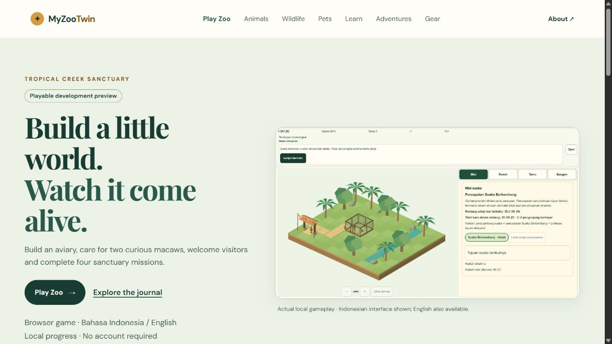

# M6-07 — Website and playable-zoo integration

**COMPLETE locally**, implementation `a8fc668739fc57a18c77f26a55d2fd8f7d44b5e6`. V1 **44/51 (86.27%)**, M6 **4/8**. Production is untouched; this is an explicitly labelled playable development preview. [Acceptance mapping](qa/m6-07/acceptance-matrix.json), [evidence summary](qa/m6-07/independent-audit.json), [open risks](qa/m6-07/risk-register.json), [prioritized next gates](qa/m6-07/next-gates-plan.json).

## Player-visible outcome

The homepage now leads with **Play Zoo**, the small sanctuary loop and an unedited image of the actual original game. Desktop and phone portrait expose the CTA clearly; the latter is 51.8px high and within the 780px viewport. A separate **Explore the journal** anchor retains the existing journal sections, text and routes. The old homepage heading remains as H2; the new game heading is the page's sole H1. The new image uses no legacy hero/favicon artwork. Its actual JPEG/JFIF encoding and 1366×768 dimensions are verified; 91,888 bytes are added. The original legacy hero remains unchanged in its journal section and is lazy-loaded, with its unresolved rights still open.

Home title/description and home/play social metadata now describe the real small game. The playable route's ID/EN description no longer says gameplay is still being prepared. `/learn/` gains a small explainer and return-to-game link; its original introduction and researched-content-coming-soon section stay intact. The ID/EN in-game guide links back to Learn and clearly identifies welfare/need numbers as simplified game rules rather than real animal-care instructions. Players can play without reading an article. The journal itself remains English, consistent with its prior scope.

## Events and privacy boundary

The new `myzootwin:navigate` CustomEvent contains only fixed **destination/source** strings. It is a page-local navigation-intent signal, with frozen details, no identity/session/save/URL fields, no persistence and no network sink. It is **not** evidence of page-open success, a production analytics collector or measured conversion/retention. Four authored cases verify filtering, modified/cancelled clicks and idempotent listener lifecycle; native click and Enter separately verify emitted details. Duplicate old-disposer calls after remount initially exposed a genuine new listener-registration defect; the original FAIL is retained and ownership-aware idempotent disposal now passes.

The PRD conditions telemetry on compliance. Remote gameplay collection stays intentionally deferred while M6-06 journal consent/privacy remains unresolved. Existing journal GA and font behavior is preserved by an **unserved synthetic-ID build**; game GA/fonts remain excluded. No real analytics event was sent or provider delivery/consent certified. Optional event candidates in PRD section 9 are not claimed implemented by this navigation signal.

## Compiled CSP compatibility

Artifact inspection caught Astro auto-inlining the new 792-byte module despite the game CSP permitting only self-hosted scripts. Source-fixture success alone had missed this compiled boundary. The failed artifact/source is retained in `compiled-inline-CSP-before-fix.json`. Installed Astro 7.4.4 vendor implementation (`dist/core/build/plugins/plugin-scripts.js`, `util.js`) confirms its supported `vite.build.assetsInlineLimit` callback: we return false only for emitted `.js`, leaving vendor defaults for other assets. **CSP source is byte-identical to M6-06**; no unsafe-inline script, nonce exception or permission expansion was added.

Final homepage/Learn load only the external792-byte BaseLayout module; the homepage does not load PlayEntry/Three/scene code. `/play` has external BaseLayout and game-entry modules, with no inline script. An exact built-page fixture retains the actual game CSP and emitted BaseLayout module while removing PlayEntry to avoid game/owner storage. Two trusted native inputs emit the expected nav→play and game-guide→learn details under that policy. Its navigation is intentionally cancelled by QA after the product event; actual product navigation is verified separately. See [compiled-signals.json](qa/m6-07/compiled-signals.json).

## Final verification

Run **`s20261102T151611Z`**, source `34652474e652d050f92def393505d787422e2fa06e2d6036cfcf29dd9880eabc`, build `2e2946b4215422940f205609319216aaab57aa9ea06030171984f49d44f2455c`. Commands: `$env:MYZOO_QA_SCOPE='integration-m6-07'; node scripts/qa/settings-isolated.mjs local`, then `serve`. **469 tests**, **192 checked files/zero diagnostics**, build PASS; lazy chunk warning remains unsuppressed. All 9 route/canonical/directplay/sitemap checks and **22 exact served artifact bodies** pass. The corrected image is served as`image/jpeg`; its former unreleased`.png` path returns404. Every internal link/fragment resolves. All original 8 journal main-text sequences remain; the 7 non-home journal metadata sets are unchanged. Homepage metadata and the play description change intentionally. [Structural audit](qa/m6-07/structural-audit.json), [HTTP evidence](qa/m6-07/http-artifacts.json), [final logs](qa/m6-07/final-local/report.json).

Actual final compiled native mouse/keyboard journeys cover home→Play→ID/EN guide→Learn→Play, journal navigation/Back, skip-link-to-CTA, portrait360×780 and landscape780×360 plus desktop1366×768. Continue after these routes retains the displayed 1,057 ZC/completed-mission indicator, one canvas and explicit paused/no-offline-progress state. This is observable continuity, not a complete payload assertion or a new fresh-player/full-game soak. Captured final native/compiled-fixture warning/error logs are empty; policy proof additionally uses artifact inspection and positive compiled-event execution, since console capture alone is insufficient. No physicalAndroid, real touch, cross-browser, native-background, speaker, browser-process-restart or presentedFPS pass is implied. The generic full-browser-template gate remains UNRUN; scoped evidence is explicit. Viewport dimensions above are DOM/CSS readings. Encoded final desktop bitmap is1265×712, portrait bitmaps345×748 and full-page Learn344×2226; these differ from the DOM sizes. Both are recorded in [screenshot dimensions](qa/m6-07/screenshot-dimensions.json), without a physical-size or pixel-perfect capture claim. The separate shipped poster is independently verified1366×768.

Final raw client chunks: BaseLayout 792 bytes, game entry 267,889 bytes and lazy scene 643,075 bytes. Only Three appears among emitted third-party modules; its existing full MIT notices are retained. These are output sizes, not transfer/latency/FPS measurements. No performance improvement or GPU-risk closure is claimed.

## Evidence, rollback and release holds

Retained failures include stale-disposer duplication, two timing-dependent QA-observer reads corrected by observing the actual emitted event, unsuitable first screenshot clipping, a screenshot extension/format mismatch corrected without changing pixels, an initial Git-normalized-byte comparison corrected with prior exact working-byte fingerprints/parsed content, and the compiled inline-script/CSP conflict. Candidate receipts keep their actual source/timestamps; they are not relabelled as final. None establishes the unrelated original M6-03 import failure's root cause. [Interpretation notes](qa/m6-07/interpretation-notes.json) explain the initial capture-runner stdin/cleanup race and the raw runner's generic owner-status wording.

Four superseded generated candidates/84 files were CRC/every-file-SHA verified in a new ignored local archive before those copies were removed: `C:\MyZooTwin\.qa\archives\m6-07\candidate-builds.zip`, SHA `722252b7841a16eaa1a72274868f194b37e7ae9ad3776fc9905545d9e9d96f08`. 16,717,222 bytes become13,277,815 archive bytes, net 3,439,407 bytes reclaimed, leaving 12 loose builds. All candidate raw reports remain, and restore is documented to a **new empty** `.qa/restored/<run>` only; no filesystem restore was executed. Existing M6-05 rollback archive retains its exact SHA. Original source/media/owner saves and protected olddist remain intact. Only owned QA tabs/processes closed, viewport reset and ports 4322/4346 free; owner 4345 was already absent and was not restarted or accessed.

M6-06 **remains PARTIAL**: legacy hero/favicon rights, 12 current standalone package notice gaps, journal privacy/consent and exact Cloudflare settings are open. The Astro 7.4.4 upgrade's 11 exact vendor affected/patched ranges and discrepancies remain recorded in [M6-06 vendor evidence](qa/m6-06/vendor-astro-advisories.json) and [review](M6-06_SECURITY_PRIVACY_REVIEW.md). In particular GHSA-26w7-cxv4-gfx2 affects`<7.2.8`, patched 7.2.8; GHSA-98hj-9722-w3j8 affects`<7.3.2`, patched 7.3.2, so 5.x/6.x patches cannot cover those bounds. 7.4.4 is not claimed the only safe version. Package/lock working bytes and parsed Git content are unchanged in M6-07. Local Node 24.12.0 meets the recorded >=22.23.4 requirement; Cloudflare builder compatibility is still unverified. The prior 0-advisory observation is dated M6-06, not a new clearance claim.

Seven V1 items remain unchecked: **M0-01, M4-07, M5-07, M6-01, M6-03, M6-06, M6-08**. GPU timing uncertainty, real device/cross-browser tests, unaided human study, supported recording and initial fixture-import uncertainty remain. Recovery download BLOCKED/UNRUN and denied QA46 operations were not retried or bypassed. No login/grants/credentials, GitHub Actions, push or deploy. Stop after parent review; do not begin another feature or release.

Prioritized next work is in [next-gates-plan.json](qa/m6-07/next-gates-plan.json): resolve security/legal/privacy scope; isolate GPU/import technical uncertainty using permitted contexts; arrange real device/browser/interruption evidence; obtain actual human/recording evidence; verify existing Cloudflare binding/build/Node before the final exact-source release gate. External tests/access require the appropriate available supported environment; do not fabricate substitutes or reopen denied routes.

Audit helper snapshots in `qa/m6-07/tools` retain the exact selected-environment paths for reproducing these local checks. Run the scoped local QA gate first, then generate the compiled fixture and use the approved browser tools. They are evidence tools, not public routes or an unattended production release workflow.
