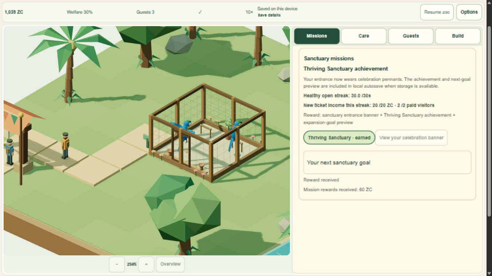

# Published visual candidate — live verification

**Live:** https://myzootwin.com/play/ · commit `f5c480a57761ed5a97de2c9e05f8e2aefc06ac78` · Pages deployment `ff9d9fd5-f36b-4008-89cf-f2e13e07666f`. Published **2026-11-02 23:51:52 UTC**, success33s, Node22.23.4/npm10.9.9. One authorized non-force main push; no Actions/manual duplicate build/settings/grants. The known lazy-chunk warning remains documented.

Nine HTML routes on apex and deployment match the verified local candidate except the production analytics eligibility property; all16 non-HTML assets match exactly. Direct`/play`, canonical URLs and sitemap pass. CSP is the existing meta-http-equiv policy; absent HTTP CSP header is not an invented failed policy. Only original evidenced art/runtime assets ship; no tooling/private archives/source maps.

Native fresh production-artifact gameplay on the new isolated deployment origin completed **Q01–Q04**: actual habitat/path/costs, two birds, food/water/rest and consumption, welfare streak, real guests/tickets, and once-only60ZC mission rewards. Cancel is free. Switching1x/10x, pause, privacy/refusal/withdrawal in the ineligible game, EN/ID, LowApply/HighDiscard/Auto, motion setting and Escape work. No actual provider transmission enabled. Native homepage/navigation on the isolated production origin passed after leaving the HUD. Apex`/play` entry was separately observed without opening owner progress; apex and deployment assets are identical. Do not claim the apex-origin save was exercised.

Cold-tab Continue restored **1,037ZC /4missions /2birds /tick8187**, checkpoint generation and10 world/resource fields exactly, paused, ID retained. Actual browser viewports360×780 and780×360 were captured. Four captured console contexts have zero entries at limit200. This is not physical Android/touch, presented FPS, native background, speaker or browser-process restart. Initial wrong-target viewport receipts and stale-handle/locator observations remain documented, not reported as failures of the product or hidden passes. No P0/P1 defect reproduced in the bounded live journey; formal overall clearance is not implied.

[Live portrait Continue](qa/release-live/live-cold-portrait.png) · [landscape](qa/release-live/live-cold-landscape.png) · [acceptance/limits](qa/release-live/acceptance.json) · [routes/assets](qa/release-live/routes-assets.json) · [Cloudflare build](qa/release-live/cloudflare-build.txt).

Previous production `5a755ea7-3513-41a8-8908-7dab1fa2b2cf`/`ad20f2b...` and pre-push main`f10d037...` are retained. Current verified`f5c480a`/`ff9d9fd5` becomes the next camera release rollback reference. Actual rollback execution/eligibility was not tested. Owner data/build/archives remain intact; QA tabs closed, no services started.

**New owner direction:** camera rotation is not in this deployed commit (pan/zoom only). Owner now explicitly requests rotation controls, tests, then publication. Implement a bounded follow-up; parent review before its release dispatch. Keep45/51 until that final current release scope is reviewed; no docs-only push. Recording/human/device/FPS/native and privacy/service sign-off gates remain unrun/partial. Operator/contact deferred, not requested again. Owner live testing sequence is not a waiver.
