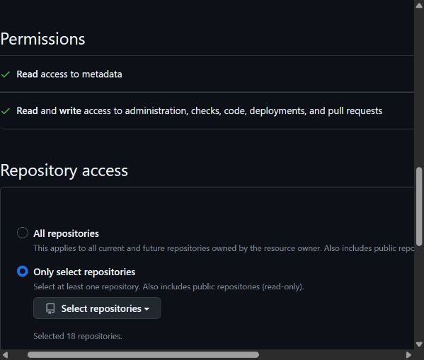
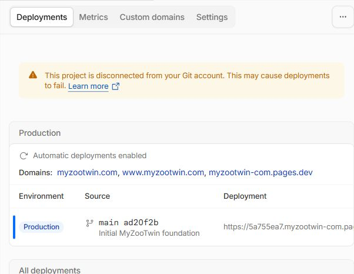

# Existing Cloudflare GitHub connection - pending scope confirmation

2 November2026 UTC. User approved reconnecting existing Pages project **myzootwin-com** to **andiwijaya/myzootwin.com**, without deployment or access expansion. Status **PENDING ACTION-TIME CONFIRMATION**, not denied; reconnect has **not** completed. V1 remains45/51, all six open PRD gates retained.

Existing authenticated internal browser sessions were inspected. Owner's GitHub tab progressed from sign-in/passkey prompt to the existing installation while the agent was reading; the agent entered no credentials, created no passkey and clicked no authentication/grant control. Browser IDs had changed since the prior turn: inventory located IAB2/tab28Cloudflare/tab29GitHub; no personal Chrome tab was read or controlled.

Cloudflare Settings still stores the exact intended repo/main and unchanged build configuration. Its Git-management link targets existing GitHub App installation **154265870**, **Cloudflare Workers and Pages**. GitHub currently selects **Only select repositories**, **18 repositories**, with **myzootwin.com absent**. Save is disabled, so there are no staged repository-selection changes by the agent. Existing permission categories are **read metadata**, plus **read/write administration, checks, code, deployments and pull requests**. No new permissions approval form was submitted and no unrelated repository list is reproduced in this report.

Adding MyZooTwin would extend persistent access to this additional repository. This differs from refreshing a connection already scoped to it, and the parent explicitly requires action-time confirmation before expanded repository access. The agent stopped before selecting any repository or Save. **Disconnect**, Suspend, Uninstall, deploy/retry/build and push were never used. Whether completing the repair itself causes a build has not been established; no guarantee of no automatic build is inferred.

Minimum next step: obtain explicit action-time confirmation to add **only andiwijaya/myzootwin.com** to this existing installation, preserving all18 current selections and existing permission categories. Do not use All repositories. Before any final connection action, verify whether it would start production deployment and pause if it would; current authorization does not permit deployment.

Read-only final Cloudflare check: disconnected warning still present, automatic deployments enabled, canonical production still **5a755ea7-3513-41a8-8908-7dab1fa2b2cf** /source **ad20f2b**. No new deployment appears in the observed list; no test push or rebuild was performed. This is not proof reconnect succeeded.

[Structured outcome](qa/reconnect-github/outcome.json).

Both owner tabs remain open and marked for handoff; no viewport override was applied. No source/config/dependency changes, services, test/build reruns, owner save/build/archive writes, denied-path retries, credentials or permission grants. This documentation-only checkpoint preserves original evidence. Stop for parent to obtain the specific scope decision.
