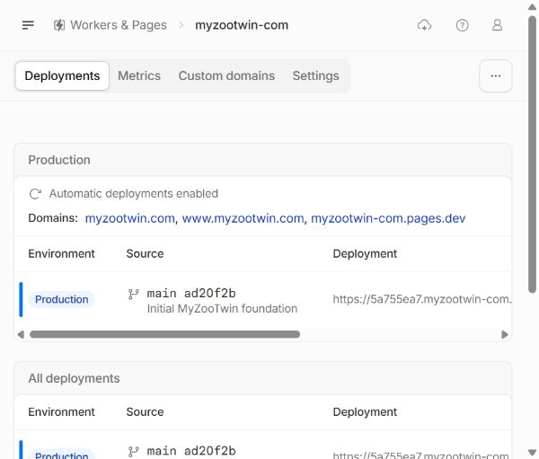

# Cloudflare GitHub reconnect - completed

2 November2026 UTC. **COMPLETE / VERIFIED**, V1 remains45/51; this closes the operational Git-connection issue only. It is not a game release or completed M6-08.

Owner provided action-time authorization at22:21UTC for exactly one additional repository, preserving the18 existing selections and the disclosed permission categories, with possible automatic build from existing remote main disclosed. The agent verified the initial18-repository set and staged diff: **+andiwijaya/myzootwin.com, -none, total19**, Only select repositories still selected, All repositories false, permission categories unchanged. Save was clicked **once at22:23:48.945UTC**. GitHub redirected through its update route to Cloudflare; the agent then reopened the observed installation page read-only and verified **19 persisted choices, exact+1/-0 diff, unchanged permissions and Save disabled** at22:24:19.556UTC. Before/after selection digests are retained without publishing the18 unrelated repository names.

Existing installation154265870 remains **Cloudflare Workers and Pages**. Categories stay readmetadata and read/writeadministration,checks,code,deployments,pullrequests. No All repositories, other repo changes, new category grant, credential creation, Disconnect/Suspend/Uninstall, or settings edit occurred. [Structured completion](qa/reconnect-complete/completion.json).

After refreshing existing Cloudflare projecttab28, the **disconnected warning disappeared**. Settings still binds **andiwijaya/myzootwin.com /main**, **npm run build /dist /repository root**, imagev3, watch*, automaticdeploymentsEnabled. The agent changed no Pages build/branch/runtime/variable settings.

Final deployment observation **22:25:43.426UTC**,114.481seconds after Save: **no new build/deployment listed**, same two IDs5a755ea7-3513-41a8-8908-7dab1fa2b2cf andc3fd7754-64a8-40ee-8096-fd6f8fa7138a. Canonical production remains successful initialfoundation source **ad20f2b90fc110e5f8a886174b3ddb816070df7d**, not the local game. No manual build, testpush, localgamepush or publication initiated. No new build existed in this bounded observation to monitor; this does not guarantee no future queued event.

Initial stale browser binding failed before any mutation. Supported troubleshooting and one REPL reset recovered the same IAB2 sessions; no alternative browser/control route or permission bypass. After Save, persistent state was inspected instead of retrying. **No denied/pending operation or uncertain Save outcome remains.** Existing owner tabs28/29 preserved; no viewport override, owner saves/build/archive edits, local services, tests/build reruns or denied-route retries. App source/config/dependencies unchanged; prior exact-source tests remain reused evidence. Six quality/privacy/release PRD gates and future actualCloudflarecandidatebuild/live smoke/rollback verification remain open. Stop for parent review.
