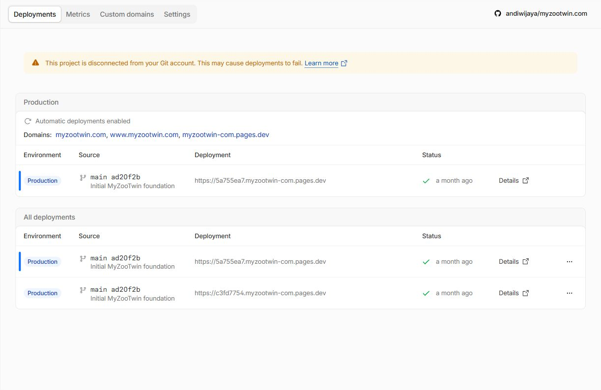

# Release configuration fact audit - 2 November 2026 UTC

**M0-01 audit requirements now verified; production release remains held.** This is a read-only dashboard/repository/distribution assessment. No application, dependency or hosting configuration changed. No tests/build/services were rerun for this report-only slice. [Structured facts](qa/release-facts/configuration-facts.json), [safe UI observations](qa/release-facts/cloudflare-observations.json), [distribution evidence](qa/release-facts/distribution-evidence.json), [minimum facts and scope decisions](qa/release-facts/privacy-and-scope.json).

## Verified destination and source

Existing authenticated owner IAB tab28 supplies independent evidence, with no login, token read, new grant or settings save. Pages **myzootwin-com** binds **andiwijaya/myzootwin.com**, production **main**, **npm run build**, **dist**, blank root (repository root; historical log corroborates), watch include `*`, build image **v3**. Build comments enabled, cache disabled, no deploy hooks. Preview builds all non-production branches. Production variable names: **PUBLIC_GA4_ID only**; preview: none. Values are omitted; no Node override exists. Apex/www both **Active / SSL enabled**; pages.dev also listed.

Automatic deployments are **Enabled**, independently observed. Owner separately confirmed that pushing remote main deploys production. **No push is authorized by this audit.** Dashboard simultaneously warns: **“This project is disconnected from your Git account. This may cause deployments to fail.”** The stored binding and enabled flag do not prove a healthy webhook/Git connection. Reconnection/installation permissions were not opened or changed. Owner must handle/authorize that operational issue before relying on release delivery.

Actual production pointer: successful **5a755ea7-3513-41a8-8908-7dab1fa2b2cf**, source **ad20f2b90fc110e5f8a886174b3ddb816070df7d**, initial journal foundation. Build log 2026-09-22 08:05:16.617561Z to success08:05:37.34381Z; UI duration23s. Log confirms eight static routes, no Functions dir, no Wrangler config; Redirects/Headers views list creation instructions without configured rules. This does not audit zone-level overrides. Prior production **c3fd7754-64a8-40ee-8096-fd6f8fa7138a** remains listed; no rollback operation or eligibility test occurred.

Live `git ls-remote --symref` (no fetch) confirms remote default/main **f10d037e84ad504e8f70b4908d20375a11c08917**. Local main started clean at **717f50bf0e74766e083f9397aa0233376f2fdb6e**,115 commits ahead/0behind that live SHA. Remote f10 differs from deployed ad20 by historical README-only changes; neither is the current local game. GitHub connector independently confirms matching public repo/default main/not archived. The production game has **not** been deployed or tested live.

## Node compatibility: known default versus actual build

Installed/locked Astro **7.4.4** and project require Node **>=22.23.4**, npm **>=9.6.5**. Local **24.12.0 /11.6.2** meets this. No `.node-version`/`.nvmrc` or production/preview `NODE_VERSION` override was found. Old deployed build used **22.16.0 /10.9.2**; that historical Node is insufficient for current Astro, but it is not proof that today's builder is still that version.

Current [Cloudflare vendor documentation](https://developers.cloudflare.com/pages/configuration/build-image/) (updated26October2026, read2November) lists v3 default **22.23.4 /10.9.9**, meeting the candidate minimum. It also says v3 does not select Node/package managers from package.json `engines` and supports an explicit version file/env override. Therefore default compatibility is supported by current vendor evidence; **actual candidate build on Cloudflare remains UNRUN**. A separate local change could pin the already-tested24.12.0 via `.node-version` for reproducibility. No setting/file was changed here and no build was triggered to find out.

## Audit acceptance and routing reuse

The original [M0-01 audit](M0-01_AUDIT.md), [M0-02 baseline](M0-02_BASELINE.md), [architecture](ARCHITECTURE.md) and later exact-source route/SEO tests cover local stack/commands/content/mobile/assets/reuse. This follow-up closes its previously missing external binding/build/root/auto-deploy/canonical-pointer observations. Audit completion records the Git disconnection and future builder verification as known release risks; it does not assert deployment health. Existing eight journal URLs remain assets; current candidate has a genuine ninth `/play` output and canonical, unlike the old production homepage fallback.

## Privacy facts and distribution scope

Candidate technical consent/storage/error/accessibility tests remain valid exact-source evidence, not newly run. Pages Metrics now explicitly says **Web analytics is disabled**. This alone does not explain the Cloudflare beacon seen in the historical public baseline or establish zone/account injection behavior. Candidate GA is journal-only, opt-in; `/play` remains excluded. Production property value was not copied. A configured public ID is not proof of ownership, retention or consent/legal clearance; current production is still the old journal, not these local privacy controls.

Minimum external facts: **(1)** responsible public operator/controller and genuine contact channel/jurisdiction; **(2)** confirmation of intended GA property/use and actual retention/sharing settings, or decision to ship without optional GA; **(3)** actual hosting/zone logging, service injection, access and retention practices. Brand, GitHub username and authenticated account email cannot substitute for these facts. No data was sent to analytics during this audit.

The exact current candidate hashes and all attributed module chunks were reread. Emitted third-party modules are **Three.js only** (three.core,three.module,BufferGeometryUtils); full matching Three MIT notice is shipped. **am-i-vibing0.5.0 /piccolore0.1.3 /process-ancestry0.1.0 are absent** from these browser modules/static candidate implementations. They are Astro build-tool dependencies; MIT/ISC declarations are metadata, not recovered full permission texts. No exhausted search was repeated and no text invented.

For **this static-output distribution**, there is no evidenced missing browser notice for those three absent implementations. Retain their precise unresolved source/tooling provenance/compliance record; do not automatically turn it into a claim that every static game release lacks required bundled notices. Conversely, this is not clearance to redistribute node_modules, a toolchain image, source package containing third-party code, or an assertion of all build-tool obligations. Cloudflare's build will acquire/use dependencies, and broader compliance assessment still needs its actual scope. Test waivers cannot grant rights. Legacy originals remain retired/non-distributed and recoverable; provenance is needed only for any later reuse.

## Remaining minimum actions, not another QA loop

1. **Operational facts/action:** address the visible Git disconnection using owner-managed existing integration; then verify connection. Future release must verify actual builderNode/build identity and live smoke/rollback eligibility. No need to repeat already-established command/root/repo questions.
2. **Public facts/service scope:** supply the three concise privacy fact groups above. Record static-output versus source/toolchain distribution scope; obtain actual permission evidence before any redistribution that includes unresolved code. This is not a request to waive license rights.
3. **Acceptance evidence/decisions:** supported recording or explicit evidence-format change; unaided human notes or explicit scope revision; representative Android/touch/Edge/FPS/native lifecycle evidence or explicit documented scope/risk acceptance. Firefox already excluded. Cold-tab restore is not process restart. Historical GPU timing/fixture import causes remain inconclusive, not newly reproduced active bugs.
4. **Release dispatch later:** handle preceding gates, then explicitly authorize main push/deployment. Current instruction continues to prohibit it.

No new denial, pending approval or uncertain mutation. Some read-only selectors/timing/console-encoding reads failed and were resolved by fresh state/JSON; no settings mutation or permission retry occurred. Inherited denied download/QA46/public-GET paths were untouched. Owner Cloudflare tab stays open on project Deployments, temporary viewport restored. No local service started; owner saves/build and rollback archives were not edited. Stop for parent review.
