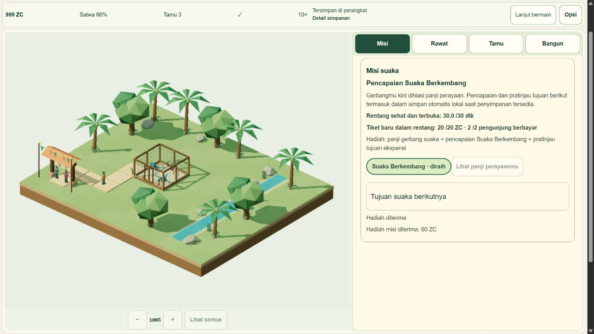

# V1 visual polish — pre-deploy candidate

**Local candidate ready for parent review; not pushed or deployed.** V1 remains **45/51 (88.24%)**. The owner authorized polish followed by publication for live testing; this changes the release sequence, not unrun test verdicts. Operator/contact facts remain explicitly deferred.

## Result

The bounded PRD/code review found V1 gameplay implemented: habitat/path placement and editing/refunds, two autonomous macaws with real care/welfare, visitors and once-only tickets, costs/recovery, Q01–Q04, speed, durable progress/recovery/reset, bilingual accessible controls/settings, and preserved journal routes. No missing in-scope gameplay action was reproduced. No M7 or extra gameplay added.

The visual pass adds warm sky/sun lighting and ACES tone mapping; cached 1024px High sun shadows; calmer grass, richer soil, continuous faceted creek banks and shallow/deeper teal water; original fern understorey; lighter aviary wire and warmer floor for macaw visibility. Low keeps lit foliage and cheap contact shade while disabling sun shadows/glints. No heavy postprocessing/reflections, external textures or new art downloads. Six scenery batches/materials remain. Existing camera, animation, deterministic simulation and save schema are preserved.

[Final portrait](qa/visual-v1/final-fixed-high-portrait.png) · [Final Low landscape](qa/visual-v1/final-fixed-low-landscape.png) · [Actual care close-up](qa/visual-v1/native-final-care-desktop.png). These are browser viewports, not physical Android. The close-up predates the depth-material cleanup fix; model/animation/geometry are identical.

## Exact candidate and verification

- Run `s20261102T233823Z`; source `14fa3267c64fa94ff17f75ba09c58bde1c64e7c26307d361493c1c0c124f073e`; build `df27520a1907203346391ea62bf828d466f7d11c74a7136e8d5712de51bfc21d`.
- **489/489 tests**, Astro check **211 files / zero diagnostics**, isolated nine-page build. Separate compiled HTTP checks cover nine routes, direct `/play`, canonical URLs and sitemap. Eight journal pages are identical after normalizing only the earlier synthetic analytics eligibility attribute; the original strict comparison failure is retained.
- Native fresh Q01–Q04/care/tickets/save journey passed before the final cleanup fix. The exact source bridge lists explanatory copy, shadow material ownership/invalidation and their tests only; simulation/economy/persistence and visual geometry are unchanged. Final compiled native Continue restored 999 ZC, four missions, two birds and tick5478. After a brief natural resume/manual pause at5504, native High/Low/reduced-motion, both orientations and reload/Continue retained progress and tick5504. Final native console receipt is empty at limit100; the earlier fresh-journey tab was closed before its console capture and is not falsely reported empty.
- A final audit found one retained GPU shader in the preliminary High shadow implementation. This is fixed using an explicitly owned public `customDepthMaterial`, disposed once. A regression test and four actual High/Low WebGL lifecycles now assert **zero geometries, textures, programs, owned material counters, pending RAF, subscribers and cleanup errors**. One renderer/one pending product RAF maximum. Earlier lighting prose claiming all-zero cleanup was premature and is superseded; raw programs=1 failures are preserved.
- First-play raw payload **1,023,617 bytes**; gzip9 estimate **270,025**, Brotli11 estimate **226,605**. Initial shell377,728 bytes. Renderer remains lazy. These are compression estimates, not served mobile download/startup measurements. Output has25 files; only Three implementation modules are bundled, matching full MIT text is shipped, and no docs/tests/maps/tooling/source archives are distributed.

## Profile and limits

Four before/final windows use identical seeded whole saves, 1366×768 viewport and795×638 render buffer, with2s warmup/5s measurement. Valid GPU elapsed queries report no disjoint/GL errors. Final GPU p50: High1×2.113ms, High10×1.086ms, Low1×1.939ms, Low10×1.948ms. Baselines respectively1.946/1.880/1.981/1.879ms. CPU callback p95 respectively6.3/10.4/5.3/6.5ms, versus5.2/6.4/4.5/6.6ms. The higher High10 CPU tail and varying GPU samples prevent a blanket speedup/headroom claim. This is a quality tradeoff with bounded resources, **not presented FPS or A56 performance proof**. Raw before/final data retained; an initial post-fix run with different viewport is explicitly excluded from comparison.

High draw counts63/61 are unchanged; Low gains one contact-shadow draw. Example High triangles14,700→14,796. Shadow refresh requests stay2→2 in High and0→0 in Low; no per-frame shadow refresh for animated birds. Actual A56/touch, new15-minute visual soak, presented FPS, native background, speaker, browser-process restart, human study and recording remain unrun. Historical GPU attribution and fixture-import cause remain inconclusive, separate from this fixed shader ownership defect.

## Release boundary and rollback

No push, deploy, Actions, settings/grants/login or prohibited route/download retries occurred. Reconnected Pages target remains `myzootwin-com`, `andiwijaya/myzootwin.com`, `main`; pushing main deploys. Parent must review this candidate before dispatching the already-authorized publication. Actual Cloudflare build/Node result, configured environment differences, live smoke and rollback eligibility require release-time verification. Existing production deployment `5a755ea7-3513-41a8-8908-7dab1fa2b2cf` / source `ad20f2b90fc110e5f8a886174b3ddb816070df7d` remains the rollback candidate, not a tested rollback guarantee.

Current static distribution introduces no unverified external artwork and ships its evidenced runtime notice. Missing texts for three absent tooling packages remain a source/toolchain redistribution issue, not blanket license clearance. Operator/contact and remaining privacy/hosting facts are deferred/unverified; M6-06 sign-off is partial. Six items stay unchecked: M4-07, M5-07, M6-01, M6-03, M6-06, M6-08. Owner live testing after deployment does not mark them passed.

Owned QA tabs/servers are closed; viewport reset was confirmed1280×720/DPR1.5. Original owner `dist` hash and five rollback/evidence archives match. The final server's closed stdin required stopping its verified own node PID; separate route/build receipts and post-cleanup hashes are retained. Owner tabs/saves were untouched.

[Acceptance and exact metrics](qa/visual-v1/final-acceptance.json) · [Raw profiles, including pre-fix failures](qa/visual-v1/final-profiles.zip) · [Final test/build logs](qa/visual-v1/final-gate.zip) · [Final native state](qa/visual-v1/shadow-fix-native.json) · [Distribution](qa/visual-v1/final-route-distribution.json) · [Execution notes](qa/visual-v1/execution-notes.json).
