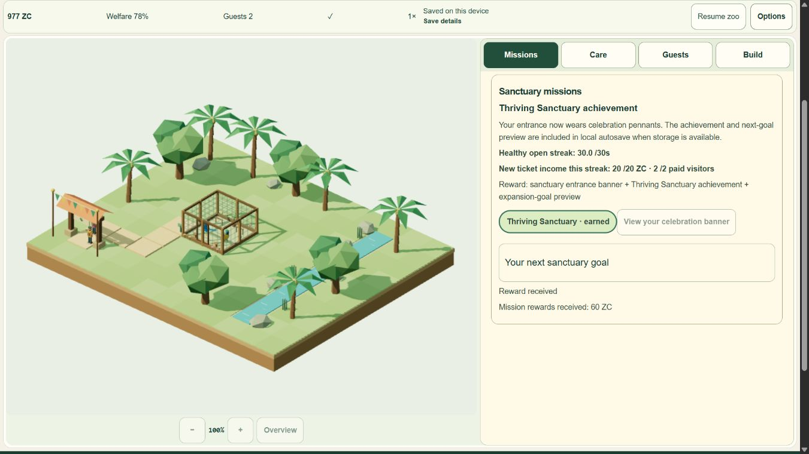

# V1 visual polish - local work in progress

Owner changed priority on2November2026: polish3D first, then publish for owner live testing. Publication is authorized conditionally but held until parent reviews exact tested candidate. Operator/contact facts are deferred, not invented or verified. PhysicalA56/human/recording/live gates remain unrun; no test pass is inferred from changed sequence.

Functional bounded review found the V1 loop implemented: habitat/path preview and editing/refund; two Ara ararauna with feeding/water/rest/enrichment and causal welfare; real guests/once-onlytickets/costs/cashflow/recovery; Q01-Q04/1x10x; localautosave/Continue/validation/recovery/restart; IDEN/help/settings/audio/quality; preservedjournal/realplayroute. Actual PRD was read against handlers/modules and prior nativeevidence. No concrete missing V1 gameplay action was found. No M7 or new gameplay added.

## Slice1 - daylight, static shadows and mobile form

Original code-authored hemisphere sky/ground plus warm sun, ACES tone mapping. High uses one1024PCF shadow map for static vegetation/props/aviary; map updates on topology/quality changes, not animal/camera frames. Low disables the shadow map but retains lit faceted leaves and cheap existing contact shading, so phoneauto no longer flattens plants to unlit silhouettes. Dynamic birds receive static shadows without causing a new shadow pass per animation frame. No second RAF, asset download, save schema or simulation changes.

39focusedtests and final487unit tests pass; Astro check211files zero diagnostics and isolatedninepage build pass in s20261102T230708Z. HTTP route/native finalproduct checks remain for final visualcandidate. Failedguard/oneQAhint/fixtureHMR observations retained in executionnotes; no false allpass from compile.

Four before/four lighting windows use identical whole fixturestate/settings/795x638buffer at1366x768viewport. Valid elapsedGPU p50 high1x1.946→2.130ms,high10x1.880→2.119ms; Low1x1.981→1.948ms,Low10x1.879→1.904ms. This is a small measured visual-quality cost in this environment, not proven hardware FPS/headroom. CPUcallbackp95 high1x5.2→5.0,high10x6.4→6.3,Low1x4.5→4.7,Low10x6.6→7.7ms. All four shadowrefresh counters stayconstant2/0 across live windows. At mostone ownedrenderer/onependingRAF; allreleasedGPU/resources/listeners zero. Do not generalize to SamsungA56.

[Structuredevidence](qa/visual-v1/lighting-summary.json), [raw boundedprofiles](qa/visual-v1/lighting-profiles.zip), [preservedfailures](qa/visual-v1/execution-notes.json).

Next bounded slice: richer calm grass/riverbank/water, understorey within existingscenerybounds, lighteraviarywire for birdreadability. Then finalcompilednative desktop/portrait/landscape/gameplay/save/quality/lifecycle verification, checklist/handoff and predeployreport. No push/deploy/Actions/newgrants/settings or deniedroute/downloadretry. V1 checklist remains45/51.
