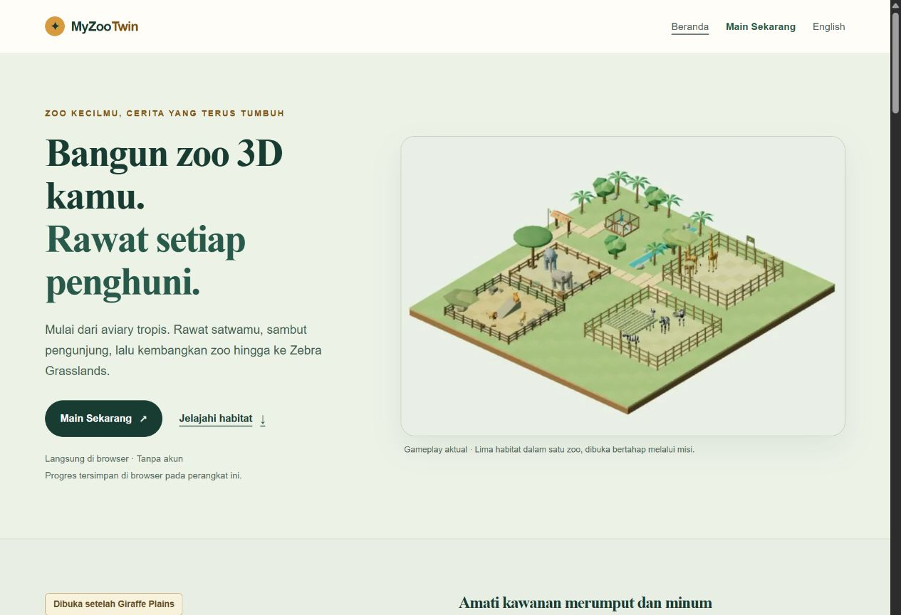

# HP6-02 local five-habitat release candidate

**PASS locally,53/54. No push or deploy.** Application/build source `9272a5d3fa0164bd880198b974ed9cf88c09065d`; input `cf86c84922c9c07db5b49a92613c8729725089ff914c94cc2e6aa1d7e24600b8`. Documentation/evidence commits after this source retain these native/build identities. This closes the earlier HP6-02 preview/playability hold **for the local V5 candidate**. It does not claim public availability; production was read-only verified still four habitats.

The two home components and SSR-only habitat data now describe five playable habitats in both languages, with Macaw as the start and the remaining four unlocked through progress. Zebra explicitly requires completed/claimed GQ04, the once-only grant, paid construction, paths and separately purchased facilities. Each card has a44px+ active generic `/play/` link with a habitat-specific accessible label. It promises to open the game, not skip progression or deep-link into a habitat. Hero, title, description, Open Graph/Twitter alt/copy, promo and FAQ agree. Existing actual renderer media and Giraffe spotlight are preserved. No mission count, rating, cloud-save promise or fabricated gameplay benefit is added. The three-column desktop grid becomes two/one columns on smaller profiles.

The current normal product contains37 files: **34 byte-identical to Z2-06**, including every game JS bundle, other eight HTML routes, retained media, licenses, robots and sitemaps. Only the two home HTML files and renamed hashed ZooHome CSS change. All source/runtime/tests/scripts/public/package/config inputs are byte-identical except exactly `ZooHome.astro`, `ZebraHomePreview.astro` and `home-habitats.ts`. Thus the [Z2-06 five-habitat paid grant/play/care/cold proof and1,055-test regression](../../z2-06/review.md) retain their original4157e2b identity and apply through exact game parity; they are **not claimed rerun** for this static homepage change. No new unit tests mirror copy/CSS. Fresh strict TypeScript passes; Astro633 files has0errors/warnings/hints; compiler completes10 pages. The existing large game-chunk advisory remains.

The initial post-build audit expected only changed home HTML and stopped on the newly hashed home CSS. The compiler itself had succeeded. The audit expectation was corrected to exactly two home HTML plus one ZooHome CSS, with34 other output hashes exact; no source or artifact bytes were rewritten to make this pass. That distinction is retained in the resource/build records.

Built HTML audit checks all10 routes and **184 internal links with0broken targets/fragments**, one H1 per route, homepage ID/EN `lang`, reciprocal hreflang/canonical, matching social metadata and1200×630 social image, descriptive responsive image alt/srcsets, simple truthful VideoGame JSON-LD without ratings/reviews, five native FAQ disclosures, and sitemap/robots. Homepage has one unchanged BaseLayout script, no module preload/game entry/engine/canvas or QA markers. This is source/HTML proof, not a search ranking/indexing guarantee.

**71 current-source internal-browser observations** comprise55 actual homepage and16 actual `/play/` observations. All five cards in each language navigate via keyboard Enter to the real game menu and return through browser Back. Desktop native Tab/Shift+Tab, six language/CSS profile combinations (1280×900,780×460,360×800), language Back/Forward, promo fragment Back/Forward, all five FAQ Enter/Space toggles in both languages, privacy open/Close/Escape, wrapping/44px targets, loaded retained images and no dangling ARIA pass. No document overflow; captured console warnings/errors are empty. Actual native raster sizes differ from CSS profiles; unedited screenshots are correctly identified as JPEG. Full-page EN capture was visually inspected. No physical-device or unsupported-engine claim is made.

On this newly owned loopback origin, an actual Zebra-card CTA starts the original default-backend New Game with1,500 ZC and a locked GQ04 grant. Pausing, selecting English through existing game Options, closing through the product, cold reload/Continue/Resume, and closing again preserve1,500/no early grant and English game preference. Both closes remove the game canvas; subsequent homepage has no engine canvas. This smoke is additional current-build entry/navigation proof, not a complete replay of a fresh campaign through all five habitats, a new storage-inspection test or a repeated long soak. Z2-06's native actual grant/purchase/care, frozen old projection checks, strict V5 storage tests and source-budget proof are explicitly linked through unchanged runtime bytes.

Known behavior: homepage language is route-based. Fresh `/play/` keeps the game's existing default locale until Options changes it; that preference persists. No automatic EN-home-to-game locale handoff is promised. Game journal/header copy retains its existing scope. No gameplay, engine, save contract or language behavior was changed for this homepage task.

Exact normal manifest: `acfed511a09c11ebc253498ede2294064315d83d84040e12063db7190726e992`, path `.qa/zebra-audit/hp6-02-final/product`. Separate maintenance manifest: `33d44bb16a9b88903dcd482cb2e70c2bae1bfbb803d1a9935aa6c534f6cf8b87`, path `.qa/zebra-audit/hp6-02-final/maintenance-site`. The fallback overlays the accepted immutable readonly maintenance HTML/script over this current normal site; all53 reader source modules/dependency manifests are exact. It is explicitly reassembled, not a new compilation. V4 binaries are not a safe rollback after V5 adoption. Follow the [current fix-forward plan](../../../../ZEBRA_V5_RELEASE_PLAN.md).

Read-only production/remote check at2026-11-10T21:04UTC: `main` remains `634de84ebfeab6c069ca9463527193a4e99ea458`, ancestor of the candidate; existing successful Cloudflare Pages check/deployment `de1f5a36-23ab-4b6a-bd13-14a3d822b2a3`, project `myzootwin-com`. ID/EN home, Play, robots and sitemap index return200; home titles remain four-habitat. There is no new Zebra deployment. No direct Cloudflare account/domain-binding API audit is claimed; recheck runtime/pipeline/domain and remote ancestry immediately before any authorized publication.

Run `node docs/qa/zebra/hp6-02/final/verify.mjs`: **1,752 portable assertions**,15 compressed receipts79,040 bytes plus four unedited JPEG screenshots. [Verification](verification.json) records exact inputs/outputs, native observations, source parity, compiler/check logs, built route audit, real game DOM, console, server and production read-only receipts. Earlier prepared HP6-02 evidence remains unchanged. All own game/inspector/browser tabs, server PID34872/port61700 and build/check work are closed; viewport reset. User saves/previews and Farm repo/process/tab were untouched. No old media or evidence was deleted.

Only **R7-08** remains. Permission must cover the **final reviewed candidate commit**, fast-forward push to `andiwijaya/myzootwin.com` `main`, and Cloudflare Pages publication on `myzootwin.com` of **both** the five-habitat home and V5 game, including atomic V4 backup/migration, old-client guard and explicit once-only1,700 ZC grant. Never publish this homepage over the old four-habitat game. After permission, verify the exact resulting deployment/assets/metadata, production V5 adoption and grant with isolated saves, actual old-tab/client barrier and appropriate live smoke. Public V5/CDN behavior, live grant acceptance and real-user migration are still untested and are not implied by local acceptance. Presented FPS, physical devices and other browser engines remain unmeasured.

