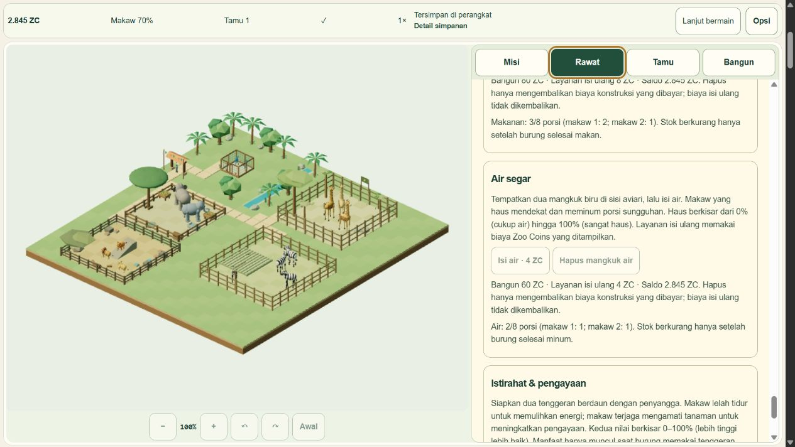

R7-04 is verified at the recorded internal-browser scope: 933,996 ms (15 min 34 sec) of active native 1x operation, 9,294 measured canonical ticks, 10,960 further ticks through deterministic 10x source/renderer playback, and 20 actual product reopen/dispose cycles. Five habitats and all 14 actors remained strict V5. Progress is 48/54. Zebra is not pushed or deployed.

The native build is `fb868d9ab2f4f76121f40abb48084885886687a6`, input `2e8219e90865c458b079089534c28914ac176509aa164b24a0b9a3ac8388809c`. The yielding stress build is `754f38e64d1736a7c74c6edd2396ed07c9159815`, input `acfd378544e493a250abf0c67fd35e4864c07dfe4611f4ed46c2e24729d1a430`. All 36 production output files match byte for byte across these builds and R7-03. Changes are confined to QA instrumentation and its tests; gameplay, engine, schema, saves, art and runtime dependencies remain unchanged.

The native measurement wraps the one original requestAnimationFrame driver and passes its timestamp unchanged. It requires both 900,000 eligible active milliseconds and 9,000 actual canonical ticks; paused/hidden/cancelled intervals cannot substitute for that requirement. Forty bounded samples, fixed-size histograms, at most one pending callback, zero speed violations and automatic product Pause establish the measured interval. Actual care used the original paid UI controls. The fixture's already-claimed grant/home prerequisite remains explicitly synthetic and does not complete Z2-06.

Native callbacks averaged 111.35 ms CPU (p95 histogram lower bound 136 ms); JS render submission averaged 1.71 ms, excluding GPU completion. Callback intervals averaged 135.09 ms, p95 lower bound 199.8 ms. Engine wall/simulation time discarded by its normal frame cap was 3,765.8 ms. These costs are disclosed, not converted to presented FPS. Presented FPS, physical-device 30/60 FPS targets and retained-object heap attribution remain **UNMEASURED**. The current host evidence does not certify desktop/mobile frame-rate performance.

Chromium's approximate used heap ranged 54.55–123.99 MB and ended at 95.44 MB, with repeated decreases and bounded total heap after warmup. Native scene counts stayed within 78–83 geometries, 15 textures, 16 programs and 48 owned materials; observed draw calls were 90–111 and triangles 75,768–76,940. These are bounded observations, not a universal leak-free claim. The 20 reopen cycles each created a new renderer context and consistently reported 68 geometries, 13 textures and eight programs while live. Every close released owned geometries/textures/materials, simulation subscribers and pending callbacks to zero, without changing the save. No forced GC or per-cycle retained-heap attribution was performed. Three.js cache program counts are not required to be literally zero; the native soak's disposed counter retained one, while these reopen cycles retained zero.

The initial synchronous QA ten-callback handler completed its 100 ticks but exceeded the browser input deadline. A bounded task-yielding QA control replaced it; tests prove the original sole V5 loop advances 1,000 ticks per 100 explicit 100 ms callbacks, safe cancellation, no reentrant batch, bounded input and missing-owner refusal. Native UI then completed 11 blocks: seven 1,000-tick blocks and four 990-tick blocks. Real durable care transactions prime the original loop's first resumed callback; those uncredited ticks were not imputed. All 10,960 accepted ticks were recorded, with zero dropped manual interval time. A redundant care-tab input also hit a host deadline; its completed source outcome was checked before proceeding. No duplicate command or product error was observed.

Native paused, disposed and cold hashes all equal `f5f04f055fdd773c693a7f967d940d383a88db9cc2687ddcd9a6306d581c7f57`. After stress and 20 cycles, the exact cold state is tick 34,736, 2,139 ZC, command 332, revision 904, hash `6db1789958d4b025b8b7fa110569b86e8b5927faf8a29b91eaf57bb98fcf55a3`. Primary payload hash is `04a5cfc5408b191be3521946fcbd9a3a16ba67bc3073a6e8fade9bf0926d0415`. The read-only inspector opens only the explicit existing visual QA UUID, aborts absent upgrades and refuses other namespaces/lineages. V3/V4 envelope and payload hashes stayed exact before stress, after stress, after cycles and after cold reload. The original V4 payload is `f68c6602412a4401fe4955d5ff357147e22d8f732d0ab5cd69fc1991df71eeaf`. V1/V2 backup keys were absent in this V3-seeded lineage; their coverage is the separately recorded R7-03 regression, not this native run.

Current validation: 19/19 targeted QA/clock/performance/timeline tests, strict TypeScript exit 0, Astro 618 files with zero errors/warnings/hints, two QA-excluded production builds, exact byte comparison and zero captured product errors/warnings. R7-03's 1,030-test full suite is historical evidence for unchanged production source and was not rerun here. The portable `node docs/qa/zebra/r7-04/verify.mjs` checks 210 archive/source/measurement/save/resource assertions; running it verifies archived evidence, not a new browser benchmark. Thirty-two lossless compressed receipts preserve raw output; no old evidence or media was deleted.

Both owned IAB tabs and both QA servers ended normally. Their PIDs and port 59936 were checked absent; all owned test/build sessions ended 0. User/default/carried saves, owner Chrome, Farm and user preview were untouched. R7-05 is next; R7-06/07 audits and V5 maintenance/fix-forward remain open. Z2-06, HP6-02 and explicit R7-08 Zebra release authorization remain gates.

