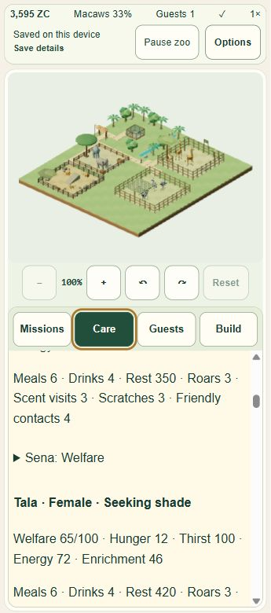

R7-05 is verified at the supported internal-browser scope: 84 labelled observations cover the actual ID/EN homepages and the original five-habitat product QA adapter at CSS 1280×720, 360×780 and 780×360. Progress is 49/54. The tested build is `7bcb81fc5bb945eda87225849eb1a0f8fb444d4f`, input `bd42604a958da403a71fc0bbe03ec16f1b8690b5d277606a83515d2da6f8207e`; that fingerprint remained exact after testing. All 36 production files match R7-04 byte for byte. The only source change was allowing the immutable QA builder to name an R7-05 run and its fresh profile fixture.

Both languages passed all three viewport layouts without document overflow. Actual keyboard actions covered skip links, FAQ disclosure, Privacy, settings/help modal focus and Escape return, the four game panels, session pause/resume, camera rotation/zoom/pan and browser CTA/back/forward navigation. The home server recorded 68 successful responses across 14 unique paths with no engine request. Homepage canvas count remained zero. The shared `/play/` destination was intentionally script-suppressed with CSP for navigation-only testing, protecting default storage. Its static ID markup after an EN CTA is not evidence of the running game's locale behavior. The separately tested V5 adapter uses the actual product DOM/CSS, mountGameEntry, original renderer/assets/picker and canonical engine with an explicit isolated IndexedDB UUID.

A genuine mouse click selected `zebra-water-122` using source-verified original triangle targets; passive input records show trusted pointerdown/up with the expected identity. Native keyboard rotation reached 45°, native zoom reached 1.5625 and zoomed mouse drag changed camera pan. Dragging at zoom 1 correctly stays bounded by the camera's clamp. Explicit untrusted QA touch-pair injection changed portrait/landscape zoom to 1.8571; holding a pair reported two pointers, product Pause cleared both, and late releases after Resume left zero pointers and no gameplay change. This is synthetic input on original canvas listeners, not physical/native touch capture.

No source time was advanced: every gameplay hash remained `ca4ef0074684ca1d9555bb63fe4c9c10faa2ab86ef8d3f67e3334ac2633302c7`, tick 14,367, balance 3,595 ZC and command 134, with 14 actors/five habitats. Only intended locale/visual preferences were exercised. Final en/auto/muted/reduced-motion-off/speed-1 preferences persisted; paused, disposed and cold state hashes all equal `2bd39c8a3e0890738d1f6b8ba988e457a00e7d8f3d5e841cb9ab3f5c48d5035a`, revision 18. Read-only primary and V3/V4 backup receipts verify exact preservation; original V4 payload remains `f68c6602412a4401fe4955d5ff357147e22d8f732d0ab5cd69fc1991df71eeaf`. Max owner is one; close releases owned geometry/texture/materials, subscribers and callbacks to zero. User/default, R7-04, historical and Farm saves were not opened.

The host advertises one permitted IAB surface with viewport/visibility controls. Owner Chrome was excluded by instruction and its tabs were not inspected. No Safari/Firefox or physical Android/iOS result is claimed. These are CSS-size overrides; coarse-pointer stayed false and observed DPR changed from 1.5 initially to approximately 1 during overridden sizes. UA/version is unavailable through the permitted DOM observation surface and was not inferred. Presented FPS and retained-heap attribution remain **UNMEASURED**; R7-04's CPU/interval limitations remain open performance considerations for release.

No product defect was found. An outside QA button correctly becomes inert during native modal dialogs; modal observations therefore read DOM state and verify source after closing. The explicit synchronous raycast QA scan took 4,542.4 ms and exceeded the input transport deadline; its completed outcome was inspected without repeating the action. That cost is not gameplay frame timing. Early large object-shaped diagnostic snapshots omit some trailing nested fields on this host; complete camera/gesture/resource receipts subsequently read the original inspector JSON text before local parsing. Missing fields were never treated as passing evidence.

Validation: 33 camera/responsive/consent tests plus five localization tests pass with no failures/skips/cancellations; TypeScript exits 0; Astro checks 618 files with zero errors/warnings/hints; the immutable ten-page build excludes QA code. Product and captured console error arrays are empty. R7-03's 1,030-test full suite is carried evidence for unchanged production source, not a fresh R7-05 full run. `node docs/qa/zebra/r7-05/verify.mjs` checks 432 archive/source/layout/input/save/resource assertions; it verifies existing receipts, not a new browser run. Twenty-six compressed receipts and six original screenshots total about 1 MB; previous evidence/media was preserved.

Both owned browser tabs and both servers closed normally, temporary viewport sizing was reset, and recorded PIDs/ports were verified absent. All test/build sessions ended normally. The heavy/browser slot is free, with user/Farm preview untouched. R7-06 audit is next, followed by V5 maintenance/fix-forward preparation. Public V5/grant budget/exactly-once, five-playable-homepage claims and separate Zebra publish permission remain open gates. Nothing was pushed or deployed.

