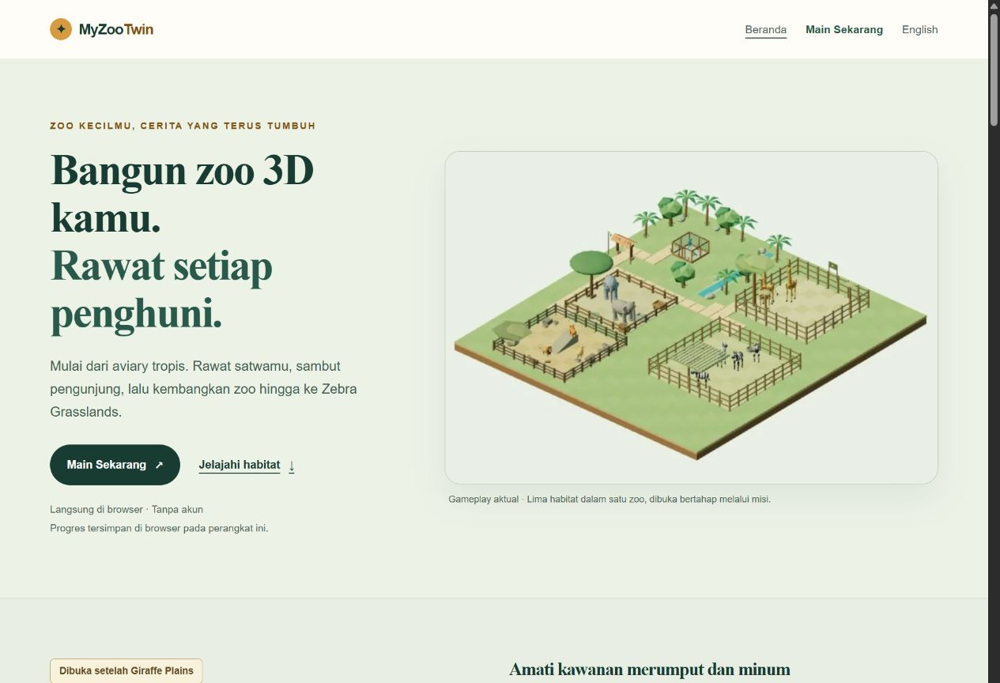

# R7-08 controlled Zebra V5 release

**COMPLETE and LIVE,54/54.** Andi explicitly approved the exact final candidate, fast-forward main/Cloudflare publication, V5 migration/backup and once-only1,700 ZC grant plus five-habitat home. Authorization arrived before any push. Published source **`5595effad9d11e493c6d90df61380d83d8cbfddc`**; application/build identity remains9272a5d/inputcf86c849 as accepted in [HP6-02](../hp6-02/final/review.md). Later evidence/docs commits are local only, not another deployment.

Preflight found a clean `zebra-grasslands` worktree, expected `andiwijaya/myzootwin.com` remote and remote main634de84 as an ancestor. Candidate input and all normal/maintenance artifact hashes passed; the1752 HP6-02 and359 Z2-06 evidence assertions passed again. One **non-force push** advanced main634de84→5595eff. No source edits, settings/dependency changes or forced ref update occurred. Cloudflare's automatic **Pages** check binds the exact SHA to successful deployment **`79d0c9ce-2cfe-4f00-ac4d-51cf844414ea`**, completed **2026-11-10T22:44:24Z**, project `myzootwin-com`.

Public URLs: [Indonesia](https://myzootwin.com/), [English](https://myzootwin.com/en/), [Play](https://myzootwin.com/play/). The check's observed immutable [deployment origin](https://79d0c9ce.myzootwin-com.pages.dev/) was used for browser writes, keeping apex and owner saves untouched. The hostname was read from Cloudflare's check summary, not guessed. HTTPS/TLS body checks also confirm that the apex serves this same released artifact. No direct account-wide Cloudflare settings/domain-binding API or terminal build-log audit is claimed.

**76 HTTP comparisons pass:** all37 normal files on both apex and deployment origin plus canonical `/play`→`/play/` redirects. Every game bundle, CSS, image, notice, robots and sitemap byte is exact to the tested artifact. All10 HTML routes match except the one declared existing analytics configuration attribute. Local Astro emits bare empty `data-analytics-id`; production supplies its configured `G-…` value. The first overly literal empty-attribute comparison stopped on this syntax difference; the initial failure is retained, and a narrowly bounded canonicalization of that attribute alone passed the complete repeat. No application or served artifact was rewritten. Both origins use the same configuration. Game's self-only CSP remains exact; no analytics provider script loads during essential-only smoke.

**47 actual internal-browser observations** include17 homepage and30 real Play observations. Five active cards, source-grounded progression/GQ04 statements, canonical/one-H1/home engine exclusion, ID/EN desktop1280×900, portrait360×800 and landscape780×460 CSS profiles, image loading,44px targets, actual five CTA destinations/Back, and GQ04 FAQ keyboard behavior pass without document overflow or dangling ARIA. Essential-only privacy is chosen only on the newly created deployment origin. Existing owner Chrome/Farm tabs are never claimed or operated; a changed browser-ID inventory is resolved before opening the IAB tab. Actual browser is internal IAB2, own tab28. Native host JPEG dimensions are recorded separately from CSS dimensions, not physical-device proof.

The new deployment origin explicitly reports **no existing save** before mutation. Actual product actions produce:

- New Game: **1,500 ZC**, original V5 entry, Zebra grant locked by GQ04.
- Free habitat preview: still1,500. Confirm an actual Macaw habitat: **1,200**, exactly−300.
- Twelve guided real path confirmations: each−15, ending **1,020**.
- Actual earned Q01 claim: +20, ending **1,040**, progression moves to Q02.
- Pause, switch game Options to English, close through the product and cold reload/Continue/explicit Resume: balance remains **1,040**, English persists, Zebra grant remains unavailable before GQ04. No reward/grant duplication or offline progress is observed.
- Second product close removes the canvas; browser Back returns to home with no game canvas. Captured warn/error log is empty at limit200, uncapped.

This is genuine live paid gameplay and persistence on a new isolated deployment origin, **not** an entire fresh live campaign through GQ04 or an eligible live-origin1,700 ZC claim. No existing real-user V4 save is inspected, cloned or migrated. V4 atomic backup/migration, old-client guard/CAS and once-only earned grant retain their accepted local native/source tests, including all12 frozen old projections,45 native Z2-06 observations and1,055/1,055 full regression. Every deployed game bundle is byte-identical to that tested candidate; this explicit evidence reuse must not be relabelled a live legacy migration test. The local five-habitat care/cold and budget549-reserve proof retain their original source/scope. No raw live IndexedDB inspection, browser storage injection, accelerated callbacks or QA route was used on production.

No defect requiring containment was found. The prepared V5-compatible readonly maintenance/fix-forward artifact remains hash-verified and available; it was **not deployed**. No V4 binary rollback, data clearing or backup restoration was attempted. Already-open tabs cannot be globally suspended by a new page. Follow the [maintenance/fix-forward rules](../../../ZEBRA_V5_RELEASE_PLAN.md) for any later incident.

Final read-only remote check still reports main5595eff; local origin/main agrees. All own QA tabs closed, viewport reset, no local server started and no active owned test/build/server remains. User apex saves/previews and Farm repo/process/tab remain untouched. Presented FPS, physical devices, unsupported engines, global browser-fleet migration/old-tab containment and search indexing are not measured. Fresh `/play/` keeps its existing default locale until the player chooses Options; the selected game locale then persists.

[Verification](verification.json) binds32 compressed receipts120,371 bytes, original local HTML references, actual live home/Play/robots/sitemap samples, complete HTTP hash receipts, GitHub check, initial attribute audit discovery, push/preflight/final remote records,47 native observations, console and three unedited JPEG screenshots. Run `node docs/qa/zebra/r7-08/verify.mjs`: **578 portable evidence assertions**. Earlier receipts/media remain unchanged; nothing was mass-deleted. Documentation/evidence after the approved commit is saved locally to avoid an unnecessary second deployment.

