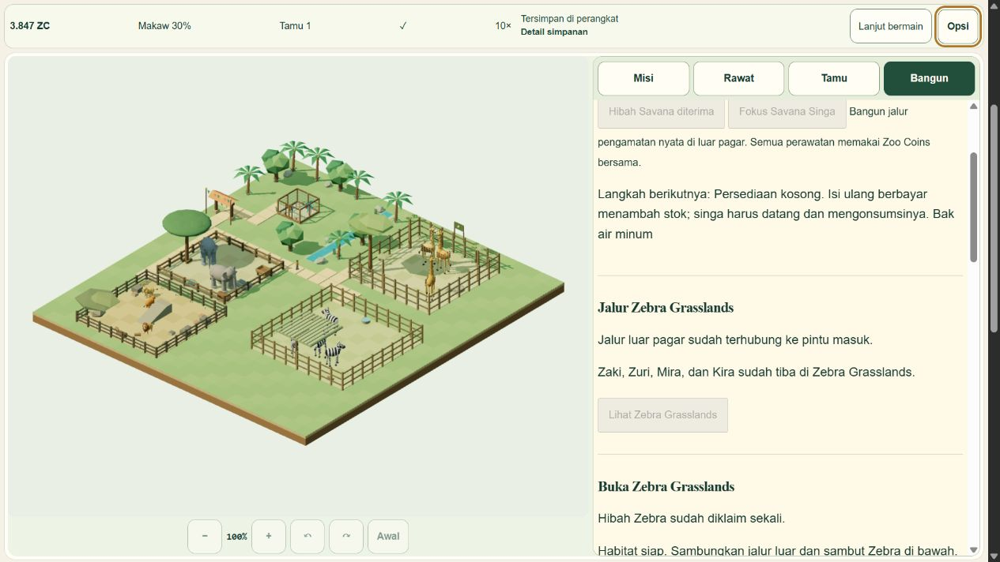

# Z2-06 local grant and V5 adoption acceptance

**PASS locally,52/54. Not pushed or deployed.** Tested runtime/build/regression source `4157e2b19bd94a30716faccd69d20f349c4e9bee`, input `5a681f90e534a13ae2930ac321cb459cd197288553d21315009eed0d0da71508`. Implementation starts at c2d179d; cce38e3 fixes the actual native-discovered Zebra construction price. The public entry in this local candidate now selects the V5 backend. Existing production remains a separate four-habitat V4 release.

The grant requires an earned, claimed GQ04 and its exact200 ZC mission proof, including proof retained through journal compaction. It prepares a strict candidate, credits exactly1,700 ZC in a winning durable CAS, then adopts in memory. Quota, stale command/generation, a competing writer, invalid lineage, capacity, pause and disposed owner cannot mint money. No automatic grant, automatic habitat, resident or supply is introduced by migration. Original V4 and earlier history stay archival; no restore/downgrade is used.

The new source tests cover all12 frozen old projections, two actual source autosave writers using **emulated IndexedDB**, quota/retry, cold exactly-once proof, preclaim compaction, reset-generation rejection, overflow and malformed commands. Those tests do not claim a new native two-tab grant race. R7-03 retains its separately recorded native mission race and old-client barrier. Final full regression passes **1,055/1,055 across169 files**, concurrency2, timeout1,800s, complete TAP,0fail/skip/cancel/todo, input/test data unchanged. Runtime1152.192s. Strict TypeScript passes and Astro reports633 files with0errors/warnings/hints. The normal37-file build excludes QA; game chunk-size warning remains.

The essential budget uses actual prepared grant/construction/care commands, four paid paths and four actual residents, then6,000 canonical1x ticks. Visitors are closed, no later mission rewards are claimed and old currency is excluded from the budget equation. Habitat700 + paths60 + graze90 + water75 + shade90 + refills36 + upkeep100 = **1,151 ZC**, leaving **549 ZC**. Four refills; all four eat/drink at least three times and rest; final welfare is at least60. Minimum welfare44 is transient while needs are unmet. This is deterministic source execution with emulated successful adoption, not a native wall-time soak, zero-low-welfare guarantee or FPS measurement. Optional enrichment is excluded from this essential budget.

**45 current-source internal-browser observations** use three independently owned UUID QA databases and original product UI/renderer/engine. The earned case begins with the original V4 fixture/GQ04 receipt, not seeded Zebra progress. Continue adopts strict V5 with cash3,099, tick13,580, command116 and all old residents/positions intact. Explicit grant gives4,799 once; the actual unpaid64-cell ghost remains free. Confirm debits700; four15 ZC paths connect the fifth habitat. Actual welcome/care/refill controls produce14 residents across five habitats. All four Zebras eat/drink causally; two rest in this native interval. ZQ01 and earned ZQ02 claim through actual UI, with the latter adding150. Existing objective latching is preserved: a previously achieved streak remains achieved even if welfare later falls.

During the first native discovery on c2d179d the confirm/cost hint incorrectly displayed300 although the real engine cost was700. The preview was cancelled without purchase. cce38e3 uses canonical Zebra pricing and preserves pending-save feedback. Final native evidence verifies both700 text and700 debit; red evidence is retained.

Native quota injection at the actual backend leaves memory and disk at3,099/command116/no grant. The regular product retry restores storage without credit; the next explicit claim gives exactly1,700 and one receipt. The360px portrait retry also passes. A separate fresh campaign starts with1,500, two unplaced Macaws, no habitat and a locked GQ04 grant. Another fresh loopback origin serves the **unmodified normal `/play/` entry without backend injection**: real New Game produces database5/strict save5,1,500 and no grant; a QA-only readonly inspector confirms this and refuses progressed/foreign data. It is not part of the normal37-file product.

After full-zoo play, closing flushes and disposes the owner; the original readonly maintenance reader preserves every row/hash/version. Cold menu preserves the entire store (`71d5f141…18edb`), and cold paused Continue restores the exact canonical state (`faa0636e…d0739`), money, command, positions, preferences and receipts. **Continue normally refreshes autosave envelope revision/writer/time** and therefore changes primary/previous envelope hashes; entire-store equality is claimed for cold menu and maintenance only. Original backups remain exact. No offline time or second grant appears.

ID/EN and1280 desktop/360 portrait/780 landscape supported CSS profiles show no document overflow and visible grant controls at least44px. Four current console captures are empty. The mobile full-zoo image is a functional scrolled capture, not a physical-device or polished full-canvas capture. Explicit deterministic QA callbacks drive the engine; callback deliveries/CPU intervals are not presented FPS or native wall-time. Prior R7-04 active soak and R7-05 broader profiles retain their original scope, not relabelled as new executions.

Normal build fingerprint `24377fb9f68059626434edc10fe5c8c018efef541e6adddc47c620d486f03694`; separate maintenance fingerprint `70b3a4d40edda88b48f80616bad801e753c83836b23cb7aba472869cf22c51c8`. The latter explicitly reassembles the current normal site with the unchanged R7-07 HTML/script: all53 actual reader source modules and package/lock are byte-identical to their original build. Only play HTML and one104,665-byte maintenance script differ from the normal output. This is reviewed source parity, not a claimed fresh compilation or bypass of the prior builder's historical causal-fixture guard. Actual reader acceptance on the newly granted/played native databases complements parity.

Run `node docs/qa/zebra/z2-06/verify.mjs` for **359 portable evidence assertions**. [Verification](verification.json) binds24 compressed receipts (231,090 bytes), complete native JSON/TAP/build/console/fallback manifests, and four screenshots. Raw discovery, draft failures, builds and useful media remain under `.qa`; no old assets/evidence were mass-deleted.

All recorded QA/full-test PIDs and listener ports are gone; all game/inspector tabs closed and viewport reset. One own failed-navigation error tab could not be rebound under the browser data-URL policy and is left ephemeral for automatic end-of-turn cleanup; no game ran in it. Initial sandbox loopback reachability was resolved by a permitted host loopback server. No owner Chrome, user save/preview, Farm repo/process/tab or production origin storage was touched.

Remaining: HP6-02 truthful five-playable homepage acceptance and R7-08 explicit Zebra release authorization/live verification. Preview labels stay truthful until authorized release. Required permission must cover the **exact final candidate SHA, fast-forward push to `main` and Cloudflare Pages deployment of Zebra V5 migration plus the once-only1,700 ZC grant on myzootwin.com**. Historical homepage permission does not cover it. [Maintenance/fix-forward plan](../../../ZEBRA_V5_RELEASE_PLAN.md) forbids V4 binary rollback after V5 adoption and retains existing-tab/CDN limitations.

